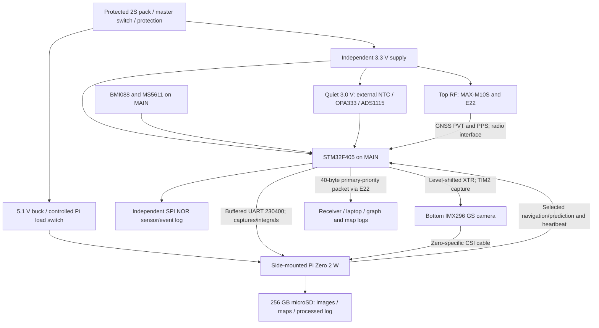
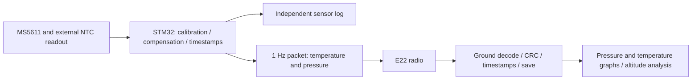
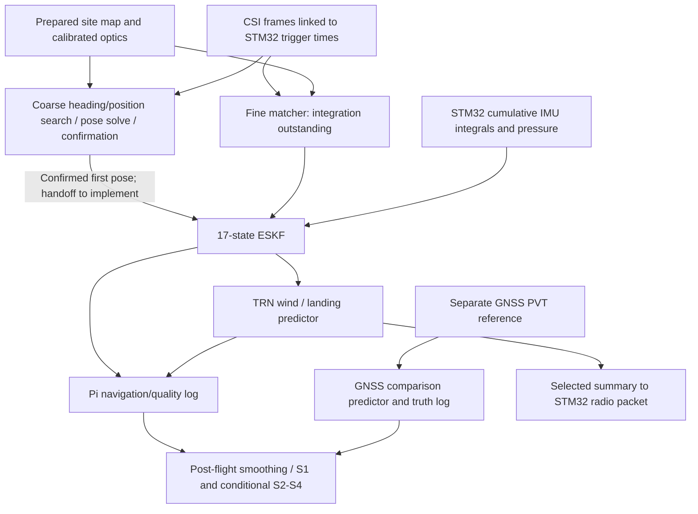

# Mission Proposal: Terrain-Relative Navigation and Wind Profiling

**A Mars-inspired navigation experiment during passive CanSat descent, with an independently assessed image-derived wind profile**

*Revised 13 October 2026 to the current flight computer BOM and the 9-11 October engineering studies. Preliminary design; no physical flight or bench qualification claimed.*

The [current design baseline](design_baseline.md) summarises selected parts, rates and evidence. [The BOM](flight_computer_bom.md) governs component selection; the [connection guide](flight_computer_connections.md) and [STM32-Pi protocol](stm32_pi_link_protocol.md) govern intended interfaces. The September hardware assumptions are superseded in this live proposal. The original is retained as a [dated historical snapshot](history/trn_secondary_mission_proposal_2026-09-27.md).

## 1. Summary

The primary mission measures **air temperature and pressure during descent and transmits both once per second to the ground station**, where records can be plotted and analysed. MS5611 pressure and an external GA10K3MCD1 temperature probe are acquired by an STM32F405, which also controls timing, independent logging and radio telemetry. The temperature implementation remains conditional on calibration and its response in the installed airflow/shield.

The secondary mission uses a downward-facing IMX296 global-shutter camera, an onboard orthoimage and BMI088 inertial measurements to estimate a map-relative trajectory without GNSS position or velocity in the navigation loop. A Raspberry Pi Zero 2 W performs acquisition, navigation, logging and proposed landing prediction. Independent MAX-M10S observations score the trajectory and a separately labelled GNSS-driven predictor. Primary operation is intended to continue if image processing or Linux fails; shared battery/STM32 failures remain common failure modes.

The trajectory is used to retrieve a wind profile and compare image-derived and GNSS-derived estimates. Their agreement cannot reveal aerodynamic errors shared by both methods. True wind accuracy requires a justified canopy-motion model and independent calibration/reference evidence. Temperature and pressure support an exploratory boundary-layer interpretation.

| Quantity | Current design / target | Evidence and limit |
|---|---|---|
| Ejection altitude | Approximately 300-400 m | Supplied 2025-26 UK guidelines; current season unconfirmed |
| Descent | Drop-calibration recommendation near 11.0 m/s; canopy not frozen | Historical studies use 10.5 m/s. Neither rate has been measured on this can |
| Canopy time | Roughly 27-36 s for 300-400 m at 11 m/s | Ideal height/speed arithmetic, excluding inflation/transients |
| Camera | IMX296, native 1456 x 1088; 5 Hz capture target | Official GS camera; complete timing/logging unverified |
| Lens | Edmund #34-711, 2.5 mm f/2; #53-675 adapter, #64-102 lock nut | Focus, clearance and distorted intrinsics require calibration |
| Ideal optical footprint at 300 m | Approximately 603 x 450 m, 0.414 m/native pixel near nadir | Pinhole model with f=724.6 px. Real usable footprint depends on distortion, calibration and tilt |
| TRN performance T1 | <=10 m horizontal error above 80 m; first confirmed fix <=5 s after canopy settles | Target, not achieved flight performance |
| Camera-IMU time alignment | <=0.5 ms | Hardware capture design; requires scope/optical test |
| Wind-method agreement S1 | <=0.5 m/s RMS per 20 m layer over 80-300 m | Compare retrieved image and GNSS winds; not absolute wind accuracy |
| Mass | Expected about 335 g; design allocation around 330 g | Latest calculated budget, with 6-15% modelled chance above 350 g; no weighing |
| Power / cost | 3 h system-on requirement and £400 flight budget | Modelled energy margin; measured runtime and complete delivered cost outstanding |

## 2. Motivation and framing

Terrain-relative navigation converts images into a position estimate by matching stable ground structure against a stored map. Mars 2020's Lander Vision System is the architectural inspiration: image preparation, map matching, inertial fusion and uncertainty-aware outputs. Our CanSat investigates that navigation chain over terrestrial farmland during a short passive descent; it does not reproduce the flight hardware, environmental qualification or powered landing capability of a planetary vehicle.

MER image-based velocity estimation, Mars 2020 LVS, terrestrial COBALT trials and balloon/suborbital TRN work are precedents listed in the references. They motivate the approach; their performance is not evidence for this can's accuracy. The current acquisition implementation differs from the September LVS-like sketch: it uses a whole-view heading search, landmark pose refinement and confirmation over two distinct frames. The Pi's cost, memory and unmeasured throughput determine practical limits.

The atmospheric motivation is to ask whether a camera already flown for navigation can also recover useful horizontal wind information. Huygens' imaging and Doppler analyses motivate comparing complementary measurements. A CanSat samples a short local atmospheric profile, not a regional climatology or a complete turbulence ensemble.

## 3. Scientific value

### Questions and hypotheses

- **S1 — method agreement.** Image-derived and independently GNSS-derived wind estimates agree within 0.5 m/s RMS per horizontal axis in valid 20 m layers over 80-300 m. Also report vector RMS, bias, sample counts and coverage. A decrease with height is a diagnostic, not a compulsory shape. The methods share the parachute and motion model, so S1 alone does not establish absolute wind accuracy.
- **S2 — conditional boundary-layer interpretation.** With a logged wind reference at known height, a calibrated temperature response and identifiable data, assess whether a similarity-law profile is consistent with observed conditions and whether inferred roughness is compatible in order of magnitude with upwind land cover. Without the near-surface reference, report profile/fit uncertainty and failed identifiability rather than claiming a measured roughness length.
- **S3 — exploratory swing/shear.** Estimate the association between swing/spin and shear, separating canopy-generated dynamics from atmospheric forcing where possible. A single short flight may not support a decisive conclusion.
- **S4 — exploratory turbulence scaling.** Compare constant-scale and height-dependent vertical-descent turbulence priors, with averaging kernels, uncertainty and record-length limitations. The 6 m ground wind is a proposed reference, not an existing installed instrument or guaranteed turbulence truth.

### Physical model and limits

For an ideal drag-only probe with positive distance descended s, horizontal velocity u follows the wind w with lag length ell_tau = v_d^2/g. At the historical 10.5 m/s simulation point this is about 11.2 m; at 11.0 m/s it is about 12.3 m. The simple inversion is

$$
\mathbf w(s)=\mathbf u(s)+\ell_\tau\,\frac{d\mathbf u}{ds}.
$$

The implemented wind retrieval uses a state-space prior and filtering/smoothing rather than directly differentiating noisy velocity. The simple equation is conditional on aerodynamic assumptions; canopy glide is not wind. The [end-to-end study](wind_retrieval_end_to_end.md) found shared glide bias even when S1 passes. Time-averaged lateral specific force is a candidate airspeed measurement; its gain, offset and averaging behavior need real-can calibration before the correction can support a science claim.

Potential temperature and the bulk Richardson number combine air temperature/pressure with wind shear. Monin-Obukhov fitting is conditional on surface-layer applicability, adequate height coverage and an independent near-surface constraint; a thermal gradient alone does not establish all flux/stability parameters.

| Measurement | Proposed use | Important limitation |
|---|---|---|
| Full-field images, nominal 5 Hz | Map-relative position, velocity and wind comparison | Actual processing cadence, terrain texture, blur, map season and lens calibration |
| BMI088 inertial streams | Attitude/trajectory propagation and motion correction | Separate accel/gyro timing, launch clipping margin, noise and bias; instantaneous accelerometer tilt is unreliable under swing |
| MS5611 pressure | Primary telemetry, relative height and density model | Static-port error, datum/calibration and conversion timing dominate sensor resolution |
| External GA10K3MCD1 via ADS1115/OPA333 | Primary air temperature; exploratory stability | <=0.1 K relative precision and <=1 s installed response are qualification goals; the quoted 200 ms is in liquid |
| MAX-M10S independent PVT | Navigation comparison and GNSS wind/predictor branch | Receiver lag, uncertainty and GNSS reference quality need recording |
| Ground anemometer at proposed 6 m | Near-surface wind reference and S2 constraint | Hardware/source not selected; siting, calibration and safe setup need planning |

At 11 m/s and 5 Hz capture, height spacing is about 2.2 m: approximately nine images per 20 m layer before rejection. Capture density is not the same as independent information or matched-fix availability. Map-based coverage below 80 m and visual odometry remain unimplemented flight work.

## 4. Mission objectives and success levels

**Primary:** valid temperature/pressure acquisition, independent sensor logging and 1 Hz radio delivery during descent, with analysable ground records.

**T1:** <=10 m horizontal position error above 80 m and first confirmed fix <=5 s after canopy settling. Score against independent GNSS and report map-datum bias separately, failed acquisitions, availability and false-fix rate. The original target is retained despite terrain-dependent synthetic first-fix results.

**T2:** quantify navigation error and test calibrated horizontal position/velocity covariance and protection-level coverage. Compare a geometry-based error budget with real residuals without requiring the September attitude/map crossover prediction to hold. A protection level is a model-dependent uncertainty output, not a certified safety guarantee.

**T3:** compare landing position/time predictions driven by TRN, GNSS and inertial-only sources, using the same prediction model where possible. Report error and ellipse coverage at common heights; GNSS fallback is explicitly labelled.

**T4 — stretch:** demonstrate uncertainty-aware safe-target selection without steering or an actual divert.

| Level | Criterion |
|---|---|
| Primary floor | Safe passive recovery design and primary temperature/pressure telemetry; received data usable even if retrieval fails |
| Secondary floor | Recover imagery and sensor logs where possible; attempt offline map-relative trajectory/wind analysis, with quality and failure reasons reported |
| Minimum live demonstration | Confirmed onboard TRN estimates logged/downlinked with validity and uncertainty |
| Nominal secondary objective | T1 and T2 assessed; S1 comparison made over valid layers; S2 attempted only with required reference/identifiability |
| Further demonstration | T3 landing prediction evaluated; S4 supported only if data permit |
| Stretch | T4 and S3; dropped first if core integration is late |

No success probability is asserted. The earlier subjective percentages have been replaced by observable test gates. Failure of vision does not become a claim of GPS-denied performance merely because the GNSS fallback works.

## 5. Ambition ladder

| Rung | Adds | Gate / fallback |
|---|---|---|
| 0. Offline reconstruction | Logged imagery and sensors -> post-flight trajectory/wind analysis | Requires usable images/map, timestamps and retrieved logs; GNSS science fallback separately labelled |
| 1. Live TRN | Acquisition -> confirmed fix -> fine tracking -> navigation | Requires real-terrain tests and Pi timing; if unavailable, retain primary and Rung 0 |
| 2. Quantified uncertainty | T2 consistency, error budget and protection-level tests | Requires representative data and honest failed-fix accounting |
| 3. Landing prediction | TRN-driven selected live prediction; GNSS/inertial comparisons in logs/offline | Requires velocity and calibrated prediction model; predictor is Pi software, not STM32 redundancy |
| 4. Safe-target decision | Preloaded hazard map and notional reachable region | Only after core integration; no actuators or steering |

Onboard motion-stereo hazard reconstruction, learned feature matching and motorised descent are outside the selected design. Any new algorithm must fit the measured Pi budget before adoption.

## 6. Rules and preliminary compliance

The supplied [UK guidelines](https://drive.google.com/file/d/1LubKeC729i9NbmgHwG-wzu4gwhDO1PfJ/view) are for **2025-26**. The 2026-27 rulebook, template and dates remain unconfirmed. The [PDR checklist](../BOTS/PLANS/PDR_FULL_MARKS_CHECKLIST.md) contains all 14 supplied hardware requirements and report criteria.

Design against the provisional 66 mm diameter x 115 mm height, 300-350 g mass, 50 N parachute connection, 20 g launch load, 3 h powered and £400 flight cost. Include parachute mass until organisers confirm otherwise. Provide accessible battery/master switch, safe materials, a reusable passive recovery system and changeable radio frequency. Antennas/transducers remain inside the diameter before ejection; allowed antenna exceptions are top/bottom, not side protrusions.

The reusable canopy is not yet specified; a round canopy on a swivel is a candidate, not a measured stable solution. The budget recommends trimming by drop measurements near 11 m/s to provide margin above the supplied 10 m/s floor, within the recommended 10-15 m/s range. Replaced launch-provider parachutes can change swing, glide, descent time and science, so bring measured data and log any replacement.

The current radio payload is **40 bytes at 1 Hz**. Candidate 869.525 MHz SF7/BW125/CR4/5 gives **82.176 ms calculated airtime**, or **8.2176%** without extra packets/retries. [Ofcom IR2030](https://www.ofcom.org.uk/siteassets/resources/documents/spectrum/interface-requirements/ir-2030.pdf), published 7 April 2026, IR2030/1/19 permits airborne use at 869.40-869.65 MHz subject to its conditions, including a <=10% duty-cycle alternative and 500 mW ERP maximum. Organiser allocation, total airtime, antenna gain, emissions and finished hardware must still be checked. This mode is not the old 32-byte/7.2% example or a generic 868 MHz 1% mode.

## 7. Concept of operations

| Phase | Intended activity | Verification dependency |
|---|---|---|
| Preparation | Obtain launch-site orthoimage, calibrate camera/extrinsics/probe, build maps/prediction tables, configure radio and ground logs | Real imagery, calibrated build and confirmed rules/channel |
| Pad waiting, up to 3 h | STM32 primary/housekeeping logs; Pi idle or controlled startup; independent GNSS and ground anemometer available as planned | Endurance, boot and ground-support rehearsal; no GNSS pose seeding of TRN |
| Ascent | High-rate STM32 IMU/pressure logging and capture; retain event history; camera start policy tested | Firmware/event detection and shock qualification outstanding |
| Ejection and inflation | Trigger camera; log full-field frames and STM32 trigger times; establish swing-averaged tilt reference | Settling/event definitions and frame association measured |
| First fix | Search unknown heading/position, refine pose and confirm agreement over two distinct images | T1 clock starts at defined canopy settling; no promise of a fixed three-image sequence |
| Tracking above 80 m | Fine matcher -> 17-state filter; selected prediction/validity summary to STM32; 1 Hz primary-priority telemetry | Fine matcher, handoff and integrated application remain open |
| Lower altitude | Retain valid available estimates and conservative prediction; proposed visual odometry tested before use | Below-80 m vision is a development item, not an existing switch-over capability |
| Touchdown/recovery | Detect/log candidate touchdown; beacon; save ground records before attempting recovery | Accelerometer/contact and independent GNSS/time evidence cross-checked |
| Analysis | Synchronise records; score primary, acquisition, tracking, wind and prediction; label missing/invalid observations | Raw logs retained; simulation truth never substituted for missing flight measurements |

## 8. System architecture

### Hardware/data path

### Primary software path

### Secondary software path

The GNSS branch is separate from TRN acquisition/tracking/propagation. PPS may synchronise the common timebase. The published Python modules are candidate components, not an integrated flight application.

## 9. Map preparation

Use recent, permitted orthoimagery covering the launch site and plausible drift region. Check georeferencing against independent surveyed points and report datum bias separately. The existing acquisition code uses a **1 m/px map**, with decimated edge-strength views at 2/4 m/px inside its search; the old 2 m/px coarse + 0.5 m/px fine pyramid is not its current default.

The default 1024 m acquisition window only covers roughly 250 m offset from its centre under the study's pose/tilt assumptions. A proposed 1280 m window for 300 m offsets needs memory/time validation. Map extent, permissions, preparation time and real seasonal imagery remain launch-site gates. Select stable boundaries/hedgerows/tracks; corner-based matching is weak on large fields and repetitive tramlines.

## 10. Map-relative localisation

### Rectification and optics

Calibrate the physical lens and camera-window assembly, then undistort/project rays onto the modelled ground surface using estimated altitude and attitude. A ground-plane homography is valid for pinhole/rectified rays; it is not directly valid on raw barrel-distorted images. The ideal pinhole used in the current simulations is a convenient model, not a measured lens calibration. Nominal geometric HFOV is 90.3 degrees; roughly 110-115 degrees horizontal for the actual lens is an inference in the parameter-source study, still to be measured.

### Acquisition implementation

`code/cansat/coarse.py` searches the whole view over position and unknown heading, matches corner-like landmarks, solves an interim pose, and refines using up to 48 patches on the 1 m/px map. `Acquirer` confirms two distinct images through gyro propagation; competing distant explanations cause refusal. A default unknown-heading attempt needs many FFTs. Optional calibrated LIS3MDL can reduce heading-search cost; it is not required by the code or assumed installed.

The [first-fix study](acquisition_first_fix.md) reports approximately 91% per-image availability on synthetic mixed farmland and 41% on synthetic large-field terrain, with about 9% of returned large-field fixes over 10 m. The broader run predates the last review fixes; a smaller final-code rerun is separate. The default 5 s target therefore depends on real launch-site imagery and timing. No real imagery or Pi acquisition timing has been demonstrated.

### Tracking and low altitude

A flight fine matcher must hand calibrated landmark observations to the navigation filter and meet search-window/availability budgets. The earlier 50-landmark/5 Hz description is an ambition, not established throughput; reduced landmark/cadence options remain profiling tradeoffs. The simulation fine matcher is not yet a deployed flight matcher. Below 80 m, frame-to-frame visual odometry is proposed but unimplemented; report availability and propagate uncertainty instead of asserting a successful switch.

## 11. Navigation filter

`code/cansat/eskf.py` implements a **17-error-state** candidate filter: position, velocity, local/right attitude error, accelerometer/gyro biases, barometer bias and camera time offset. It uses body-to-world rotations, east/north/up world coordinates from the launch pad, and body z through the camera boresight. The ideal level attitude is diag(1,-1,-1). Landmarks jointly constrain pose; pressure constrains relative height with calibrated datum/terrain information.

The hardened configuration includes iterated landmark updates, post-fit rejection, cautious prior recovery, rate-dependent gyro noise and correlated-map-error allowances. The plain 15-state form retained in Appendix H is the mathematical starting model, not the selected implementation. Tunings are synthetic-data choices requiring real-data calibration. A majority of coherent false matches can evade innovation checks.

Under parachute swing, instantaneous specific force points largely along the suspension line and is not a reliable gravity/tilt reference. Gyro integration and image geometry provide attitude information; swing-averaged force supports initialisation only within its assumptions. Landmarks spread across a calibrated wide field help separate tilt from translation. Pressure resolution does not remove static-port bias; GNSS does not enter the TRN filter.

First-fix confirmation has not yet been handed into the filter in a complete image-in-the-loop flight sequence. The [navigation study](navigation_closed_loop_simulation.md) establishes synthetic component behavior, not complete onboard TRN.

## 12. Error budget and uncertainty

The first-order design model is

$$
\sigma_p^2 \approx (h\sigma_\theta)^2 + \frac{(g\sigma_c)^2}{n} + \sigma_{map}^2 + (h\dot\theta\delta t)^2 + (\delta z\tan\phi)^2.
$$

Here g is map spacing (not gravitational acceleration), n the number of usable independent landmarks, and phi the off-nadir ray angle. Reused map errors, coherent mismatches, static-port bias and calibration errors need explicit covariance/bias treatment; an independent-term sum cannot guarantee integrity.

| Example term | Illustrative assumption | At 300 m | At 100 m |
|---|---|---|---|
| Attitude | 0.3-1 degree residual | 1.6-5.2 m | 0.5-1.7 m |
| Matching | 1 m/px, 0.2 px, 12 independent landmarks | 0.058 m | 0.058 m |
| Map datum | Assumed 2-3 m, to measure | 2-3 m | 2-3 m |
| Timing | 40 degrees/s, 0.5 ms | 0.105 m | 0.035 m |
| Relief | 2 m height error, approximately 27 degrees off nadir | Approximately 1 m | Approximately 1 m |

These are sizing examples, not the calibrated current-build covariance. The navigation study's approximately 0.6 m synthetic RMS is relative to its map and scenario; adding an unknown georeferencing bias or real-lens errors changes absolute performance. The first-fix study has a different terrain/acceptance scope and is not a common end-to-end accuracy claim.

Use held-out real data to tune uncertainty, compare achieved pose covariance with geometry-based bounds, and score horizontal position/velocity NEES plus protection-level exceedance. Hardware edge capture targets <=0.5 ms, but exposure centre, sensor group delays and frame association must all be included. Exposure near 0.5 ms is a candidate: angular blur depends on focal/ray geometry and spin; short exposure does not guarantee acceptable images in launch-day light.

## 13. Landing prediction

`code/cansat/landing.py` runs on the Pi, using precomputed drift tables and `windprofile.py` for bounded streaming updates. It returns landing position/time and covariance. Tables must be built using the measured descent/canopy model; density rescaling is an approximation, not an exact transfer of every old scenario.

T3 compares separately labelled TRN, GNSS and inertial-only predictors. One selected prediction is available in the 40-byte radio packet; full comparison records stay onboard or are reconstructed after flight. A C port would be needed for prediction to survive Pi loss; none exists. Flight GNSS delivery over the serial reference is defined, but firmware integration is outstanding.

The end-to-end wind study shows that glide can bias wind/prediction and reduce ellipse coverage. A calibrated airspeed or glide model is conditional work, not a guaranteed remedy. Score common-height error, time error, bias and interval coverage against independent touchdown evidence rather than claiming an ellipse must monotonically shrink.

## 14. Safe-target selection — stretch

If core integration succeeds, use a preloaded hazard map and navigation covariance to choose a low-cost target in a **notional** reachable region. The hardware has no steering actuator. A hypothetical divert radius is solely a decision-demo parameter; it does not describe actual reachability of the passive can. Evaluate target safety/agreement/stability offline first; any live summary needs a defined additional packet/airtime allocation before transmission.

## 15. Hardware, mechanics and budgets

| Assembly | Selected parts / function |
|---|---|
| MAIN | STM32F405; BMI088; MS5611; ADS1115/OPA333/150 kOhm temperature readout; independent converters/quiet LDO; Pi switch/buffers; W25Q128; sounder/LEDs |
| RF | MAX-M10S and active GNSS antenna feed; E22-900M22S and FPC radio antenna |
| Bottom | Official IMX296 GS camera, Edmund lens/adapter/lock nut; CSI directly to Pi, XTR from STM32 |
| Side | Pi Zero 2 W, Zero CSI cable and 256 GB microSD; buffered UART and switched power from MAIN |
| Power / harness | Protected KeepPower 2S pack, accessible E-Switch master switch, XT30 harness, GH connectors, MAIN J4 Wuerth 61202021621 and keyed IDC ribbon mates |
| Mechanics / recovery | Enclosure/frame, optics/window/probe shield, fasteners, cable retention, passive canopy/lines/swivel/hardpoint: not completely designed or qualified |

The [BOM](flight_computer_bom.md) retains exact purchasing identities and dated stock/price evidence. The intended top-RF/middle-MAIN/bottom-camera/side-Pi layout is a packaging concept, not a proven 66 x 115 mm fit. MAIN's saved outline is 44 x 64 mm; RF outline/enclosure/access need completion. Candidate frame/shell polymers and window materials require mass/heat/strength/RF/optical justification. A metal wall would obstruct the selected internal FPC antenna.

The [latest budget](mass_power_budget.md) models about 335 g expected total with 6-15% chance above 350 g under stated uncertainty assumptions, including the parachute. The previous approximately 20 g mission addition is withdrawn. The approximately 100 g pack, 34 g camera, lens/adapter and structure all count. Weigh the actual flight configuration and retain ballast only if needed.

Minimum nominal pack energy is about 23.76 Wh; the budget's idle-pad/flight/beacon scenario uses roughly 4.3 of 19.6 Wh usable. This does not verify three-hour flight-load endurance. Measure temperature-dependent whole-system power, startup transients, radio bursts and mode policies. Pi shutdown/UART isolation protect the primary branch, while common failures remain explicit.

Full-frame 5 Hz capture needs about 9.9 MB/s tightly packed RAW10 or 15.8 MB/s in 16-bit storage before padding/metadata. A 30-40 s descent is approximately 0.30-0.40 GB packed or 0.48-0.63 GB unpacked. Three hours of unpacked full-rate tests is about 171 GB; 256 GB is the selected storage size, with actual sustained Pi writes still to verify.

The dated mandatory IC/module subtotal, about $45.49 before support parts/assembly, is not the flight cost. Lens/adapter, camera, battery, both PCBs, assembly charges, mechanics, harnesses, VAT and delivery need a complete landed budget. The old £50-70 camera/lens estimate is withdrawn. No current flight-cost compliance is claimed.

## 16. Software and implementation status

| Function | Target / candidate implementation | Status |
|---|---|---|
| STM32 sensor/timing/power/radio firmware | C/C++; captured sensor/PPS/XTR timing, watchdog, independent logging/1 Hz telemetry | Not implemented |
| Pi sensor/time link | `link.py`, cumulative IMU differencing, trigger association; 230400 baud | Python reference/golden vectors; laptop only |
| First fix | `coarse.py`, `firstfix.py`; 1 m/px map and two-image confirmation | Synthetic validation; Pi timing and real terrain outstanding |
| Tracking/navigation | Fine matcher + `eskf.py`; nominal 100 Hz propagation, image updates as budget allows | Filter exists; fine matcher/handoff/full flight application incomplete |
| Wind / landing | `windprofile.py`, `landing.py`; selected predictor to STM32 | Synthetic component/closed-loop studies; hardware untested |
| Radio/ground data | `telemetry.py` defines 40-byte packet | Reference encode/decode; actual radio/ground integration incomplete |
| Capture/logging/ground UI | Camera setup, bounded queues, save raw frames/quality; laptop graphs/maps | Full application and sustained writes unverified |
| Low-altitude odometry / T4 | Optional future modules | Not implemented flight capability |

Python/NumPy is the current candidate navigation stack. OpenCV or a compiled implementation may support calibrated image processing after profiling; they are not evidence of target execution. Capture cadence, matcher latency, filter update timing and logging throughput must be budgeted independently. Temperature readout also has an unresolved constraint: the <=6% excitation goal conflicts with the study's 128 SPS/10 Hz paired-read bench schedule (~19.41% duty). Resolve settling/rate/self-heating before firmware adoption.

## 17. Verification campaign

| Gate | Work | Pass evidence / failure response |
|---|---|---|
| Baseline/document review | Current rules, cost/fit sketches, materials, interfaces and mission thresholds | Resolve contradictions; keep unverified claims labelled |
| Bench instruments | Probe air-step/calibration, pressure-port tests, camera focus/extrinsics/XTR timing, IMU synchronisation | Measured response/noise/timing; revise readout/mounting/calibration on failure |
| Target compute/link | Acquisition/fine matcher/filter/logging on Pi; STM32 codec against golden vectors; serial loss/reboot tests | Timestamped worst-case timing and memory, no corrupted primary stream; reduce load before revising any target |
| Real imagery / integrated replay | Launch-like seasonal imagery -> acquisition -> filter -> predictor with separate GNSS branch | Score T1/T2 availability, false fixes and consistency; use offline reconstruction if live gate fails |
| Recovery/dynamics | Canopy proof load, measured settled descent, swing/glide and side-force tests | 50 N load path, appropriate speed and calibrated motion; redesign/retest before flight |
| Integrated rehearsal | Representative power duration, reset faults, full radio ground records and operations/recovery | Primary 1 Hz mission remains independent of Pi; conserve logs; postpone stretch work if integration fails |

Captive-carry/drop locations, equipment, permissions and supervision are not yet secured. Test plans do not imply an authorised aerial operation or that short-drop average velocity equals terminal speed.

| Provisional requirement | Verification | Failure consequence |
|---|---|---|
| 1 Hz primary telemetry and graphs | Calibrated sensor-to-radio-to-ground timed run | Prioritise primary; repair scheduling/receiver pipeline |
| 66 x 115 mm envelope / no pre-ejection protrusion | Full stowed assembly gauge and access inspection | Repackage/rebuild mounts |
| 300-350 g | Complete flight weighing, including conservatively counted parachute | Trim/add retained ballast and recalibrate canopy |
| Safe materials / passive reusable recovery | Materials review and repeated packing/deployment | Substitute parts/materials |
| 3 h powered / accessible battery and master switch | Representative duration and field access test | Reduce load/revise power or access within mass/cost limits |
| 50 N attachment / 20 g launch | Suitable supervised load-path and functional checks | Reinforce/retain/retest |
| Descent around 10-15 m/s, minimum should be 10 | Settled-flight measurement at flight mass and recorded conditions | Resize canopy; update trajectory/science models |
| Recovery not guaranteed | Save ground data and rehearse lost-can analysis | Results limited to received data |
| £400 flight cost | Complete dated landed quotes and cost ledger | Substitute/simplify before purchase |
| Changeable frequency / compliant radio use | Configuration, total airtime and radiated-power checks; organiser allocation | Change radio mode/configuration before transmitting |

## 18. Risks and degradation

| Risk | Consequence | Mitigation / fallback |
|---|---|---|
| Pi throughput/logging overload | Missed image updates or lost imagery | Target profiling, bounded queues, tile maps; keep 5 Hz capture if feasible, separately budget processing; offline reconstruction |
| Large fields / seasonal changes / coherent aliases | No fix or wrong fix | Real site imagery, edge structure, ambiguity refusal and multi-frame checks; report failures rather than force a solution |
| Lens distortion / tilt / timing | Position bias and false precision | Calibrated rays/extrinsics, hardware captures, optical timing tests; withhold unreliable fixes |
| Canopy glide and swing | Shared false-wind bias; prediction undercoverage | Measured dynamics; calibrate any lateral-force correction; qualify S1 as method agreement |
| Temperature lag / self-heating / radiation | Invalid lapse-rate/stability interpretation | Installed air-step and environmental tests; restrict/withdraw S2 claims if unidentifiable |
| Incomplete firmware/fine matcher/handoff | Components never become a live mission | Integration gates and protected primary schedule; cut T4/S3 first |
| Mass/cost/fit margins | Rule failure or late redesign | Complete mechanical/landed budgets, weigh prototypes, freeze interfaces before manufacture |
| Radio/antenna/ground support | Lost primary data or uncertain range | Configure actual permitted mode, finished antenna tests, offline ground logging and backups |
| Staff skills/time/lead times | Delayed integration and weak report evidence | Real student task ownership, skill gaps/support route, weekly review and procurement contingency |
| Site/rules/channel/weather change | Invalid map or launch/test plan | Confirm issued documents, alternative test data/site coverage; report scope honestly |

Degradation: live TRN/prediction -> live TRN only -> logged imagery/offline reconstruction -> separately labelled GNSS analysis -> received primary data. Every branch requires usable inputs; recovery and science are not guaranteed.

## 19. Results analysis

Retain raw images, captures, sensor/GNSS streams, received radio packets, settings/calibration and test conditions. Never merge synthetic ground truth into flight evidence. Align clocks using the documented captures; score valid observations and rejected/missing samples separately.

| Objective | Data / calculation | Validity and reported output |
|---|---|---|
| Primary | Temperature/pressure vs time; pressure-derived relative altitude | Calibration, gaps, units, radio delivery; air temperature separated from die temperature |
| T1 | Horizontal TRN-GNSS error, acquisition time, availability/false-fix rate | GNSS quality, map datum, camera geometry and stated settling event |
| T2 | Position/velocity NEES and protection-level exceedance by regime | Independent/held-out calibration data, serial/temporal correlation and failed updates |
| S1 | Image/GNSS wind difference per axis/vector in 20 m layers over 80-300 m | Same motion corrections; averaging kernels/coverage; common bias caveat |
| S2 | Wind/temperature profile, similarity fit and roughness uncertainty | Ground reference height/wind, installed thermal response and fit identifiability; report inconclusive cases |
| T3 | Common-height landing/time errors and ellipse coverage for three sources | Same model/settings, separately labelled source branches, independent touchdown evidence |
| S3/S4 | Motion/shear association and candidate turbulence-model comparison | Exploratory record length, canopy confounding and prior sensitivity |
| T4 | Hazard-map target quality/stability | Notional decision region; no physical divert achievement |

## 20. Roles and support

| Workstream | Responsibilities / interfaces |
|---|---|
| TRN | Site map, calibration, acquisition/fine matcher, Pi timing; pose/quality handoff to navigation |
| Navigation/science | Filter/uncertainty, wind/prediction, separate reference stream and analysis; motion/probe calibration requirements to systems |
| Systems | STM32 firmware, power, radio, sensors, mechanics/recovery, serial/timestamp integration and ground equipment |
| Planning/documentation/outreach | Weekly plan, cost/risk/compliance records, report evidence, audience-specific activities |

These are workstreams, not invented student assignments. The actual team must map Student identifiers, skills, gaps and agreed support to them for the PDR. Required support routes include radio/embedded integration, mechanical load testing and atmospheric/thermal calibration; no mentor commitment is asserted.

## 21. Schedule and decision gates

The old monthly chart carried unconfirmed dates and H618 work. Use the following dependency order to build the team's weekly Gantt; student owners, effort and issued deadlines must be supplied from real availability. This proposal does not invent a current competition date.

1. Confirm rules/site imagery/support; document baseline, packaging and landed cost.
2. Bench-qualify camera/probe/power/timing and implement STM32 reference protocol/primary telemetry.
3. Profile Pi, finish fine matcher and first-fix/filter handoff; integrate image/sensor/radio logging.
4. Replay real imagery, run dynamic/recovery tests and calibrated descent measurements; revisit science feasibility.
5. Rehearse complete mission and primary fault survival; freeze tested configuration and prepare report evidence.
6. Perform confirmed launch operations, preserve logs, analyse results and execute scheduled outreach.

Outreach/report work runs alongside all technical phases. Preserve retest/procurement time. Lower-priority features are dropped at failed gates; targets are not silently changed to pass.

## 22. PDR and outreach evidence

The [full-mark checklist](../BOTS/PLANS/PDR_FULL_MARKS_CHECKLIST.md) maps the supplied 36-point PDR scheme. The diagrams here support both mission software paths, but this working proposal is not a final anonymous <=20-page PDR. A mechanical sketch, justified materials, actual team/skills/support, weekly Gantt, grounded outreach schedule and complete verification plan must be assembled into the issued template.

Proposed outreach activities are a younger-pupil terrain-matching demonstration, a school primary-telemetry/engineering presentation, and a community descent-map/wind story with uncertainty explained. Choose audiences/methods deliberately and record real owners, dates and feedback; these are ideas, not completed outreach or booked events. Hypotheses, units, calibrations and explanatory plots should be understandable without reproducing every equation in the main PDR.

## 23. Outstanding decisions and evidence

- Confirm current-season rulebook/rubric/deadlines, regional/final launch sites, channel allocation and parachute mass treatment.
- Obtain representative orthoimages and check permissions/datum/extent; nearest atmospheric reference sources remain to be selected.
- Prove selected lens/adapter infinity focus, retention, envelope and calibrated ray mapping.
- Measure Pi capture/matching/logging worst-case performance; finish firmware, fine matcher and acquisition-filter handoff.
- Choose/qualify passive canopy and complete mechanical/material/access design; weigh full assembly and obtain delivered flight quotes.
- Resolve thermistor pulse/read schedule against <=6% duty, installed response and science precision; no TMP117 substitution without redesign.
- Secure/select the ground reference instrument/support and calibrate any proposed lateral-force airspeed correction.
- Test GNSS receiver dynamics and independent touchdown scoring; a GNSS feed defined by the protocol is not yet integrated hardware.
- Agree actual student ownership, available hours, support and outreach dates.

## Mathematical appendices: interpretation for the current design

The following appendices retain the mathematical methods and illustrative models from the earlier proposal so equation reasoning remains traceable. Hardware-specific September settings and 10.5 m/s numerical examples are historical illustrative inputs, not current measured parameters. In particular, ideal pinhole rays must follow physical-lens calibration; the 15-state derivation is extended to 17 states in code; drag-only wind inversion omits real-can glide; known-parameter retrievals are special cases of the implemented uncertain model. The [standalone mathematical reference](cansat_mathematics.tex), [audit](mathematics_simulation_audit.md) and newer studies state restrictions and evidence. Their original scenario results are preserved; updating this proposal does not rerun them.

---

