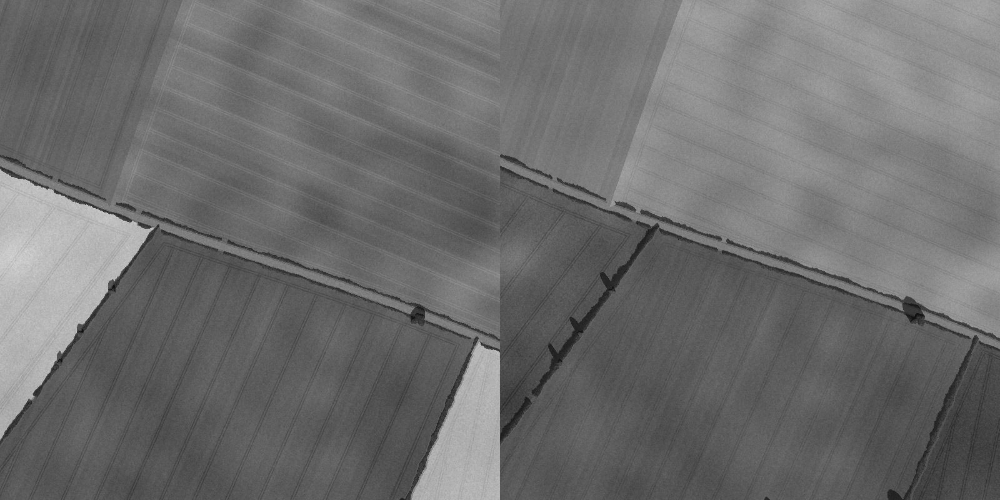
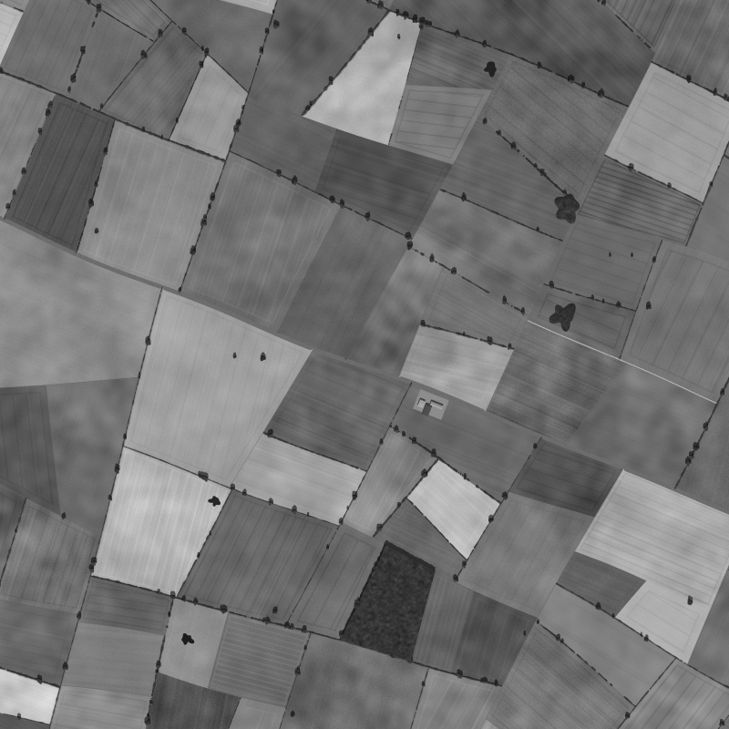
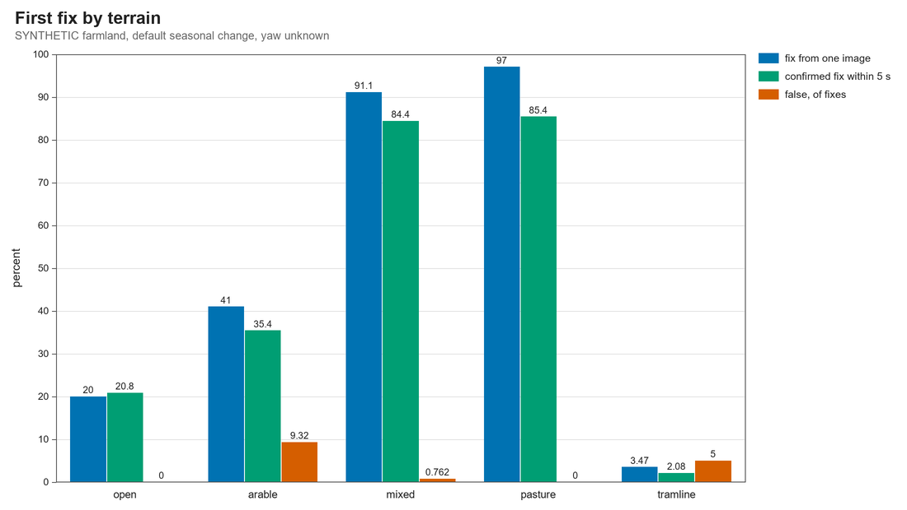
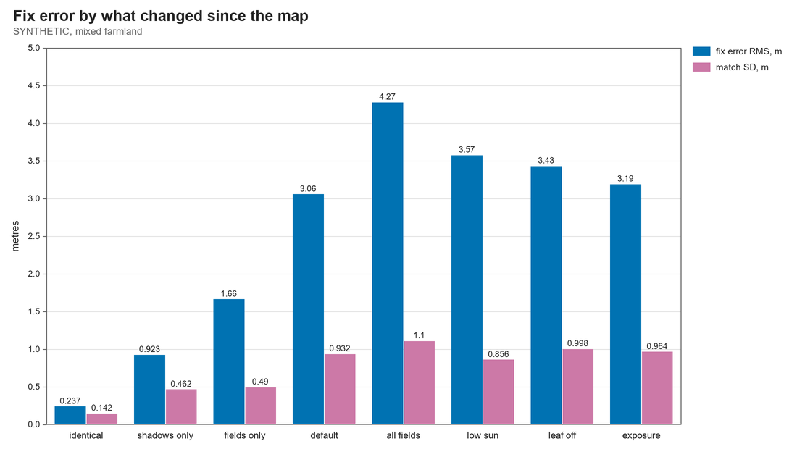
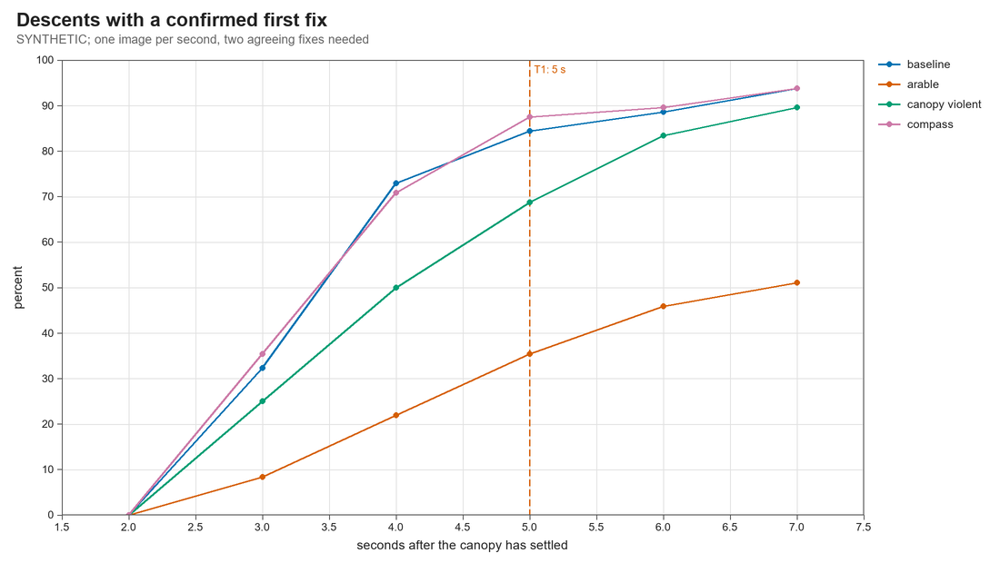

# First fix with unknown heading (Phase 0)

11 October 2026 study; status cross-checked 13 October 2026. Everything here is **simulated**. No flight, drop, captive-carry or bench data exist, no real image has been matched against a real map, and nothing was run on the Raspberry Pi. Numbers describe the models in `sim/nav/` and the code in `code/cansat/coarse.py`, not the CanSat. The current hardware baseline is recorded in [design_baseline.md](design_baseline.md) and the authoritative [flight computer BOM](flight_computer_bom.md); the study used the Pi Zero 2 W and selected IMX296 camera family, but its camera model remains an ideal pinhole and does not include the selected lens's measured distortion.

The [navigation study](navigation_closed_loop_simulation.md) of 9 October showed that the filter holds 0.6 m once it has been started within a few metres of the truth, and that a pose solver can start it from 16 landmark matches. It left open how those matches are produced when the can has just left the rocket, is somewhere within a few hundred metres of the pad and has been spinning, so that its heading is unknown. That step is the proposal's "coarse mode" (section 10), an October item in its schedule. This report covers it.

## Summary

1. **A candidate first-fix implementation exists.** `code/cansat/coarse.py` is NumPy-only Python intended for the Pi Zero 2 W. It levels the can from the accelerometer, searches the map for the view at every heading, matches landmarks, and returns a pose with a covariance or a refusal with the reason. It needs no compass and no GPS. It has only been exercised in software on a development computer; it is not hardware-qualified flight software.
2. **On well-structured terrain it works in simulation.** On synthetic mixed farmland, with 70 % of fields changed in brightness since the map and the sun 20° lower, 91 % of images gave a fix and 1 % of fixes were more than 10 m out. Fix error was 3.1 m RMS. Two fixes that agree, which is what the code requires before it reports one, were obtained within 5 s of the canopy settling in 84 % of descents and within 7 s in 94 %. None of those 90 first confirmed fixes was more than 10 m out (2 of the 299 confirmations in all were).
3. **On large fields it mostly does not.** With fields of about 9 ha, 41 % of images gave a fix, 9 % of those fixes were more than 10 m out, and 35 % of descents had a confirmed fix within 5 s. With 30 ha fields 20 % of images gave a fix. The heading search is not the weak point: it found the right place and heading in 65 % of the large-field images. What is short is corner-like landmarks to fix the pose from.
4. **So T1's "first fix within 5 s" depends on the launch site**, and the sites CanSats are flown from are open farmland. This cannot be settled on synthetic terrain. It needs an orthoimage of the actual site run through this pipeline, which takes any raster.
5. **The errors have one cause.** From above flat ground a tilt and a sideways shift look almost the same. With a dozen matches, a few of them on shadows that have moved, the pose solver trades one for the other. Fixes more than 10 m out carried about 3° of false tilt. In 7,530 fixes, 17 were more than 20 m out (the worst 56 m, with 17° of false tilt), and the two-image check rejected all 17.
6. **What has changed since the map was made sets the accuracy.** With map and ground identical the fix error was 0.24 m. Moving the sun alone made it 0.9 m. Changing every field's brightness alone made it 1.7 m. Both together gave 4.3 m.
7. **Three design choices are supported by the numbers.** Correlating edge strength instead of brightness: 91 % of images against 27 %. A 1 m/px onboard map: 91 % and 3.1 m against 57 % and 5.0 m at 2 m/px. Requiring two images to agree.
8. **A compass is not needed for the first fix.** Knowing the heading to 5° gave a fix from 89 % of images against 91 % without. It does cut the search from 123 large FFTs to 17. This bears on the open magnetometer decision of 9 October.
9. **Re-acquiring lower down is much harder.** Between 205 m and 165 m, 64 % of images gave a fix and 5 % of those were more than 10 m out. Between 142 m and 100 m, 15 % did. If lock is lost low down it will probably not be recovered this way.
10. **The cost is about 123 FFTs of 256 × 256 and 200 to 320 of 128 × 128 per image**, 1.4 to 2.1 s on the project laptop when it was loaded or on battery. The Pi has not been timed; `code/tests/bench_onboard.py` now includes the case.
11. **An independent review found seven defects, all now fixed**, the most serious being that a map which looks the same in two places produced a confident fix at the wrong one. One limit it found remains and is documented: a can near the edge of the map window may not be searchable.

Sections 4 to 8 give the evidence, section 9 the decisions and recommendations, section 10 the limits.

## 1. What was built

| File | What it is | Checks |
| --- | --- | --- |
| `code/cansat/coarse.py` | Candidate Pi implementation: `Leveller` (tilt from the accelerometer, heading carried by the gyro), `CoarseMap` (prepared on the pad), `acquire` (one image to a fix or a refusal), `Acquirer` (two images that agree); not yet hardware-qualified | `code/tests/test_coarse.py`, 31 tests |
| `sim/nav/scene.py` | Camera views of a raster world and the onboard map cut from it | `sim/nav/test_scene.py`, 10 tests |
| `sim/nav/farmland.py` | Procedural farmland: fields, hedges, trees, tracks, buildings, tramlines, shadows, and a second version of the same ground for the day of the flight | `sim/nav/test_farmland.py`, 21 tests |
| `sim/nav/run_acquisition_mc.py` | Monte Carlo: simulated descents, rendered images, the flight code, scored against truth | `sim/nav/test_acquisition_mc.py`, 5 tests |
| `sim/nav/test_acquisition_independent.py` | A separate reviewer's checks with their own renderer, terrain, brute-force matcher and pendulum | 24 tests, one of them a recorded limit |
| `code/tests/bench_onboard.py` | Now also times the map preparation, one acquisition with and without a compass, and the leveller | run on the laptop only |

Results are in `sim/nav/results/acquisition_first_run/` (36 scenarios) and `sim/nav/results/acquisition/` (the check on the final code, section 3). Previews of the terrain are in `sim/nav/results/farmland/`. To reproduce, with the KiCad-bundled Python:

```text
python sim/nav/run_acquisition_mc.py --trials 48 --workers 5
python code/tests/test_coarse.py
python sim/nav/test_acquisition_independent.py
```

The first took 57 minutes on the project laptop on mains power.

## 2. Method and inputs

The code works in four stages. Each exists because the one before it is not enough.

1. **Search.** The image is levelled with the accelerometer's tilt and the barometer's height and resampled to the ground plane. A disc of ground 200 m in radius is compared with the map at every position within about 300 m of the pad and at 60 headings, by normalised correlation of edge strength blurred to 8 m. The disc's shape does not depend on heading, so each heading costs two FFTs. When it is right this gives the place to 10 m (median; 22 m at the 90th percentile, most of it the levelling error) and the heading to 0.5°.
2. **Landmarks.** Up to 20 corner-like sites are picked in the image, and a 64 m patch around each is located in the 2 m/px map within ±32 m.
3. **Interim pose.** The existing solver (`firstfix.py`) fits all six degrees of freedom to those matches, under relaxed checks.
4. **Refinement.** With that pose, up to 48 patches of 48 m are resampled onto the 1 m/px map grid and each is looked for within 8 m. The solver runs again with its full checks. Its tilt must be within 8° of the levelled tilt.

A candidate place that fits about as well as the best one is also taken through stages 2 to 4, and if two places more than 30 m apart both pass, no fix is given. `Acquirer` then requires a second image to agree: the second attitude must equal the first carried forward by the gyro to within 3°, and the position must not have moved further than the can can fly.

| Input | Value used | Basis |
| --- | --- | --- |
| Descent, canopy classes, IMU and barometer errors | as the navigation study | [navigation report, section 2](navigation_closed_loop_simulation.md) |
| Camera | IMX296, 2.5 mm lens as a 724.6 px pinhole, rendered at half resolution (728 × 544) | BOM; ideal pinhole is assumed |
| Position of the descent | uniform in a disc of 200 m radius about the pad, plus the simulation's own 30 m scatter | assumed |
| Barometric height error | 3 % (1σ), fixed per descent | assumed |
| Image | Gaussian blur 0.6 px, noise 1 grey level, 8-bit | assumed |
| Onboard map | the map-day raster block-averaged to 1 m/px, exact georeference | proposal section 9 has 0.5 m and 2 m |
| Attempts | one image per second from 2 s to 7 s after the canopy has settled | assumed; depends on the Pi's speed |
| Terrain | five styles, four worlds of 1.6 km each per scenario | see below |
| Seasonal change (default) | 70 % of fields redrawn in brightness, all tramlines redrawn, sun from 180°/55° to 150°/35° | assumed |

**The terrain is a schematic, not a photograph.** `farmland.py` draws fields of a stated median area (2 ha "pasture", 4 ha "mixed", 9 ha "arable", 30 ha "open", and a "tramline" style in which tramlines are strong and boundaries faint), hedges about 2 m wide and 2.2 m high with gaps and boundary trees, tracks, a few buildings and copses, tramlines at 24 m and 36 m, and shadows cast away from the sun. Hedge width and height, tramline spacing and wheel gauge have sources; field areas, every brightness value and the shadow depth are assumed. The parameter table with sources is in `sim/nav/results/farmland/summary.json`. Two examples:





## 3. Verification

**The geometry has no half-pixel slip.** The reviewer's own renderer and terrain gave a mean match error over 14 poses of (−0.002, 0.014) m at stage 4 and (0.029, −0.003) m at stage 2, each ± 0.01 m, in map axes, and the same size in image axes. The unit tests hold it under 0.08 m. A block-averaged image and the camera model for it agree to 0.05 px, where a wrong convention would give 0.25 px. Moving the map's origin by (12345, −6789) m changes the fix by 1e-12 m, and a datum shift of (5, 20) m moves the fix by exactly that.

**Stage 1 finds the optimum.** The reviewer's spatial-domain search over 21 × 21 positions and 60 headings, with no FFT and no shared code, lands within one grid step of stage 1 on each of three poses.

**It refuses when there is no answer.** A scene from somewhere else, the mirror image of the map, bare parallel lines every 24 m and a half-saturated image gave no fix in 48 images. A height error of 15 % and a tilt error of 8° gave true fixes or none.

**It does not raise.** 151 malformed or extreme calls to `acquire` neither raised nor hung nor returned a wrong fix. After the fixes below the same holds for `Acquirer.update` and `Leveller.update`.

**Seven defects were found by the independent review and fixed**, each now covered by a test:

| Defect | Consequence | Fix |
| --- | --- | --- |
| A rival place was never looked for, and stage 1 kept one peak per heading | With a 520 m tile of map duplicated, 5 of 20 images fixed on the copy, 520 m out, with a stated error of 3 m | Peaks are taken from the whole search volume; a rival that fits about as well is carried through, and two places that both pass mean no fix. All 10 of 10 duplicate-map images are now refused as ambiguous |
| Two images of the same ground share an alias | 1 of 6 duplicate-map pairs was confirmed | The single-image refusal above; the limit of two-image agreement is stated in the code |
| The same frame delivered twice was confirmed | A fix "confirmed" by itself | A second look must be at least 0.2 s later |
| A missing timestamp raised, and kept raising | A crash in the flight loop on every later image | Timestamps are checked; any fault clears the pending fix |
| One sample with an infinite time step or absurd force disabled the leveller for good; wrong-shaped samples raised | No first fix for the rest of the flight | Samples are range-checked, the state is reset if it is ever not finite, nothing raises |
| A wide compass prior created hypotheses without limit | 3 s and 50 MB for one image, more for wider | A prior as wide as the circle is the whole circle; the configuration's limits are enforced |
| An attitude that is not a rotation was accepted | A fix with a smaller stated error | Refused as bad input, with the camera and image size checked the same way |

The review also showed that a 16 g shock averaged into the leveller would leave tens of degrees of false tilt. Samples outside 0.5 g to 2 g are now left out of the average.

**One limit remains.** Stage 1 can only place its 200 m disc where the whole disc is inside the map window. With the default 1024 m window that covers a can within about 250 m of the centre whatever its tilt, and 312 m if it is level. In the reviewer's duplicated-map case with the can 263 m out and tilted, the true place could not be searched, the copy could, and the fix landed on the copy. A window of 1280 m covers 300 m; it costs about half as much again in stage 1. This is recorded as an expected failure in the reviewer's tests.

**Check on the final code.** The 36-scenario run of sections 4 to 7 was made before the review. The fixes change which rival candidates are examined, so five scenarios were rerun on the final code. The laptop was on battery by then, so the rerun used the first 24 descents of each (144 images):

| Terrain | Code | Images | Fixes | Fixes over 10 m | Over 20 m | Confirmed within 5 s | Confirmed fixes over 10 m | Fix error RMS | Within 2σ of stated |
| --- | --- | ---: | ---: | ---: | ---: | ---: | ---: | ---: | ---: |
| pasture | first run | 144 | 141 (98 %) | 0 | 0 | 20 of 24 | 0 | 1.7 m | 99 % |
| pasture | final | 144 | 140 (97 %) | 0 | 0 | 20 of 24 | 0 | 1.7 m | 100 % |
| mixed | first run | 144 | 128 (89 %) | 1 | 0 | 19 of 24 | 1 | 3.5 m | 84 % |
| mixed | final | 144 | 128 (89 %) | 1 | 0 | 20 of 24 | 1 | 3.5 m | 98 % |
| arable | first run | 144 | 52 (36 %) | 7 | 1 | 9 of 24 | 2 | 7.1 m | 73 % |
| arable | final | 144 | 50 (35 %) | 7 | 1 | 8 of 24 | 2 | 7.0 m | 84 % |
| open | first run | 144 | 27 (19 %) | 0 | 0 | 5 of 24 | 0 | 0.8 m | 100 % |
| open | final | 144 | 25 (17 %) | 0 | 0 | 5 of 24 | 0 | 0.8 m | 100 % |
| mixed, 19° swing | first run | 144 | 127 (88 %) | 2 | 1 | 17 of 24 | 0 | 3.7 m | 91 % |
| mixed, 19° swing | final | 144 | 120 (83 %) | 2 | 1 | 18 of 24 | 0 | 3.8 m | 98 % |

The same descents, worlds and images are in both rows of each pair. The fixes do not change the picture: the counts of fixes over 10 m and over 20 m are identical, and the final code gives 12 fewer fixes in 720 images, 7 of them refused because the fix's tilt disagreed with levelling. No image was refused as ambiguous, so the synthetic farmland does not contain the kind of repeat the review built. The stated uncertainty now covers more of the errors, though on arable terrain it is still too narrow (84 % within 2σ against 86 % expected, with a longer tail).

A second measure was recorded in this run. The fine matcher that takes over looks for each landmark near where the fix says it is, so what it needs is the ground under each pixel placed nearly right, which is a different thing from position: a tilt error misplaces the edges of the view even when the centre is right. Of the 463 fixes, 14 misplaced the ground under some pixel of the central 80 % of the image by more than 12 m, the position error the fine matcher tolerated in the 9 October study: none of 140 on pasture, 1 of 128 on mixed terrain, 4 of 50 on arable terrain, none of 25 on open terrain and 9 of 120 under 19° swing.

## 4. Terrain

Fix per image, wrong fixes and time to a confirmed fix, default seasonal change, moderate canopy, 96 descents (576 images) per row. Intervals are 95 %.

| Terrain | Stage 1 right | Fix per image | Fixes over 10 m | Confirmed within 5 s | Confirmed within 7 s | First confirmed fix over 10 m | Fix error RMS / 95 % / worst |
| --- | ---: | ---: | ---: | ---: | ---: | ---: | ---: |
| pasture, 2 ha fields | 90 % | 97 % (95–98) | 0 % (0–1) | 85 % (77–91) | 97 % (91–99) | 0 % (0–4) | 1.8 / 3.3 / 5.2 m |
| mixed, 4 ha (baseline) | 83 % | 91 % (89–93) | 1 % (0–2) | 84 % (76–90) | 94 % (87–97) | 0 % (0–4) | 3.1 / 6.0 / 17.1 m |
| arable, 9 ha | 65 % | 41 % (37–45) | 9 % (6–14) | 35 % (27–45) | 51 % (41–61) | 4 % (1–14) | 6.7 / 13.3 / 49.0 m |
| open, 30 ha | 43 % | 20 % (17–23) | 0 % (0–3) | 21 % (14–30) | 22 % (15–31) | 0 % (0–15) | 1.2 / 2.3 / 6.2 m |
| tramline-dominated, 10 ha | 22 % | 3 % (2–5) | 5 % (1–24) | 2 % (1–7) | 4 % (2–10) | none confirmed false of 4 | 4.6 / 7.5 / 13.9 m |

"Stage 1 right" means its best candidate was within 30 m and 6° of the truth.



- **Availability follows the density of boundaries.** A view at 300 m covers 27 ha. On pasture that holds a dozen fields and the code found a median of 33 matches; on arable terrain, 19.
- **On arable terrain the search succeeds and the pose fails.** Stage 1 was right in 65 % of images, but of the 340 images that gave no fix, 109 had too few stage-2 matches and most of the rest were refused by the solver for weak or poorly determined geometry.
- **On open terrain it refuses, and is right to.** The 20 % of images that did give a fix were accurate (1.2 m, none over 10 m). A view with one straight boundary in it cannot say where along the boundary it is.
- **Tramlines defeat it.** When the strongest structure in the view is a pattern that repeats every 24 m and has been redrawn since the map, stage 1 itself is right only 22 % of the time.
- **Wrong fixes are concentrated on arable terrain.** The 9 % there is 22 fixes of 236, of which 4 were more than 20 m out.

## 5. Where the wrong fixes come from

Only the stretch of the view towards its edges separates a tilt from a sideways shift: 3° of tilt moves the centre of a view from 300 m by 16 m and its edges by 9 to 25 m more. A handful of matches biased by a few metres at one side of the image is enough to mimic that.

| | Fixes within 10 m | Fixes over 10 m |
| --- | ---: | ---: |
| Arable: number | 214 | 22 |
| Arable: median matches used | 18 | 14 |
| Arable: median attitude error | 0.5° | 3.0° |
| Arable: median stated 1σ (as first run) | 2.6 m | 2.8 m |
| Mixed: number | 521 | 4 |
| Mixed: median attitude error | 0.3° | 2.4° |

- **The stated uncertainty did not flag them.** The solver's covariance assumes independent match errors of 1 m. Over the twelve scenarios examined its horizontal error was within one, two and three of its own sigmas 42 %, 79 % and 92 % of the time, against 39 %, 86 % and 99 % for a true Gaussian: about right in the middle and too narrow in the tail. The code now returns the solver's covariance scaled by four plus 1 m² for errors common to all matches. On easy terrain that is far too wide: the reviewer measured 0.24 m median error against a stated 3.2 m.
- **The worst are caught by the second image.** All 17 fixes more than 20 m out, in 7,530, had 4° to 17° of false tilt, and none was confirmed: the next image did not repeat the trade and the attitudes disagreed through the gyro.
- **The moderate ones are not.** Of 93 confirmed fixes on arable terrain, 5 were between 10 m and 15 m out. Two images a second apart see the same ground and can be biased the same way.
- **Two alternatives were tried and did not help.** Holding the tilt at the levelled value for the interim pose removed the trade there but gave fewer fixes on mixed terrain (87 % of images against 90 %) and no fewer wrong ones on arable terrain (10 % against 8 %; a separate run of 96 descents each, in `sim/nav/results/acquisition_ab/`). Aligning the whole edge image in six degrees of freedom, which can use straight boundaries, did not move off the levelling error once shadows and field tones differed from the map: in half of 24 mixed-terrain images its pose was 6 to 25 m out, and on open and tramline terrain, with no landmarks to check it against, it returned fixes 8 to 23 m out while stating under 1 m. Those were exploratory runs that were not retained, and the method was removed.

What is missing is a use for straight boundaries. They are plentiful exactly where corners are not, a patch on one is located precisely across it and not at all along it, and the solver takes one scalar precision per match. The proposal already says each landmark's covariance should come from the shape of its correlation peak (section 10); the solver and the filter both need to accept it.

## 6. What changed since the map

Mixed terrain, 48 descents (288 images) per row.

| Difference between map and ground | Fix per image | Fix error RMS | Match error (median SD) | Matches over 4 m out |
| --- | ---: | ---: | ---: | ---: |
| none | 100 % | 0.24 m | 0.14 m | 0 % |
| sun moved from 55° to 35° elevation | 100 % | 0.92 m | 0.46 m | 1 % |
| every field redrawn, same sun | 83 % | 1.66 m | 0.49 m | 4 % |
| 70 % of fields redrawn, sun moved (default; 96 descents) | 91 % | 3.06 m | 0.93 m | 6 % |
| every field redrawn, sun moved | 80 % | 4.27 m | 1.10 m | 9 % |
| default, sun at 20° elevation | 66 % | 3.57 m | 0.86 m | 10 % |
| default, hedges and trees bare | 85 % | 3.43 m | 1.00 m | 5 % |
| default, gain 0.7, gamma 1.3, offset 10 | 87 % | 3.19 m | 0.96 m | 6 % |



- **Shadows are a bias, not noise.** A 2.2 m hedge casts a 1.5 m shadow at 55° and 3.1 m at 35°, on the side away from the sun. Every landmark on a hedge moves the same way, so the error does not average out. Exploratory runs (24 images, not retained) showed the matches displaced together by 0.6 to 0.8 m; the navigation filter's landmarks will carry the same shift.
- **A lower sun is worse.** At 20° elevation a third of images gave no fix. A March morning launch against a summer-noon orthoimage is the unfavourable case; imagery flown in spring, or at a similar sun angle, would help more than any change to the matcher.
- **Brightness is not what is matched.** Gain, gamma and offset cost nothing measurable, by construction.
- **Edge strength is essential.** With brightness correlated instead, 27 % of images gave a fix under the default change (stage 1 right in 20 %), against 100 % when nothing had changed. Field tones do not survive a season; boundaries do.

## 7. What it is given, and design choices

Mixed terrain, default change, 48 descents per row unless stated.

| Case | Fix per image | Fixes over 10 m | Confirmed within 5 s | Fix error RMS | Large FFTs |
| --- | ---: | ---: | ---: | ---: | ---: |
| baseline (96 descents) | 91 % | 1 % | 84 % | 3.1 m | 123 |
| stable canopy | 88 % | 0 % | 98 % | 2.6 m | 123 |
| canopy with 25° trim | 87 % | 0 % | 85 % | 3.0 m | 123 |
| canopy with 19° RMS swing | 83 % | 2 % | 69 % | 3.7 m | 123 |
| tilt known exactly | 90 % | 1 % | 98 % | 3.2 m | 123 |
| no levelling, 19° swing | 47 % | 0 % | 54 % | 3.1 m | 123 |
| heading known to 5° (compass) | 89 % | 0 % | 88 % | 3.2 m | 17 |
| heading hypotheses every 10° | 86 % | 1 % | 83 % | 3.6 m | 75 |
| heading hypotheses every 15° | 84 % | 0 % | 83 % | 3.1 m | 51 |
| only the best candidate tried | 83 % | 0 % | 83 % | 3.2 m | 123 |
| barometric height 8 % out | 76 % | 1 % | 75 % | 3.1 m | 123 |
| descents up to 280 m from the pad | 84 % | 1 % | 81 % | 3.4 m | 123 |
| blur 1.5 px, noise 4 grey levels | 79 % | 2 % | 81 % | 4.1 m | 123 |
| 2 m/px map, no stage 4 | 57 % | 2 % | 58 % | 5.0 m | 123 |
| interim solve under the full checks | 56 % | 1 % | 60 % | 2.8 m | 123 |
| the same on arable terrain | 13 % | 5 % | 6 % | 4.6 m | 123 |
| attempts at 205–165 m | 64 % | 5 % | (69 % by the last) | 6.7 m | 123 |
| attempts at 142–100 m | 15 % | 5 % | (17 % by the last) | 4.4 m | 123 |

- **Levelling.** Tilt from the mean specific force was good to 3.3° RMS over the attempts (4.3° under violent swing). The BMI088's 20 mg bias alone is 1.6° of that. It matters most early: with the tilt known exactly the confirmed fix came within 5 s in 98 % of descents against 84 %. Without levelling a swinging can is fixed from half as many images. The reviewer's pendulum gave 2° to 4° of error under 20° of swing and 8° in a spiral glide, so "the mean force points up" has limits of its own.
- **Compass.** No gain in fixes. On arable terrain it did not help either (39 % of images against 41 %), because the heading search is not what fails there. Its value is time: 17 large FFTs against 123.
- **Heading step.** 15° gives up 7 points of fix rate and saves 60 % of stage 1's FFTs.
- **The 1 m/px map and the relaxed interim solve are what make it work at all**: without stage 4, 57 % and 5 m; with the interim pose held to the solver's normal checks, 56 %, and 13 % on arable terrain.
- **Height.** The view shrinks with height, and with it the number of boundaries in it. Below about 150 m this is not a way to recover lock.



## 8. Cost

One image costs 123 FFTs of 256 × 256 (60 headings, two each, three for the disc) and 200 to 320 of 128 × 128 (20 sites for up to three candidates, 48 for stage 4), plus resampling. Preparing the map on the pad is one-off.

| Case, on the project laptop | Time |
| --- | ---: |
| map preparation, once | 0.34–0.53 s |
| one image, heading unknown | 1.4–2.1 s |
| one image, compass to ±15° | 0.8–1.4 s |
| leveller, per IMU sample | 0.16–0.30 ms |

The ranges are a laptop running other jobs and the same laptop on battery; they are not Pi timings. The Monte Carlo's attempts are one second apart, which assumes the Pi takes no longer than that. If it takes three seconds, "within 5 s" allows two attempts instead of four, and the confirmed-within-5-s figures above fall accordingly. `python code/tests/bench_onboard.py` on the Pi gives the figure. Memory is about 24 MB for the search volume.

## 9. Decisions and recommendations

### Needs a decision from the team

1. **Get an orthoimage of the launch site and run it.** Every result above is conditional on terrain, and the styles that resemble a rocketry field are the ones where this works least. `sim/nav/scene.py` renders from any raster and `coarse.py` takes any 1 m/px map; a summer and a winter image of the same site would replace the seasonal model as well. This is the same request as the navigation report's, and it now decides whether T1's first-fix clause is achievable. It needs someone to choose the site and obtain the imagery.
2. **T1's "first fix within 5 s of canopy settling".** In simulation it holds in about 85 % of descents on structured terrain and about a third on large fields, with one attempt per second. Options: (a) keep it and accept the risk; (b) restate it as a confirmed fix within a stated time on a stated fraction of descents, set after the site imagery is in; (c) allow the first fix to come from the first few seconds of images processed together. Recommended: (b), decided after item 1.
3. **Magnetometer (open since 9 October).** The simulation says it is not needed to get a first fix and does not raise the chance of one. It makes each attempt about 40 % cheaper. Recommended: do not fit it for acquisition's sake; revisit only if the Pi takes more than about 1.5 s per image.
4. **Whether to build matching on boundaries.** It is the one change that addresses large fields (section 5). It means a solver, and then a filter update, that accept a 2 × 2 precision per match. Recommended: yes, before captive carry, and test it on the site imagery.

### Adopted in the code (reversible)

5. Edge strength, not brightness, is correlated.
6. Four stages, with the interim solve relaxed and the final one strict.
7. A fix is reported only when two images agree; a view that fits the map in two places gives none.
8. The covariance returned is the solver's scaled by four plus 1 m².
9. Refusal with a reason instead of a guess, and no exception from the flight entry points.

### For the build and test campaign

10. Carry the map on board at 1 m/px over at least 1024 m (1 MB as 8-bit), 1280 m if the can may be 300 m from the pad.
11. Run `code/tests/bench_onboard.py` on the Pi Zero 2 W. The acquisition's time per image decides how many attempts fit in 5 s.
12. Calibrate the accelerometer bias on the pad. Uncalibrated it is 1.6° of the 3.3° levelling error.
13. Log the IMU through ejection and canopy opening on the first drops and replay it through `Leveller`: the 0.5 g to 2 g band and the 2 s time constant are untested against a real opening.
14. Choose map imagery by sun angle and season as well as by date.
15. Captive carry over large fields first, not over the most convenient hedged site.

## 10. Limits

- Everything is synthetic. The terrain is a schematic whose brightness values are assumed, and its seasonal change is a model. In it every field boundary is an edge in both images; a real pair of fields that match in tone has no edge unless there is a hedge. Real terrain could be better or worse than any style here.
- The ground is flat and tall things are painted on it: no relief, no parallax of hedges and trees towards the edge of the view.
- The camera is an ideal pinhole with the intrinsics the code assumes. The chosen lens is strongly distorted and has to be calibrated first.
- The map's georeference is exact. A datum shift passes straight into the fix.
- The 36-scenario tables are from the code before the review fixes; five scenarios were rerun on the final code (section 3) with fewer descents.
- 48 or 96 descents per scenario over four worlds. A rate of 0 % in 96 descents means under about 4 %.
- Attempts are assumed one second apart, and the leveller starts when the simulated canopy is already open. The opening itself is not simulated.
- The covariance scale was tuned on this terrain.
- Handing the confirmed fix to the navigation filter, and the fine matcher taking over from it on this terrain, were not run. The fine matcher that the 9 October study used exists only as simulation code.
- Nothing was timed or run on the Pi.
