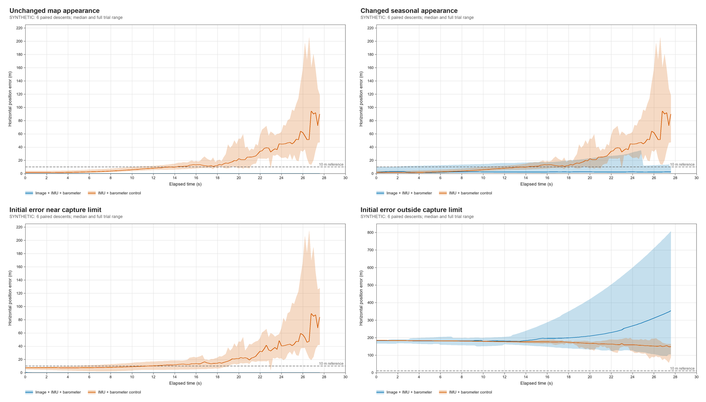

# Fine landmark tracking: implementation and rendered-image verification

23 October 2026. This is candidate Pi-side software checked using synthetic images. It has not processed real flight imagery or run on the Raspberry Pi Zero 2 W.

The new [`fine.py`](../code/cansat/fine.py) supplies the fine image matcher previously missing between acquisition and the existing navigation filter. It takes a nearby predicted pose, finds local map landmarks in a camera image and returns measurements accepted by `Eskf.update_landmarks`. Acquisition confirmation, tracking-loss decisions, timestamped sensor scheduling and the live camera/UART application were not part of this change; they were integrated later in `navigator.py` and `code/piapp/` (see the [flight software report](flight_software.md)). This change does not implement STM32 firmware.

## Implementation

`FineMatcher(raster, res, origin, config=None, landmarks=None)` prepares a fixed bank of raw brightness-map templates. Raster columns increase east, rows increase north; `origin` locates pixel `[0,0]` in the launch-site ENU frame. The map and landmarks use the z=0 ground plane. The map is supplied explicitly; the tracker does not depend on simulation terrain or GNSS.

With the defaults, templates contain 32 x 32 samples at 0.5 m spacing and are sought within +/-16 m on each map axis. This spacing is a configuration assumption, not evidence that a coarse source map contains that detail. Preparation tries a 24 m grid, or user-supplied landmarks, and discards weak texture and straight boundaries that cannot locate a point in both directions. It caps the bank at 10,000 candidate sites. The input arrays can be freed or modified afterwards; the prepared bank owns its data.

For each image, the tracker projects candidate search-patch corners using the predicted pose and keeps fully visible patches. It selects the strongest site in each predicted-image cell, with at most 24 attempts over a 6 x 4 cell grid. It rectifies each 96 x 96 sample search patch using the existing `Camera.project`, including the camera rotation, unequal focal lengths, principal point and lever arm. Work and retained memory are bounded by configuration and prepared-map size; there is no flight-history buffer.

Map templates are located in the rectified image with the existing `coarse.ncc_valid` FFT/integral-image normalised cross-correlation. This is the normalisation approach described by [Lewis, *Fast Normalized Cross-Correlation*](https://www.cs.swarthmore.edu/~turnbull/cs97/f08/paper/Lewis95.pdf). The defaults require correlation greater than 0.5 and a gap greater than 0.04 to the strongest peak outside a 3-pixel exclusion box. A joint two-dimensional quadratic fit must be interior, concave and constrained in both axes. Border, flat, elongated and ambiguous peaks are refused.

The returned map point stays fixed. Its matched offset in the rectified ground patch is projected through the **same predicted pose** to recover an observed **original image pixel**. Returning that pixel with the original point allows the ESKF to correct the prediction. Returning a corrected world point instead would conceal the image innovation. `match_filter` obtains the exposure pose using the ESKF's velocity, angular rate and camera time-offset state, without modifying the filter.

Result fields include `points`, `pixels`, `pixel_var`, `map_var`, scores, peak gaps, source-site indices, attempt counts and rejection reasons. Empty results have shapes `(0,3)` for points/map variances and `(0,2)` for pixels. Invalid frames, poses and timing return a refusal; invalid map preparation/configuration raises `ValueError` before use.

The declared pixel standard deviation is 0.5 image pixels, supplied to the filter as **variance** 0.25 px². Horizontal map standard deviation is the larger of 0.15 m and map resolution divided by sqrt(12); vertical map variance is zero because the model assumes a plane. These are allowances, not calibrated uncertainties. Scores are not converted into a claimed covariance. Map datum error, relief, consistent aliases and correlated errors across sites/frames are outside this uncertainty model.

## Calling the matcher

Run with the project's `.venv` Python and NumPy. Camera intrinsics must describe the actual undistorted image supplied, including the pixel-centre correction when binning (`coarse.bin_camera`). Create the matcher once when preparing the map, rather than rebuilding it per frame.

```python
from cansat.fine import FineMatcher

matcher = FineMatcher(map_brightness, metres_per_map_pixel, map_origin_enu)
# nav has already been propagated to this frame's timestamp.
matches = matcher.match_filter(grayscale_image, calibrated_camera, nav)
if len(matches.points):
    update = nav.update_landmarks(
        calibrated_camera, matches.points, matches.pixels, matches.pixel_var,
        map_var=matches.map_var, iterations=3, robust=True, recover=True)
    # Log BOTH matcher acceptances and update['accepted']; they differ.
```

This code is a stage interface, not a complete live camera/IMU event loop. Persistently missing measurements should trigger a caller's tracking-loss policy. The matcher alone cannot certify that a returned measurement is correct.

## Retained rendered-image experiment

[`run_fine_mc.py`](../sim/nav/run_fine_mc.py) ran **six paired trials in five conditions: 30 synthetic descents, 139 frames per descent and 4,170 frame records**. The retained data are [`full_corrected/summary.json`](../sim/nav/results/fine_tracking_20261023/full_corrected/summary.json) and [`frames.csv`](../sim/nav/results/fine_tracking_20261023/full_corrected/frames.csv). Six trial seeds determine six procedural farmland worlds and starting-error draws; these are reused across conditions. Thousands of frames/matches do not constitute thousands of independent trials.

Each world is an 800 m square raster at 0.5 m/pixel, generated by `farmland.generate` using its mixed-farmland style. The unchanged condition uses the same brightness raster for map and flight; the seasonal condition uses a separate flight raster, with 95% field-albedo change probability, redrawn tramlines and the generator's default shadow changes. The textureless condition replaces the flight raster by a constant before image noise. Each frame is ray-cast using `scene.render` with 0.35 image-pixel blur, one grey-level noise and integer quantisation.

The camera is the existing ideal IMX296/2.5 mm pinhole model reduced by a factor of four: **364 x 272 pixels, fx=fy=181.15 px, principal point (181.625,135.625)** and a 45 mm body-z lever. `coarse.bin_camera` supplies the pixel-centre convention. Identity camera/body rotation and fixed level truth attitude are assumed in this campaign; nonidentity rotation is covered separately by matcher tests.

Motion is a straight, level descent from 300 m to approximately 80 m, at 8 m/s downward and (0.35,-0.18) m/s horizontally, sampled every 0.2 s over 27.6 s. The final height is clamped to 80 m. The IMU is ideal at 100 Hz, while the barometer has independent 0.25 m standard deviation at 5 Hz. Initial filter velocity lacks the true horizontal component; ordinary position error has 1.5 m standard deviation per horizontal axis, with 0.6 degree yaw and 0.35 degree roll/pitch standard deviations. Near-capture trials start within +/-8 m on each horizontal axis. Outside-capture trials add (140,-120) m to the ordinary starting error. This simplified 8 m/s motion is a software experiment, not the frozen descent budget or a flight-envelope test; canopy swing/spin and sensor biases are absent.

Both image and no-image filters receive identical IMU/barometer inputs and identical priors within each condition. Separate sensor/prior random generators preserve the sensor sequence when the starting-error condition changes; actual trial, sensor and map seeds appear in every row. A frame at t=0 receives no preceding inertial interval. The image path alone receives matcher measurements. All ESKF updates use three iterations, robust rejection and its existing recovery option. Truth supplies only rendering, synthetic sensor inputs and scoring; it never enters site selection, rectification or matching.

### Outcomes with unchanged matcher gates

Errors in the following table are horizontal position RMS over **all** exposures, including the first, after any image update. The control receives IMU/barometer updates without images. Endpoint RMS uses the last exposure of each of the six trials; it is not a landing-error prediction.

| Condition | Image-filter RMS | Paired control RMS | Image-filter endpoint RMS | Endpoints within 10 m |
| --- | ---: | ---: | ---: | ---: |
| Unchanged appearance | 0.096 m | 33.02 m | 0.036 m | 6/6 |
| Changed seasonal appearance | 7.79 m | 33.02 m | 6.36 m | 5/6 |
| Starting error near capture limit | 0.131 m | 33.51 m | 0.035 m | 6/6 |
| Starting error outside capture | 254.25 m | 172.58 m | 481.42 m | 0/6 |
| Textureless camera images | 33.02 m | 33.02 m | 87.86 m | 0/6 |

Accepted candidate pixels are independently back-projected through the **true** camera onto z=0. A candidate is called false when that ground point is more than **0.75 m** (1.5 source-map pixels) from its claimed map landmark. This fixed physical threshold avoids a pixel threshold whose ground meaning changes with height. The summary additionally retains original-image pixel residuals and a 3-pixel diagnostic threshold.

| Condition | Matcher acceptances / attempts | ESKF acceptances | Candidate ground RMS | Candidates over 0.75 m |
| --- | ---: | ---: | ---: | ---: |
| Unchanged appearance | 15,058 / 18,420 | 15,058 | 0.099 m | 0 / 15,058 |
| Changed seasonal appearance | 3,607 / 18,452 | 2,609 | 6.12 m | 2,662 / 3,607 (73.8%) |
| Starting error near capture limit | 15,045 / 18,420 | 15,045 | 0.098 m | 0 / 15,045 |
| Starting error outside capture | 455 / 17,490 | 74 | 196.01 m | 455 / 455 (100%) |
| Textureless camera images | 0 / 18,439 | 0 | undefined | undefined: none accepted |

The false-match rate is scored **before ESKF rejection**; ESKF acceptance counts are separate and do not establish its exact false-match rate. The final navigation error is scored after ESKF correction. Textureless images give exactly the control's trajectory, as expected when no measurement is accepted. Outside capture, even 74 retained wrong measurements make the trajectory worse than its control: innovation checks and recovery do not certify absolute location.

These are useful mechanism checks and failure demonstrations. The unchanged-map condition is deliberately favourable: it shares a perfect map, has a level camera and ideal inertial inputs, and introduces no datum, calibration or relief errors. Centimetre endpoint errors in this model do not predict centimetre field accuracy. Changed appearance still helps some trajectories, but the very high candidate false-match rate and one missed 10 m endpoint make raw brightness NCC unsuitable as an unconditional flight correction source. The next implementation priorities are appearance-robust tracking and an explicit quality/loss/reacquisition policy, tested against real site imagery and the existing canopy-motion model. Gates were not tuned after inspecting these outcomes.



The bands show the full observed range across six paired trials, **not confidence intervals**. The 10 m line is a reference, not a demonstrated mission pass. At the plotted scale, the favourable-condition image error lies close to zero. [`analyse_fine_mc.py`](../sim/nav/analyse_fine_mc.py) independently checked all 4,170 expected frame keys, reconciled match counts, horizontal RMS and false-match counts between CSV and JSON, and rendered these figures. Its [`audit.json`](../sim/nav/results/fine_tracking_20261023/figures/audit.json) includes source/data SHA-256 hashes. Python 3.12.10 and NumPy 2.5.4 were used; the sum of timed descent loops was 162.2 s on the host, excluding some preparation. This is not Pi timing or a 5 Hz throughput qualification.

An early campaign used an incorrect binned principal point. A regression test first failed at cx=363.625 instead of 181.625, then passed after using the existing `bin_camera` function. All accuracy conclusions above use only the corrected rerun. The earlier `pilot/`, `benchmark/` and `full/` folders are preserved and clearly labelled invalid development diagnostics in the [results README](../sim/nav/results/fine_tracking_20261023/README.md).

To reproduce without replacing the retained results:

```powershell
.venv/Scripts/python.exe sim/nav/run_fine_mc.py --trials 6 --frames 139 --seed 20261023 --output sim/nav/results/fine_tracking_20261023/reproduced
.venv/Scripts/python.exe sim/nav/analyse_fine_mc.py --input sim/nav/results/fine_tracking_20261023/reproduced --output sim/nav/results/fine_tracking_20261023/reproduced_figures
```

## Checks

[`test_fine.py`](../code/tests/test_fine.py) uses the separate `scene.render` ray-casting renderer and known poses. Its 14 checks cover combined position/height/attitude error, nonidentity camera/body rotation and lever arm, unequal focal lengths and an offset principal point, gain/offset/noise, exposure timing, pose correction through the existing ESKF, repeated/flat/one-dimensional terrain, image/ground boundaries, a search-edge maximum, invalid inputs, capped spatial selection and input/state immutability. It explicitly checks finite positive variances and px²/m² scaling. The nonfinite timing/rate test reproduced invalid arithmetic before a validation fix and passed afterwards.

An independent Luna review checked the matcher against its design and the camera/ESKF contracts and found no substantive correctness defect. It highlighted additional fault-path/variance assertions, which are now included. This is source/test review, not independent flight validation.

The final flight-code suite passed **207 tests** (193 before this change). The runner passed **7 tests**, including deterministic inputs, strict JSON/CSV output, original-pixel and ground-error scoring, paired seeds and barometer streams, no propagation before the first exposure, and the camera regression. Existing scene checks passed 10/10, NCC tolerance checks 8/8, and the existing rendered-image suite ran 15 tests with 14 passed and one optional test skipped. These 247 tests are a focused regression set; the full historical Monte Carlo and all simulation suites were not rerun. New Python files parsed successfully and `git diff --check` passed.

A separate Luna scientific review independently recalculated the counts, pooled horizontal RMS, endpoint RMS and 10 m endpoint counts from all 4,170 corrected CSV rows. It found no numerical mismatch or material misleading comparison in this report. It did not rerun the simulation; the retained raw data and source hashes are the reproducible evidence.

## Limitations and next work

These tests establish implementation behaviour under the stated synthetic models. A fine matcher needs a usable initial pose, actual map detail at its template scale, undistorted calibrated images, a compatible season/appearance and enough two-dimensional features. A repeated pattern can agree with a wrong prior; NCC and innovation gating do not prove global correctness. Flat-ground projection also breaks when relief/structures dominate.

The next useful data are synchronized photographs of the intended launch site and its actual map, with independent pose references. Replay those through acquisition, this matcher and the ESKF, measuring refusal/false-match rates and tracking recovery. After that, benchmark the same replay on the Pi Zero 2 W and measure memory/processing latency against the 5 Hz target. Hardware timing, installed camera calibration, STM32 firmware and physical flight qualification remain open.
