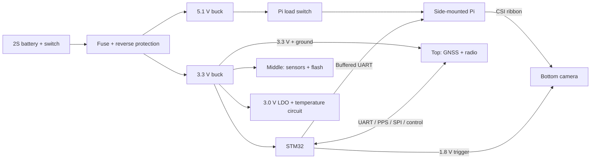

# Flight-computer schematic connection guide

Prepared 3 October 2026; this is the proposed wiring-plan snapshot. Companion to [the component BOM](flight_computer_bom.md), which is the purchasing authority. The saved-schematic review and completion records supersede this guide wherever designators or assembled connections differ; see [MAIN schematic review](schematic_bom_review.md), [MAIN completion](mainboard_completion.md), and [design baseline](design_baseline.md). Revised architecture: circular **top RF PCB**, **middle main PCB**, **bottom camera module**, separate side-mounted Pi Zero 2 W and optional compass daughterboard.

This is a wiring reference, not the as-built schematic. It records the proposed electrical plan; later MAIN schematic review and completion records confirm selected portions and their dated checks. Component pin numbers and STM32 alternate functions were checked against manufacturer documents and installed KiCad symbols. Neither this text nor schematic connectivity establishes routed-PCB or hardware performance. Converter capacitor effective values, clock loading, startup/inrush, RF performance and firmware timing still require verification.

Budget revision: the analogue prototype uses **TE GA10K3MCD1**, replacing FP07. Its installed air response is unqualified. See [temperature options](temperature_options.md) for the cheaper TMP117 digital implementation and its different connector wiring before choosing which circuit to draw.

## 1. Divide the two custom PCBs into these schematic sheets

These are logical blocks within two physical PCBs. Use separate KiCad PCB projects for MAIN and RF, each with its own schematic. Sheet boundaries within a PCB do not require connectors; the MAIN-to-RF boundary does. Keep the existing IC pin allocation below and expose its inter-board signals on the connector pair.

| PCB | Sheet | Components owned by this block | Connections to other blocks |
|---|---|---|---|
| Middle MAIN | 01_Power | Input fuse, reverse MOSFET, gate clamp, TVS, U7/U8 bucks, U6 analogue LDO, U9 Pi load switch, battery divider | Power rails, BAT_ADC, PGOOD_5V, PGOOD_3V3, PI_PWR_EN |
| Middle MAIN | 02_MCU | U1 STM32, crystal, VCAP/decoupling, reset/boot straps, SWD pads | All named digital signals in the pin allocation below |
| Middle MAIN | 03_MotionPressure | U2 BMI088, its supply ferrite, U3 MS5611 | SPI1, two CS signals, two data-ready signals, I2C1 |
| Middle MAIN | 04_Temperature | U4 ADS1115, U5 OPA333, excitation MOSFET, precision divider, probe connector | +3V0_A, I2C2, TEMP_GATE_N, ADC_RDY_N |
| Top RF | 05_GNSS | RF U1 MAX-M10S, GNSS supply ferrite, antenna bias/DC block, U.FL and all GNSS decoupling | USART3, GNSS_PPS, GNSS_RESET_N via inter-board connector |
| Top RF | 06_Radio | RF U2 E22-900M22S, local capacitors and radio default resistors | SPI2 and radio control/interrupt signals via inter-board connector |
| Middle MAIN | 07_PiCamera | U10 UART buffers, Pi harness, 1.8 V trigger divider, trigger harness | +5V1_PI, USART1, PI_UART_OE_N, CAM_TRIG_3V3 |
| Middle MAIN | 08_Recovery | Buzzer, N-MOSFET, flyback diode, two LEDs | +3V3_AON, BUZZ_PWM, LED_STATUS, LED_FAULT |
| Middle MAIN | 09_Log | MAIN U11 W25Q128JV, its capacitors and CS/WP/HOLD pull-ups | SPI2 shared with top radio; local FLASH_CS_N |

Actual saved MAIN references are **U1 STM32, U2 BMI088, U3 MS5611, U4 ADS1115, U5 OPA333, U6 TPS7A2030, U7 TPS62130, U8 TPS62162, U9 TPS22965, U10 SN74LVC2G125 and U11 W25Q128JVSIQ**. The separate RF schematic uses RF U1 MAX-M10S and RF U2 E22-900M22S. J5 is the optional DNP compass interface; the daughterboard designator is local to that assembly. Give resistors/capacitors references through KiCad annotation; the descriptive names here identify their roles.

Use hierarchical labels for signals crossing sheets, and consistently named global labels for supply rails. A drawn wire or matching net label makes the electrical connection. A bus graphic, nearby text, sheet border or connector drawing does not connect pins by itself. Use one **GND** net throughout; AGND/PGND device pins also connect to GND.

## 2. Power rails and top-level connections

| Net name | Source | Loads |
|---|---|---|
| VBAT_PROT | Protected 2S pack through switch, fuse and reverse MOSFET | Both buck VIN/EN connections; battery divider |
| +5V1_RAW | U7 output after its inductor | U9 VIN and VBIAS |
| +5V1_PI | U9 output | Pi 5 V harness contacts; camera receives power through Pi CSI |
| +3V3_AON | U8 output after its inductor | STM32, barometer, radio, flash, UART buffers, buzzer, optional compass; U6 input |
| +3V3_IMU | +3V3_AON through first BLM21 ferrite | BMI088 VDD and VDDIO |
| +3V3_GNSS | +3V3_AON through second BLM21 ferrite | MAX-M10S VCC and V_IO |
| +3V0_A | U6 output | ADS1115, OPA333, thermistor excitation, analogue I2C pull-ups |
| GND | Battery negative | All board returns, Pi/camera/probe returns and antenna connector shields |

The Pi's own 3.3 V rail is **not connected** to +3V3_AON. It is generated on the Pi and disappears when the Pi is switched off.

### MAIN-to-RF physical interface

The top board is powered by the middle board's **+3V3_AON** rail. Keep both bucks on MAIN. Move the GNSS ferrite and all receiver-side capacitors/bias components to RF; the radio's 100 nF, 10 uF and 22 uF capacitors also stay beside the radio on RF. Place radio CS/reset pull-ups and TXEN/RXEN pulldowns on RF, so their defaults survive a disconnected harness.

A proposed **20-contact** interface carries all existing signals without another MCU. The pin table below records the MAIN J4 contact mapping checked in the 4 October schematic-completion record; the corresponding RF-side endpoint still requires reconciliation against its saved schematic. These are connector contact numbers, not IC pins. The saved MAIN uses J4, Würth 61202021621 shrouded 2×10; its footprint and pin mapping were checked in the 4 October completion record. The mating RF-side connector/cable, RF placement and full harness assembly remain unresolved. The actual RF-side endpoint should be checked against its schematic before fabrication. A stock `Connector_Generic:Conn_02x10_Odd_Even` symbol can represent a two-row pair.

| Contact | Net | MAIN endpoint | RF endpoint |
|---:|---|---|---|
| 1 | +3V3_AON | U8 regulated output | Radio supply; input of GNSS ferrite |
| 2 | GND | GND | GND |
| 3 | MCU_GNSS_TX | U1 PC10 pin 51 | RF U1 RXD pin 3 |
| 4 | GND | GND | GND |
| 5 | MCU_GNSS_RX | U1 PC11 pin 52 | RF U1 TXD pin 2 |
| 6 | GND | GND | GND |
| 7 | GNSS_PPS | U1 PA0 pin 14 | RF U1 TIMEPULSE pin 4 |
| 8 | GND | GND | GND |
| 9 | GNSS_RESET_N | U1 PB5 pin 57 | RF U1 RESET_N pin 9 |
| 10 | GND | GND | GND |
| 11 | AUX_SCK | U1 PB13 pin 34 through existing 33 Ohm resistor | RF U2 SCK pin 18 |
| 12 | GND | GND | GND |
| 13 | AUX_MOSI | U1 PB15 pin 36 | RF U2 MOSI pin 17 |
| 14 | AUX_MISO | U1 PB14 pin 35 | RF U2 MISO pin 16 |
| 15 | RADIO_CS_N | U1 PC6 pin 37 | RF U2 NSS pin 19 |
| 16 | RADIO_RESET_N | U1 PC7 pin 38 | RF U2 NRST pin 15 |
| 17 | RADIO_BUSY | U1 PC8 pin 39 | RF U2 BUSY pin 14 |
| 18 | RADIO_DIO1 | U1 PC9 pin 40 | RF U2 DIO1 pin 13 |
| 19 | RADIO_TXEN | U1 PC12 pin 53 | RF U2 TXEN pin 7 |
| 20 | RADIO_RXEN | U1 PD2 pin 54 | RF U2 RXEN pin 6 |

MAIN U11 flash still connects locally to AUX_SCK/MOSI/MISO on MAIN and has its own FLASH_CS_N; that CS signal does not cross the connector. Start offboard radio SPI at **1 MHz** as an engineering starting point, keep the connection to a few centimetres, and scope SCK/MISO before raising speed. Low clock rate alone does not eliminate edge ringing. Keep grounds alongside signal paths, use the existing clock source resistor and tune termination only from the actual waveform. Allocate a connector power contact and wiring rated above the measured radio/GNSS/antenna peak current, and check RF-board rail droop during transmit bursts.

Use the same GND reference on both boards. Keep RF ground planes continuous and arrange placement so transmitter return currents do not pass through the GNSS input region; do not divide the receiver and radio into disconnected ground islands. Do not place a ferrite in the ground interconnect. Put real external-source power flags at the RF power input where ERC needs them.

### Physical placement and coexistence

- Size the circular RF outline from the **actual internal diameter** and required wall/standoff clearance, rather than making it exactly the nominal 66 mm outer CanSat diameter.
- Place MAX-M10S and its antenna feed away from E22 and digital connector/SPI routing. Keep the GNSS RF trace short, with its specified ground reference. Maximise separation between the GNSS and telemetry antennas; same-board placement does not establish isolation.
- Keep the GNSS antenna sky-facing with an RF-transparent cover and the antenna maker's ground-plane/clearance requirements. Account for nearby metal lid, parachute hardware and the Pi. A receiver at the top cannot compensate for a shielded antenna.
- Keep the radio antenna clear of the GNSS antenna, metal enclosure and Pi; a short coax allows its radiating section to occupy a different location from the RF PCB. Keep RF antenna feeds on coax or controlled-impedance PCB traces, not the digital inter-board connector.
- Validate in the assembled enclosure: compare GNSS C/N0, fix continuity and PPS/navigation validity with telemetry silent and transmitting at the intended power/duty cycle. Add spacing, shielding or suitable filtering if the test shows degradation. Do not power-cycle GNSS for each packet; it remains the continuous truth receiver.
- Use rigid standoffs/common structure between MAIN and the camera. Measure and calibrate the IMU-to-camera translation and rotation; avoid camera motion relative to the IMU under vibration. Retain CSI/trigger cables and leave room for the side-mounted Pi, battery and optical assembly within the height limit.

Sources: [u-blox RF interference guidance](https://www.u-blox.com/en/blogs/tech/reducing-rf-interference-gnss-performance), [GNSS antenna application note](https://content.u-blox.com/sites/default/files/products/documents/GNSS-Antennas_AppNote_%28UBX-15030289%29.pdf) and the [MAX-M10S integration manual](https://content.u-blox.com/sites/default/files/MAX-M10S_IntegrationManual_UBX-20053088.pdf). Separation and enclosure tests above are engineering recommendations for this CanSat, not a manufacturer guarantee of coexistence.

## 3. 01_Power: physical wiring

### Battery protection

1. Battery positive -> accessible master switch -> board BAT_IN pad -> 5 A fuse -> BAT_FUSED.
2. Reverse-protection **AO3401A drain pin 3 -> BAT_FUSED; source pin 2 -> VBAT_PROT**. This orientation lets its body diode start conduction for correct polarity. It is intentionally opposite the source-to-supply orientation of the thermistor switch.
3. Gate pin 1 -> 100 kOhm -> GND. Add **8.2 V Zener BZT52C8V2: cathode -> source/VBAT_PROT, anode -> gate**. This clamps gate-to-source voltage; the AO3401A limit is +/-12 V.
4. SMF9.0A TVS cathode -> VBAT_PROT; anode -> GND. Battery negative -> board GND pad. This arrangement puts the TVS after polarity protection.
5. Use retained power wires through suitable solder pads; the cable XT30 connectors are not PCB-mounted parts. Two stock `Connector:TestPoint` symbols with `TestPoint:TestPoint_THTPad_D2.5mm_Drill1.2mm` are a starting option; confirm pad/hole size against the chosen wire and current.
6. BAT_ADC divider: VBAT_PROT -> 100 kOhm -> BAT_ADC -> 47 kOhm -> GND. Add 10 nF from BAT_ADC to GND. BAT_ADC -> U1 PC0, pin 8. This measures the protected board input, including reverse-MOSFET drop.

MOSFET ratings: [AOS AO3401A datasheet](https://www.aosmd.com/sites/default/files/res/datasheets/AO3401A.pdf). The TVS does not establish a complete surge rating, and the 5 A fuse does not establish MOSFET thermal capacity.

### U7 TPS62130RGTR: 5.1 V buck

| U7 pin(s) | Wire to |
|---|---|
| 10 AVIN, 11/12 PVIN (stock symbol labels all VIN) | VBAT_PROT |
| 13 EN | VBAT_PROT, for automatic startup |
| 1/2/3 SW | Join to SW_5V; SW_5V -> 2.2 uH inductor -> +5V1_RAW |
| 14 VOS | +5V1_RAW, after the inductor |
| 5 FB | FB_5V: 806 kOhm from +5V1_RAW to FB_5V, 150 kOhm from FB_5V to GND |
| 7 FSW | +5V1_RAW, selecting the lower switching-frequency option |
| 8 DEF | GND |
| 9 SS/TR | 10 nF to GND; starting soft-start value |
| 4 PG | PGOOD_5V -> U1 PC1 pin 9; 10 kOhm pull-up to +3V3_AON |
| 6 AGND, 15/16 PGND, exposed pad 17 | GND |

VBAT_PROT to GND: two 10 uF input capacitors plus 100 nF at AVIN. +5V1_RAW to GND: two 22 uF output capacitors, shared with the nearby U9 input. An optional feed-forward capacitor position across the 806 kOhm resistor remains **DNP** pending TI control-loop review. [TI pin/functions and application circuits](https://www.ti.com/lit/ds/symlink/tps62130.pdf).

### U8 TPS62162DSGR: independent 3.3 V buck

| U8 pin | Wire to |
|---|---|
| 2 VIN, 3 EN | VBAT_PROT |
| 7 SW | SW_3V3 -> second 2.2 uH inductor -> +3V3_AON |
| 6 VOS | +3V3_AON, after the inductor |
| 5 FB | GND; this is the fixed-output TPS62162 |
| 8 PG | PGOOD_3V3 -> U1 PC13 pin 2 as an input; 10 kOhm pull-up to +3V3_AON |
| 1 PGND, 4 AGND, exposed pad 9 | GND |

VBAT_PROT to GND: two 10 uF input capacitors. +3V3_AON to GND: two 22 uF output capacitors. Keep the switch-node nets separate from the output-rail nets. [TI TPS6216x datasheet](https://www.ti.com/lit/ds/symlink/tps62160.pdf).

### U6 TPS7A2030PDBVR: quiet 3.0 V supply

Pin 1 IN and pin 3 EN -> +3V3_AON; pin 2 -> GND; pin 5 OUT -> +3V0_A; pin 4 NC -> no-connect flag. Add 1 uF input and 2.2 uF output to GND. The output capacitor must meet TI's effective-capacitance requirement under DC bias. [TI TPS7A20 datasheet](https://www.ti.com/lit/ds/symlink/tps7a20.pdf).

### U9 TPS22965DSGR: switched Pi supply

Custom symbol pin numbering: **1/2 VIN -> +5V1_RAW; 3 ON -> PI_PWR_EN; 4 VBIAS -> +5V1_RAW; 5 GND and pad 9 -> GND; 6 CT -> 10 nF -> GND; 7/8 VOUT -> +5V1_PI**.

PI_PWR_EN -> U1 PC2 pin 10, with 10 kOhm to GND, so the Pi stays off during STM32 reset. Add 100 nF from VBIAS to GND and two 22 uF from +5V1_PI to GND. CT is a starting value; check the complete Pi/camera capacitance and inrush. [TI TPS22965 datasheet](https://www.ti.com/lit/ds/symlink/tps22965.pdf).

## 4. 02_MCU: core support and complete signal allocation

### Core wiring

| U1 pin(s) | Connection |
|---|---|
| VDD 19, 32, 48, 64 | +3V3_AON; **one 100 nF per pin**, plus local **4.7 uF bulk** (actual C5, 0805). Corrected 4 October to ST's supply scheme; VCAP capacitors remain 2.2 uF. |
| VSS 18, 63; VSSA 12 | GND |
| VDDA 13 | +3V3_AON through a dedicated 10 Ohm resistor; 100 nF + 1 uF from VDDA to GND |
| VBAT 1 | +3V3_AON; 100 nF to GND; no separate backup battery |
| VCAP_1 31 | Dedicated 2.2 uF to GND |
| VCAP_2 47 | Separate dedicated 2.2 uF to GND; do not join VCAP pins to VDD or to each other |
| PH0/OSC_IN 5, PH1/OSC_OUT 6 | Opposite terminals of the 8 MHz crystal; one 33 pF from each terminal to GND as initial loading values |
| NRST 7 | 10 kOhm to +3V3_AON, 100 nF to GND, reset test pad |
| BOOT0 60 | 10 kOhm to GND; accessible pad for temporary connection to +3V3_AON |
| PB2/BOOT1 28 | 10 kOhm to GND |
| PA13 46, PA14 49 | SWDIO and SWCLK test pads |

Expose five programming pads: **VTREF/+3V3_AON, GND, SWDIO, SWCLK, NRST**. VTREF tells the programmer the target voltage; it is not an instruction to power the entire board from the programmer.

Package review: keep the current 0603 small passives and 0805 converter bulk capacitors. Actual C5 uses Samsung CL21A475KOFNNNE (4.7 uF, 16 V, X5R, 0805), following the [ST supply scheme](https://www.st.com/resource/en/datasheet/stm32f405rg.pdf). See [the complete passive package review](passive_package_review.md). Use 0402 only where placement requires it, after selecting a matching part and checking power ratings/effective capacitance.

### STM32 pin map

GPIO names are STM32 ports; the number column is the physical **LQFP-64 package pin**. Output/input directions are from the STM32's perspective. AF denotes the firmware alternate-function setting.

| Net | STM32 port | Pin | Mode / direction | Other endpoint |
|---|---|---:|---|---|
| GNSS_PPS | PA0 | 14 | AF1 TIM2_CH1 input capture | RF U1 TIMEPULSE pin 4 |
| IMU_G_DRDY | PA1 | 15 | AF1 TIM2_CH2 input capture | U2 INT3 pin 12 |
| IMU_A_DRDY | PA2 | 16 | AF1 TIM2_CH3 input capture | U2 INT1 pin 16 |
| CAM_TRIG_3V3 | PA3 | 17 | AF1 TIM2_CH4 input capture | Direct wire to U1 PB0 pin 26, before the divider |
| LED_FAULT | PA4 | 20 | GPIO output | Fault LED through 330 Ohm |
| IMU_SCK_MCU | PA5 | 21 | AF5 SPI1_SCK output | 33 Ohm -> IMU_SCK -> U2 pin 8 |
| IMU_MISO | PA6 | 22 | AF5 SPI1_MISO input | U2 pins 10 and 15 |
| IMU_MOSI | PA7 | 23 | AF5 SPI1_MOSI output | U2 pin 9 |
| IMU_A_CS_N | PC4 | 24 | GPIO output, 10 kOhm pull-up | U2 CSB1 pin 14 |
| IMU_G_CS_N | PC5 | 25 | GPIO output, 10 kOhm pull-up | U2 CSB2 pin 5 |
| CAM_TRIG_3V3 | PB0 | 26 | AF2 TIM3_CH3 output | Camera divider |
| ADC_RDY_N | PA8 | 41 | GPIO input, optional EXTI8 | U4 ALERT/RDY pin 2 |
| TEMP_GATE_N | PB1 | 27 | Open-drain output; firmware drives it as AF3 TIM8_CH3N in one-pulse mode, so the timer ends excitation in hardware | Temperature PMOS gate |
| TEMP_SCL | PB10 | 29 | AF4 I2C2_SCL open drain | U4 SCL pin 10 |
| TEMP_SDA | PB11 | 30 | AF4 I2C2_SDA open drain | U4 SDA pin 9 |
| FLASH_CS_N | PB12 | 33 | GPIO output, 10 kOhm pull-up | MAIN U11 CS pin 1 |
| AUX_SCK_MCU | PB13 | 34 | AF5 SPI2_SCK output | 33 Ohm -> AUX_SCK -> RF U2/MAIN U11 |
| AUX_MISO | PB14 | 35 | AF5 SPI2_MISO input | RF U2 pin 16 and MAIN U11 pin 2 |
| AUX_MOSI | PB15 | 36 | AF5 SPI2_MOSI output | RF U2 pin 17 and MAIN U11 pin 5 |
| RADIO_CS_N | PC6 | 37 | GPIO output, 10 kOhm pull-up | RF U2 NSS pin 19 |
| RADIO_RESET_N | PC7 | 38 | GPIO output, 10 kOhm pull-up | RF U2 NRST pin 15 |
| RADIO_BUSY | PC8 | 39 | GPIO input | RF U2 BUSY pin 14 |
| RADIO_DIO1 | PC9 | 40 | GPIO input, EXTI9 | RF U2 DIO1 pin 13 |
| MCU_PI_TX | PA9 | 42 | AF7 USART1_TX output | U10 1A pin 2 |
| MCU_PI_RX | PA10 | 43 | AF7 USART1_RX input | U10 2Y pin 3 |
| SWDIO | PA13 | 46 | AF0 debug | SWD test pad |
| SWCLK | PA14 | 49 | AF0 debug | SWD test pad |
| MCU_GNSS_TX | PC10 | 51 | AF7 USART3_TX output | RF U1 RXD pin 3 |
| MCU_GNSS_RX | PC11 | 52 | AF7 USART3_RX input | RF U1 TXD pin 2 |
| RADIO_TXEN | PC12 | 53 | GPIO output, 10 kOhm pulldown | RF U2 TXEN pin 7 |
| RADIO_RXEN | PD2 | 54 | GPIO output, 10 kOhm pulldown | RF U2 RXEN pin 6 |
| GNSS_RESET_N | PB5 | 57 | Open-drain GPIO output | RF U1 RESET_N pin 9 |
| BARO_SCL | PB6 | 58 | AF4 I2C1_SCL open drain | U3 pin 8; optional J_MAG |
| BARO_SDA | PB7 | 59 | AF4 I2C1_SDA open drain | U3 pin 7; optional J_MAG |
| BUZZ_PWM | PB8 | 61 | AF2 TIM4_CH3 output | 33 Ohm -> buzzer MOSFET gate |
| PI_UART_OE_N | PB9 | 62 | GPIO output, 10 kOhm pull-up | U10 OE pins 1 and 7 |
| BAT_ADC | PC0 | 8 | ADC123_IN10 analogue input | Battery-divider midpoint |
| PGOOD_5V | PC1 | 9 | GPIO input | U7 PG pin 4 |
| PI_PWR_EN | PC2 | 10 | GPIO output, 10 kOhm pulldown | U9 ON pin 3 |
| LED_STATUS | PC3 | 11 | GPIO output | Status LED through 330 Ohm |
| PGOOD_3V3 | PC13 | 2 | GPIO input only | U8 PG pin 8 |

This allocation uses distinct pins and preserves SWD. The remaining unassigned GPIOs can receive no-connect flags and be configured as analogue inputs in firmware. USART2 is unused; its PA2/PA3 pins have other jobs here.

TIM2 is a free-running common timestamp counter. Its fourth channel captures the camera-trigger output: **draw a direct wire from PB0 pin 26 to PA3 pin 17**, on the 3.3 V side of the divider. Do not connect PA3 to the 1.8 V XTR node; 1.8 V is not a guaranteed high level for this STM32 input.

TIM3 generates 5 Hz camera pulses; TIM4 generates approximately 4 kHz sound. **Do not put camera PWM and buzzer PWM on channels sharing one timer period.** TIM3 is 16-bit: for example, a 250 kHz counter with ARR=49,999 gives a 200 ms period and 4 us pulse resolution. Firmware must account for sensor group delay and assign DMA streams without conflicts; pin availability alone does not validate the timing target. Hardware capture stores camera/IMU/PPS edge times independently of ISR arrival time. [ST datasheet, LQFP64 pinout and AF tables](https://www.st.com/resource/en/datasheet/stm32f405rg.pdf).

## 5. 03_MotionPressure: BMI088 and MS5611

### U2 BMI088, four-wire SPI

| BMI088 pin(s) | Connection |
|---|---|
| 3 VDD, 11 VDDIO | +3V3_IMU; separate 100 nF at each pin |
| 2, 4, 6 | GND; pin 2 is grounded in Bosch's connection diagram even though its datasheet name is NC |
| 7 PS | GND, selecting gyro SPI |
| 8 SCK | IMU_SCK |
| 9 SDI | IMU_MOSI |
| 10 SDO2 and 15 SDO1 | Join to IMU_MISO |
| 5 CSB2 | IMU_G_CS_N; 10 kOhm to +3V3_IMU |
| 14 CSB1 | IMU_A_CS_N; 10 kOhm to +3V3_IMU |
| 12 INT3 | IMU_G_DRDY |
| 16 INT1 | IMU_A_DRDY |
| 1 INT2, 13 INT4 | Leave unconnected for the default separately timestamped acquisition |

+3V3_AON -> BLM21 ferrite -> +3V3_IMU. Add 2.2 uF from +3V3_IMU to GND. Populate 10 kOhm pull-ups on the data-ready nets to +3V3_IMU and configure the interrupt polarities/capture edges deliberately. Both CS signals must stay high during reset and only one may be low during a transfer.

An optional open solder jumper between **INT4 pin 13 and INT2 pin 1** enables Bosch's hardware data-sync wiring later; close it only with the matching firmware and configure INT2 as an input. Stock symbol `Jumper:SolderJumper_2_Open`, footprint `Jumper:SolderJumper-2_P1.3mm_Open_RoundedPad1.0x1.5mm`. Omit the no-connect flags on these pins if the jumper is drawn. Bosch's [datasheet](https://www.bosch-sensortec.com/media/boschsensortec/downloads/datasheets/bst-bmi088-ds001.pdf) and [shuttle-board diagram](https://www.bosch-sensortec.com/media/boschsensortec/downloads/shuttle_board_flyer/application_board_3_1/bst-bmi088-sf000.pdf) support these connections.

### U3 MS5611-01BA03, I2C

Pin 1 VDD and pin 2 PS -> +3V3_AON; pin 3 -> GND; **CSB pads 4 and 5 -> +3V3_AON** (the stock symbol exposes both internally connected CSB pads). Pin 7 SDA -> BARO_SDA; pin 8 SCLK -> BARO_SCL. Pin 6 SDO -> no-connect flag.

Tie CSB high for the **7-bit address 0x76**. Add 100 nF + 1 uF between VDD and GND, and one 4.7 kOhm pull-up on each BARO bus line to +3V3_AON. Use a protected static-pressure vent; it is a mechanical air path, not an electrical connector. [TE datasheet](https://www.te.com/commerce/DocumentDelivery/DDEController?Action=showdoc&DocId=Data+Sheet%7FMS5611-01BA03%7FB3%7Fpdf%7FEnglish%7FENG_DS_MS5611-01BA03_B3.pdf%7FCAT-BLPS0036).

## 6. 04_Temperature: draw the analogue circuit explicitly

### Excitation and divider

- Temperature **AO3401A source pin 2 -> +3V0_A; drain pin 3 -> TEMP_EXC; gate pin 1 -> TEMP_GATE_N**.
- 100 kOhm from gate to source/+3V0_A holds excitation off during reset. U1 PB1 is open-drain: low turns it on, release turns it off.
- TEMP_EXC -> **precision 150 kOhm RT0603BRD07150KL** -> TEMP_RAW -> external **TE GA10K3MCD1, 10 kOhm at 25°C** -> GND. Retain 150 kOhm to limit self-heating; a divider reference need not equal the probe's nominal resistance.
- The thermistor is external through J_TEMP; the precision resistor, excitation MOSFET, buffer and ADC stay on the main PCB.

### U5 OPA333AIDBVR

Pin 5 V+ -> +3V0_A; pin 2 V- -> GND; pin 3 +IN -> TEMP_RAW. Join output pin 1 to -IN pin 4 for a voltage follower. Output pin 1 -> **330 Ohm** -> TEMP_BUF; add 10 nF from TEMP_BUF to GND. TEMP_BUF -> U4 AIN0 pin 4. Add 100 nF from U5 supply to GND. [OPA333 SOT-23 pinout](https://www.ti.com/lit/ds/symlink/opa333.pdf).

### U4 ADS1115IDGSR

| ADS1115 pin | Connection |
|---|---|
| 8 VDD, 3 GND | +3V0_A, GND; 100 nF + 1 uF supply decoupling |
| 1 ADDR | GND, selecting 7-bit address 0x48 |
| 4 AIN0 | TEMP_BUF |
| 5 AIN1 | TEMP_EXC |
| 6 AIN2, 7 AIN3 | GND, unused analogue inputs |
| 9 SDA, 10 SCL | TEMP_SDA, TEMP_SCL |
| 2 ALERT/RDY | ADC_RDY_N -> U1 PA8; 4.7 kOhm pull-up to +3V0_A |

Each TEMP bus line gets **4.7 kOhm to +3V0_A**, not +3V3_AON. Set STM32 I2C2 open-drain without internal 3.3 V pull-ups. The 3.0 V high level is compatible with the STM32 input threshold.

Read AIN0 and AIN1 as sequential single-ended measurements while excitation is on. Select **+/-4.096 V** for AIN1 so the 3.0 V excitation reading does not saturate; AIN0 can use **+/-2.048 V** if its worst-case expected divider voltage fits. Convert each reading to volts using its configured PGA range before taking the ratio. For this resistor orientation, R_NTC = 150 kOhm * V_AIN0 / (V_AIN1 - V_AIN0). Allow settling and completed conversions after mux/gain changes; switch excitation off afterward. Calibrate the actual TE probe, and qualify its air response in the mounted shield. [TI ADS1115 datasheet](https://www.ti.com/lit/ds/symlink/ads1115.pdf).

### J_TEMP: 4-pin JST GH

| Pin | Main-board net | Probe harness |
|---:|---|---|
| 1 | TEMP_RAW | Thermistor lead A |
| 2 | GND | Thermistor lead B |
| 3 | GND | Optional shield/drain termination; otherwise no cable contact |
| 4 | NC | No cable contact |

This is a two-wire, unpolarised thermistor measurement. There is no supply wire to the bead and no I2C running down the probe cable. Avoid ground paths from other powered assemblies through the sensing return.

## 7. Top RF PCB, 05_GNSS: receiver, PPS and antenna

### RF U1 MAX-M10S

| MAX-M10S pin(s) | Connection |
|---|---|
| 7 V_IO (stock name VCC_IO), 8 VCC | +3V3_GNSS; one 100 nF at each supply plus 10 uF local bulk |
| 1, 10, 12 | GND |
| 2 TXD | MCU_GNSS_RX -> U1 PC11 |
| 3 RXD | MCU_GNSS_TX -> U1 PC10 |
| 4 TIMEPULSE | GNSS_PPS -> U1 PA0 input capture; no external pulldown |
| 9 RESET_N | GNSS_RESET_N -> U1 PB5 open-drain; internal pull-up, no reset capacitor |
| 6 V_BCKP | Leave open: hardware backup mode is not used |
| 15 VIO_SEL | **Leave open for 3.3 V I/O** |
| 5 EXTINT, 13 LNA_EN, 16 SDA, 17 SCL, 18 SAFEBOOT_N | Leave open for this UART/basic-antenna design |
| 14 VCC_RF | Antenna-bias supply below |
| 11 RF_IN | GNSS_RF_RX below |

+3V3_AON -> second BLM21 ferrite -> +3V3_GNSS. The common VCC/V_IO supply and no-backup wiring follow the manufacturer's integration manual. Never drive TIMEPULSE low during startup: it is connected internally to SAFEBOOT_N.

### Active-antenna bias tee

Draw these as separate nets:

- RF U1 VCC_RF pin 14 -> **10 Ohm** -> GNSS_ANT_BIAS.
- GNSS_ANT_BIAS -> **10 nF** -> GND.
- GNSS_ANT_BIAS -> **27 nH choke** -> GNSS_ANT_RF.
- U.FL centre contact -> GNSS_ANT_RF.
- GNSS_ANT_RF -> **47 pF C0G DC-block capacitor** -> GNSS_RF_RX -> RF U1 RF_IN pin 11.
- U.FL shield contacts -> GND. The antenna plugs into that socket by coax; it does not connect through a JST signal harness.

Check choke impedance and antenna supply voltage/current at the actual operating point. VCC_RF permits up to 50 mA; **the 10 Ohm resistor is not a complete short-circuit protection circuit**. This minimal design omits the optional antenna-supervisor circuitry. Sources: [MAX-M10S datasheet](https://content.u-blox.com/sites/default/files/MAX-M10S_DataSheet_UBX-20035208.pdf) and [integration manual, supply and antenna circuits](https://content.u-blox.com/sites/default/files/MAX-M10S_IntegrationManual_UBX-20053088.pdf).

## 8. Top 06_Radio and middle 09_Log: shared SPI2, separate chip selects

### RF U2 E22-900M22S custom module symbol

| Module pin(s) | Connection |
|---|---|
| 9 VCC | +3V3_AON; 100 nF + 10 uF + 22 uF local supply capacitors |
| 1-5, 10-12, 20, 22 | GND, subject to the pad-12 revision check below |
| 6 RXEN | RADIO_RXEN -> U1 PD2; 10 kOhm to GND |
| 7 TXEN | RADIO_TXEN -> U1 PC12; 10 kOhm to GND |
| 8 DIO2 | No-connect; this design controls TXEN separately |
| 13 DIO1 | RADIO_DIO1 -> U1 PC9 |
| 14 BUSY | RADIO_BUSY -> U1 PC8 |
| 15 NRST | RADIO_RESET_N -> U1 PC7; 10 kOhm to +3V3_AON |
| 16 MISO | AUX_MISO |
| 17 MOSI | AUX_MOSI |
| 18 SCK | AUX_SCK |
| 19 NSS | RADIO_CS_N; 10 kOhm to +3V3_AON |
| 21 ANT | No added PCB trace when using the module's own IPEX antenna socket |

**Pad-12 source discrepancy:** Ebyte's [Chinese manufacturer pin table](https://www.ebyte.com/product/435.html) identifies pad 12 as GND, matching the published module manual; its [English table](https://www.cdebyte.com/products/E22-900M22S/2) currently labels pad 12 NRST as well as pad 15. The proposed wiring uses the Chinese table/manual. Confirm the supplied module revision's pad drawing before freezing the custom symbol/footprint.

Do not assert TXEN and RXEN simultaneously. Leave DIO2's RF-switch function disabled when TXEN is controlled by the separate MCU pin; configure the module's TCXO requirements in its radio driver. The MCU's SPI2 master uses software-controlled NSS, so PB12 remains an ordinary GPIO for flash CS. The radio antenna connects to the module's socket; do not add a parallel antenna socket or unterminated RF branch.

### MAIN U11 W25Q128JVSIQ, standard SPI

Pin 8 VCC -> +3V3_AON; pin 4 -> GND; pin 1 CS -> FLASH_CS_N with 10 kOhm pull-up; pin 2 DO -> AUX_MISO; pin 5 DI -> AUX_MOSI; pin 6 CLK -> AUX_SCK. Pin 3 WP and pin 7 HOLD -> +3V3_AON through separate 10 kOhm pull-ups. Add 100 nF and local 2.2 uF supply capacitors.

Radio and flash share SCK/MOSI/MISO but have independent CS signals. Select only one at a time and restore the appropriate SPI mode/rate for each device. Use the stock **wide 5.3 mm SOIC-8 footprint** from the BOM. [Winbond datasheet](https://www.winbond.com/resource-files/w25q128jv%20revf%2003272018%20plus.pdf).

## 9. 07_PiCamera: UART isolation and physical harnesses

### U10 SN74LVC2G125DCUR

| Buffer pin | Connection |
|---|---|
| 8 VCC, 4 GND | +3V3_AON, GND; 100 nF decoupling |
| 1 1OE_N, 7 2OE_N | Join to PI_UART_OE_N; 10 kOhm to +3V3_AON |
| 2 1A | MCU_PI_TX from U1 PA9 |
| **6 1Y** | MCU_TO_PI_UART, to Pi GPIO15/RXD |
| **5 2A** | PI_TO_MCU_UART, from Pi GPIO14/TXD; 100 kOhm to GND to prevent floating input when Pi is off |
| 3 2Y | MCU_PI_RX to U1 PA10; 10 kOhm to +3V3_AON |

**For the DCU package, 1Y is pin 6 and 2A is pin 5.** Place both buffer units and the power unit. OE high disables both directions; OE low enables them. The Pi-side signal nets must not have pull-ups to the always-on rail. [TI buffer pin table](https://www.ti.com/lit/ds/symlink/sn74lvc2g125.pdf).

### J_PI: 8-pin JST GH

These numbers are the main PCB's **JST connector contact numbers**, not Pi GPIO numbers.

| J_PI pin | Net | Pi connection |
|---:|---|---|
| 1 | +5V1_PI | Parallel power conductor |
| 2 | GND | Parallel ground conductor |
| 3 | +5V1_PI | Parallel power conductor |
| 4 | GND | Parallel ground conductor |
| 5 | +5V1_PI | Parallel power conductor |
| 6 | GND | Parallel ground conductor |
| 7 | MCU_TO_PI_UART | Pi physical pin **10**, GPIO15/RXD |
| 8 | PI_TO_MCU_UART | Pi physical pin **8**, GPIO14/TXD |

Join the three equal-length power conductors at the Pi's **5 V pads, physical pins 2 and 4**; there is no third 5 V GPIO pad. Ground conductors can use physical pins 6, 9 and 14. Each GH contact is rated 1 A; check current sharing, wire size and the complete harness voltage drop. Solder/retain the harness at the unheadered Pi and support the Pi through its mounting holes on the side frame.

These are 3.3 V logic UART signals. Disable the Pi serial console and configure a stable hardware UART for the link. Do not connect Pi 3.3 V to the flight-board rail or power the Pi through a GPIO signal. [Raspberry Pi GPIO and UART documentation](https://www.raspberrypi.com/documentation/computers/raspberry-pi.html).

### Camera trigger and CSI

U1 PB0/CAM_TRIG_3V3 -> **1.5 kOhm** -> CAM_XTR_1V8. Add **1.8 kOhm** from CAM_XTR_1V8 to GND. CAM_XTR_1V8 -> J_CAM pin 1 -> camera **XTR touchpoint**. J_CAM pin 2 -> GND -> camera GND touchpoint; pin 3 GND is an optional extra return and pin 4 is NC.

The camera's **CSI ribbon connects directly to the Pi**, using the Zero-specific 22-to-15-pin cable. Its data and supply do not pass through the custom board or the trigger JST. The trigger connector does not supply 1.8 V power.

XTR is a 1.8 V input. Set the trigger high while powered and idle, and use timed low pulses for exposure; keep PB0 low/Hi-Z with camera power absent. Apply the documented R11 modification only for the applicable Q2-populated camera revision. [Official external-trigger instructions](https://www.raspberrypi.com/documentation/accessories/camera.html).

Startup order: UART OE high -> verify 5.1 V good -> PI_PWR_EN high -> allow Pi power to settle -> enable UART -> complete boot/camera setup -> start triggers. Shutdown order: request shutdown over the still-enabled UART -> stop triggers/drive PB0 low -> wait for the agreed shutdown completion condition -> OE high -> PI_PWR_EN low. Fault recovery can bypass clean shutdown, with the logging/OS protections described in the BOM.

## 10. 08_Recovery: buzzer and LEDs

CMT-8504 sounder positive terminal -> +3V3_AON; negative -> BUZZ_LOW. AO3400A drain pin 3 -> BUZZ_LOW; source pin 2 -> GND; gate pin 1 -> 33 Ohm -> BUZZ_PWM. Add 100 kOhm gate-to-source pulldown.

SS14 flyback diode **cathode -> +3V3_AON; anode -> BUZZ_LOW**. Generate approximately 4 kHz PWM on TIM4_CH3. This is an externally driven magnetic sounder, not a buzzer with a built-in oscillator.

Each LED: STM32 LED output -> separate 330 Ohm -> LED anode; LED cathode -> GND. PC3 drives status; PA4 drives fault. Include the buzzer's pulse current in the independent 3.3 V rail load.

## 11. Optional LIS3MDL daughterboard

Use the existing **I2C1 BARO bus**, not the 3.0 V temperature bus. MS5611 at 0x76 and LIS3MDL at 0x1C do not conflict. Keep this short internal harness at an initial 100 kHz bus rate and verify rise time; do not duplicate the main-board pull-ups unless required by measured capacitance.

J_MAG, 4-pin GH: **1 +3V3_AON; 2 GND; 3 BARO_SCL; 4 BARO_SDA**. On daughterboard U14:

- Pins 5 VDD and 6 VDD_IO -> connector 3.3 V.
- Pins 2, 3 and 12 -> GND.
- Pin 4 C1 -> dedicated 100 nF -> GND.
- Add 100 nF + 1 uF across VDD/GND.
- Pin 10 CS -> 3.3 V, enabling I2C.
- Pin 9 SDO/SA1 -> GND, selecting 0x1C.
- Pin 1 SCL -> BARO_SCL; pin 11 SDA -> BARO_SDA.
- Pins 7 INT and 8 DRDY -> no-connect; polling is sufficient for this connector.

Use a shared rigid cradle for main PCB and camera; place the compass away from steel cells, inductors and magnetic sounder. Vertical IMU mounting is fine when its axes and camera alignment are calibrated. [ST LIS3MDL datasheet](https://www.st.com/resource/en/datasheet/lis3mdl.pdf).

## 12. BOM reconciliation and drawing checks

This 3 October reconciliation is a historical proposed-plan snapshot. Its analogue acquisition notes are subject to the current ≤6% excitation duty ceiling; the 128 SPS/10 Hz pair in the later temperature analysis exceeds it and is not adopted. The saved schematic records (4 October) and the later [STM32-to-Pi link protocol](stm32_pi_link_protocol.md) supersede it for actual references, completed connectors and serial framing. The selected purchasing baseline remains in [the BOM](flight_computer_bom.md); no electrical selection change is implied by those later records.

The companion BOM was updated for this concrete connection plan:

| Change | Reason |
|---|---|
| Add 1 MDD BZT52C8V2, SOD-123, JLC C173432 | Reverse-MOSFET gate clamp; stock 101,308, $0.0150, Extended, checked 3 Oct |
| Add 1 Walsin 0603N470J500CT, 47 pF C0G, JLC C302069 | GNSS DC block follows the integration manual's value; stock 19,504, $0.0089, Extended, checked 3 Oct |
| 10 nF allowance increases from 4 to 5 | Buck SS, load-switch CT, buffered temperature input, battery ADC and GNSS antenna-bias filter |
| 22 uF allowance increases from 6 to 7 | Two outputs per buck, two at the switched Pi supply and one at the radio |
| 10 kOhm allowance increases from 18 to 20 | Explicit CS/WP/HOLD, reset/boot, OE/enable, data-ready, power-good and radio-control defaults |
| 100 kOhm allowance increases from 4 to 5 | Battery divider, reverse gate, temperature gate, buzzer gate, Pi-TX buffer input |
| 10 Ohm resistor increases from 1 to 2 | Separate GNSS antenna-bias and STM32 VDDA filtering positions |
| 100 pF position becomes an optional DNP feed-forward reserve | It is no longer the GNSS DC-block capacitor |
| LDO output uses a 2.2 uF position | Provides margin for effective capacitance; reconcile the existing capacitor allowances |

Use the BOM's already checked MPNs for these changed quantities; they do not introduce new resistor/capacitor packages. The new Zener uses `Device:D_Zener` + `Diode_SMD:D_SOD-123`; the 47 pF capacitor uses `Device:C` + `Capacitor_SMD:C_0603_1608Metric`.

Before routing, run ERC and check:

- Every supply pin and exposed pad connected, including both VCAP capacitors.
- No-connect flags only on genuinely unused pins; no pin accidentally left floating because it was hidden/stacked in a symbol.
- Power flags only where needed for externally supplied/passive-filtered rails; use `power:PWR_FLAG` to describe real power sources, not to suppress unrelated ERC problems.
- Separate net labels on each side of inductors, ferrites, sense resistors, buffer stages and the trigger divider.
- Both OE pins joined, correct UART direction, and no connection between Pi 3.3 V and the always-on rail.
- A clear pin-1 mark on each GH connector and harness drawing; identical four-pin housings need clear CAMERA/TEMP/MAG identification.
- E22 pad-12 source discrepancy resolved against the module you buy, and custom pad/symbol numbering checked in top/bottom views.
- Final counts/designators reconciled to the drawn schematic; power, RF and timing validated before flight.
