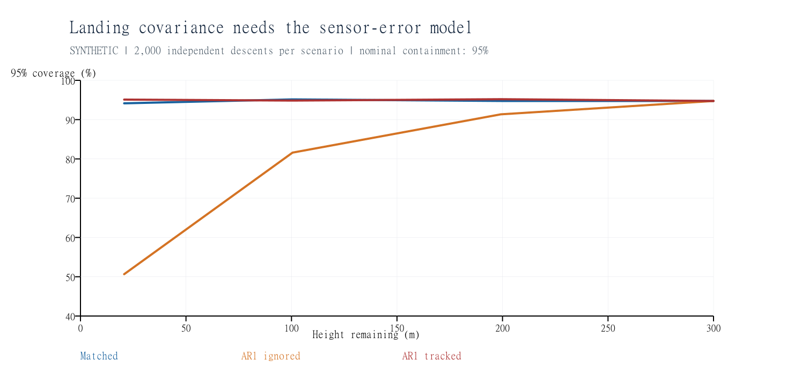
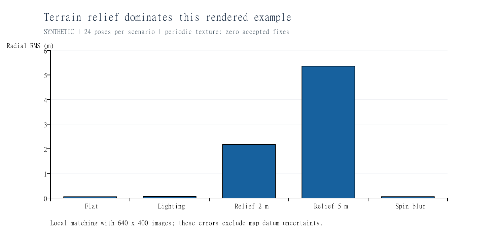
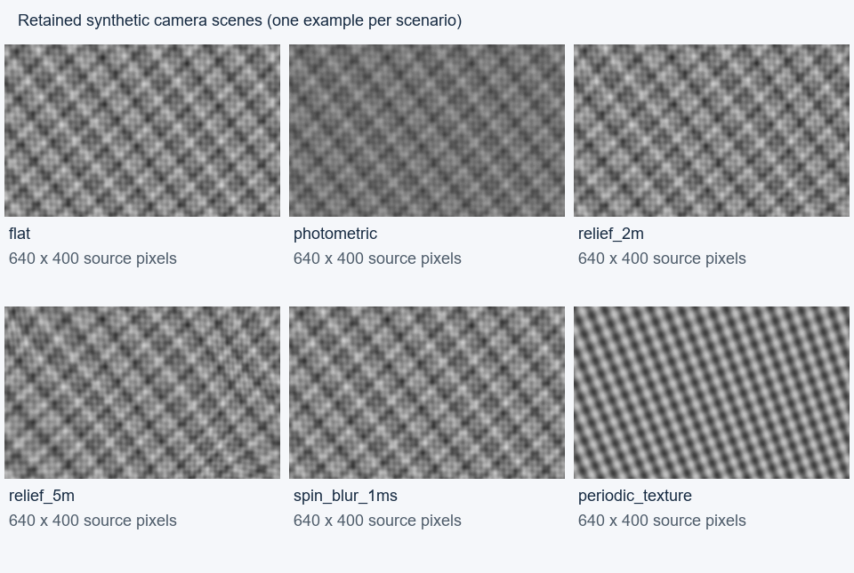
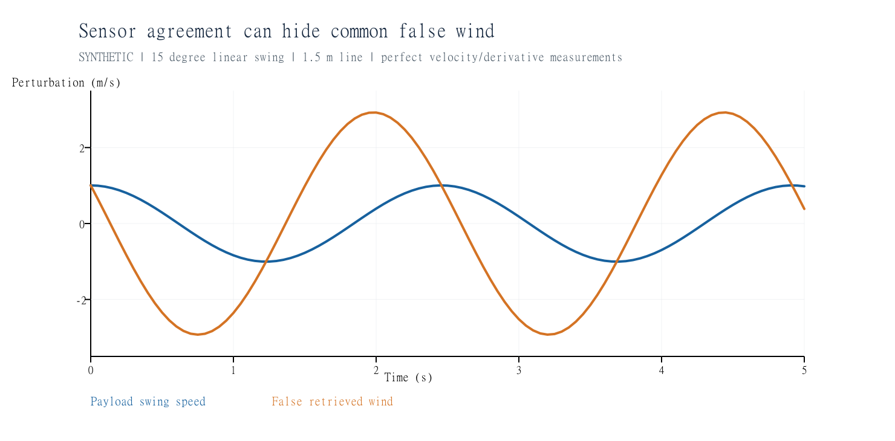

# Mathematical simulation and feasibility audit

1 October 2026. All physical results below are **simulated**, unless explicitly labelled as measured host timings. No flight measurements were available.

The tested mathematics is consistent under its stated models. The core estimation calculations are small enough to be credible CanSat candidates, and an excessive-memory reference matcher has been fixed. **Real-flight feasibility is not established:** canopy/suspension response, terrain/map errors, correspondence integrity, sensor timing and compute throughput on the current Raspberry Pi Zero 2 W remain unmeasured. The independent models are not a complete image-to-navigation-to-wind flight pipeline. Current component choices and the distinction between current design targets and unverified performance are recorded in the [design baseline](design_baseline.md).

## Scope and provenance

This audit reports the scope and evidence available when the supplied attachment was reviewed on 1 October 2026. At that time, no flight-software implementation was in scope. The project has since added candidate navigation and link code; those later files do not change the historical test results in this report. This folder is not a Git checkout. The connected CANSAT 2027 folder was listed; Control Systems and Design Reviews remain empty. Its regulations are explicitly for 2025-2026, so they were treated as historical context.

The attachment `C:\Users\b_yee23\Downloads\type_shit.pdf` contains 52 pages and 249 numbered equations, organised into 56 mathematical families in the new registry. Its SHA-256 is `771cacde831131c4eb60a0775d704e0fc8e07d724ce8a554c35a573d61fd1a4f`. Source extraction is retained. Selected rendered pages confirmed equation signs and the transfer-function typo. This is not a claim of complete typography review or successful recompilation of the local LaTeX source.

The [equation coverage table](../sim/maths/results/attachment_audit/equation_coverage.csv) maps **every numbered equation** to its PDF page, mathematical family, executable checks, experiment and restrictions. Numbered proof steps and empirical definitions are covered by representative family checks; the table does not claim 249 independent experiments or prove a general theorem from finite tests. Unnumbered storage, queue, load, swing and timing arithmetic is also exercised.

The original proposal and supplied 52-page PDF were preserved and audited as historical sources. The editable standalone LaTeX source now carries current BOM context while retaining its historical derivations, stated inputs and numerical results. The mathematical correction below is recorded here rather than silently rewriting the proposal or attachment PDF. See [cansat_mathematics.tex](cansat_mathematics.tex) for the editable source and [design_baseline.md](design_baseline.md) for the current hardware baseline.

## Corrections and contradictions

1. **Transfer-function notation, PDF page 34 / section 6.4.** The prose numerator reads `(1 + sqrt(3), i omega)`. The state-space resolvent gives `(1 + sqrt(3) i omega)/(1 + i omega)^2`. The comma is erroneous. A new test compares the corrected expression with `C(i omega I-F)^(-1)B` at five frequencies and verifies its squared modulus against the stated spectrum. The covariance realization itself is correct.
2. **Previously reported compilation failure is historical.** The current editable LaTeX source compiled successfully with the desktop editor's compiler on 13 October 2026. The supplied attachment PDF is a separate historical snapshot and its embedded note about unavailable layout review predates this compilation.
3. **The previous suite did not simulate image matching.** This audit adds a ray-based image renderer, local rectification, NCC, joint subpixel peaks and pose refinement. It still does not establish first-fix reliability over real maps or implement the complete nonlinear flight ESKF.
4. **Reference NCC normalization was not practical at coarse search sizes.** It materialized a centered array of all candidate windows. For a 364 x 364 search image and 64 x 64 template, that array alone needs 2,968,813,568 bytes. Integral-image normalization now keeps memory proportional to the search image. FFT padding uses power-of-two sizes. Constant or invalid patches are rejected.

## Executed verification

**76 tests pass**, up from 46. Added checks cover 15-state ESKF dynamics against nonlinear finite differences; covariance discretization against an independent ODE; vector Gaussian updates with shared noise; pose recovery; optical flow; photometric nuisance elimination; thermodynamic sensitivities; forced pendulum response; Taylor-Goldstein transformation algebra; neutral roughness fitting; continuous-layer quadrature; covariance cross terms; time change of Brownian noise; and radio/energy/load arithmetic.

A small TLS example exercises an analytically constructed PSD dual slack and a zero-cost feasible primal candidate. It verifies the document's numerical certificate conditions for that special noiseless case. There was no general noisy SDP solve, exact-arithmetic certificate, or onboard certification benchmark. Existing exhaustive finite-switch robust-registration and greedy-selection tests remain in place.

The original 2,000-descent scenarios were rerun into a separate `baseline/` directory. Their complete scenario dictionaries equal the original results exactly, including lag mismatch, coloured-error misspecification and its remedy. Original results were not overwritten. Matched vision-labelled velocity retrieval again gives 0.2085 m/s mean component RMS in sampled 20 m layers. At 100.5 m the original nominal 95% landing coverage is 95.15%; ignoring AR(1)=0.85 lowers it to 81.60%; tracking that error restores 94.85%.



## Rendered-image experiments

Six paired scenarios use 24 independent poses each, at 80, 150 and 300 m. Camera images are 640 x 400, focal length 320 px. This is a historical synthetic renderer input that preserves the proposal's assumed angular field of view at half its proposed 1280 x 800 pixel dimensions; it does not model the current IMX296 1456 x 1088 sensor or selected lens. The renderer intersects rays with an analytic height field; the matcher independently assumes a flat plane. The map and images share a continuous procedural radiance field, not a satellite map or representative farmland. A 2-gray-level noise SD is assumed.

Nine landmarks are attempted in each scene. Local 32 px templates use 0.5 m map pixels and a +/-8 m search; the separate benchmark uses the proposal's +/-16 m fine window. Peaks require score >0.5, an isolated interior concave quadratic fit, and a >0.04 gap to competitors outside a 3-pixel exclusion radius. Those are demonstration thresholds, not calibrated flight gates. Original-image pixel observations then feed a local six-parameter pose fit. There is no coarse acquisition, RANSAC stage or temporal navigation feedback in this experiment.

| Scenario | Accepted pose fits | Radial position RMS | Local nominal 95% containment |
| --- | ---: | ---: | ---: |
| Flat surface | 24/24 | 0.049 m | 24/24 |
| Photometric gain 0.65 and offset 30 | 24/24 | 0.065 m | 24/24 |
| Unmodelled relief amplitude 2 m | 24/24 | 2.170 m | 16/24 |
| Unmodelled relief amplitude 5 m | 24/24 | 5.359 m | 8/24 |
| 1 rev/s spin, 1 ms exposure | 24/24 | 0.051 m | 24/24 |
| Repeating 8 m texture | 0/24 | Undefined | Undefined |

Relief amplitude is the sinusoidal elevation amplitude, not RMS elevation. The worst 5 m-relief trial had 9.06 m error. Local covariance assumes a 0.5 px observation SD and correct planar correspondences; it excludes datum, terrain and photometric-model uncertainty. The flat result's tiny error and conservative covariance do not predict flight accuracy. Terrain residuals and resampling are shared between landmarks. At 24 trials, 95%-coverage sampling uncertainty alone is about 4.45 percentage points; pose epochs are not extra independent drops.

The periodic gate rejects ambiguous matches rather than falsely declaring a fix. That demonstrates one failure detector on one texture family; it does not bound false matches in general.





## Navigation and atmospheric uncertainty

A separate matched linear-Gaussian 15-state ensemble uses 1,000 independent synthetic descents, 100 Hz propagation and 5 Hz observations. Perfect known landmark correspondences stop below 80 m, where an assumed independent 0.6 m/s horizontal velocity channel replaces them. Barometer SD is 0.5 m. Process-noise densities, prior uncertainties and observation assumptions are recorded in the runner. This checks the local error equations; it does not couple the rendered matcher to a nonlinear ESKF or establish real VO error independence.

Across five comparable epochs, full-state mean NEES is 14.71-15.09 versus the model expectation 15; the standard error is 0.173. Horizontal 95% containment is 94.1-95.4%. Near the final 0.12 m sample, horizontal RMS is 0.832 m after absolute map updates have stopped. The model has no map datum or association faults, so these are internal consistency results.

The new atmospheric experiments retain their input draws and produce:

- **Shared suspension bias:** a linear 15-degree swing on a 1.5 m fixed-pivot line produces 2.059 m/s instantaneous false-wind RMS under the isotropic inverse, with perfect velocity and derivatives. Both sensors share the motion, so their difference is exactly zero. This demonstrates a common-mode failure; it is not a measured swing or a claim that 20 m averaging retains the full instantaneous bias. Flexible suspension correction must account for reference-point translation as well as image rotation.
- **Roughness uncertainty:** 20,000 neutral-profile draws with true roughness 0.1 m, known heights/displacement and correlated wind errors (AR1=0.8, SD=0.15 m/s) give a 2.5%-97.5% estimated-roughness range of 0.0143-0.3237 m. A precise-looking single fit does not establish the surface roughness.
- **Weak-shear Richardson uncertainty:** for assumed temperature difference 0.1 +/-0.05 K across 20 m and component wind-difference errors of 0.2 m/s, a 0.1 m/s true shear difference gives sampled Ri quantiles 0.030, 0.997, 31.324. Near-zero denominators create heavy tails. These are sample quantiles, not a stable Gaussian SD or a validated 0.25 classification. With a 1 m/s difference the corresponding range is 0.00035-0.209.
- **Touchdown time:** 20,000 independent draws at height 300 +/-0.5 m and downward speed 10.5 +/-0.3 m/s give time SD 0.8189 s, versus linear propagation 0.8177 s. The sample central 95% interval is 27.04-30.25 s. This excludes deployment and vertical-wind uncertainty.
- **Thermistor response:** in the specified 0.008 K/m ramp, 1 s response at 10.5 m/s gives 10.5 m spatial lag and about -0.084 K bias after 10 s. Response time must be measured in the actual airflow; differentiating to deconvolve it also amplifies noise.
- **Covariance-model identification:** among six fixed candidate priors, 1,000 synthetic velocity profiles generated by the transverse attached-scale model selected that exact model only 223 times by maximum likelihood. All candidate parameters were fixed; this is neither a Bayes factor nor a claim about fitted weather. One noisy short descent weakly distinguishes these priors even in a favourable known-parameter comparison.



## Processing, memory and supporting budgets

The following timings were **measured on this Windows host**. Older study notes compared them against an Orange Pi H618 target; that target is historical and is not the current BOM compute platform (Raspberry Pi Zero 2 W). Twenty warmed repetitions per shape were retained. Multiplying the median by the landmark count estimates serial correlation time only; it is not a complete frame latency or a concurrent-worker benchmark.

| Stage | Search/template | Median per correlation | Serial landmark estimate | Traced temporary peak | Old centered-window array |
| --- | --- | ---: | ---: | ---: | ---: |
| Fine | 96 x 96 / 32 x 32 | 0.552 ms | 27.6 ms for 50 | 0.500 MB | 34.61 MB |
| Coarse | 364 x 364 / 64 x 64 | 19.36 ms | 290 ms for 15 | 7.70 MB | 2,968.81 MB |

Temporary peaks use Python/NumPy allocation tracing, not total resident memory. Earlier host timings differed significantly; contention and timing variability matter. These figures exclude rectification, camera capture, logging, filtering, telemetry and target selection. The former 150-250 ms full-frame estimate was an unverified H618-era estimate; it is not a Pi Zero 2 W result. Benchmark the complete current pipeline on the Raspberry Pi Zero 2 W before claiming the 5 Hz target.

At 5 Hz, a deterministic single-worker 250 ms service model accumulates **7.45 s wait** by the last of 150 frames, with 7.70 s final latency. Two independent 250 ms workers have no wait in the ideal schedule; shared resource contention is not modelled. Exactly 200 ms has zero margin, even if a constant-service simulation shows no backlog. A bounded queue and explicit dropped-frame policy are required.

The historical illustrative eight-bit 1280 x 800 stream is 5.12 MB/s and 153.6 MB for 30 s. These values do not describe the current native 1456 x 1088 sensor stream; derive current storage and bandwidth from the selected capture format, frame rate and measured compression. A 0.5 s write stall alone needs 2.56 MB buffering, plus any existing backlog. Recovery requires sustained writes above the input rate.

The illustrative 40-byte, SF7, 125 kHz, explicit-header, CRC, coding4/5 LoRa configuration (not a statement of the selected E22 module's configured air interface) takes 82.176 ms, or 8.2176% occupancy at 1 Hz. If an **assumed** 1% airtime budget applied, its minimum interval would be 8.2176 s before retries. SF11 and SF12 packets exceed 1 s and cannot physically sustain one packet per second on a single transmitter. No frequency plan or current regulatory compliance is asserted. Battery energy, peak-current, free-space loss and inertial-load identities are tested, but actual battery, radio, structure and canopy limits need measured inputs.

## Feasibility judgement and decisions

| Workstream | Established | Still needed |
| --- | --- | --- |
| Wind Kalman/RTS and batch retrieval | Algebra, covariance, initial-condition handling and matched calibration | Measured lateral lag, common suspension motion, velocity covariance |
| Local camera matching and pose refinement | Executed on synthetic images; scalable NCC implemented | Real imagery, DEM, datum, lighting/season changes, coarse first fix |
| ESKF mathematics | Nonlinear derivative and 15-state covariance checks | Full nonlinear implementation, timestamp/calibration errors, image coupling |
| Atmospheric stability/roughness | Uncertainty propagation and identification limits quantified | Thermistor calibration, flux/profile assumptions, mast representativeness |
| Safe-target demonstration | Expected-cost/control-bound identities and a half-plane case | Finite real hazard raster, boundary cases; no passive-canopy divert claim |
| Robust registration certificate | TLS lift and special analytic primal/dual case | General noisy SDP solve and measured cost; keep offline until justified |
| Compute/storage/radio/power | Memory defect fixed and parametric budgets executed | Complete Pi Zero 2 W throughput at the 5 Hz target, actual settings, endurance and load tests |

No flight architecture, turbulence law, terrain model, canopy design or regulatory requirement was adopted or replaced. Historical H618/OV9281/1280 x 800/90-degree camera studies and calculations remain preserved as historical model inputs; they must not be read as current BOM selections or performance results. The current BOM uses Pi Zero 2 W, IMX296 at 1456 x 1088 native resolution, BMI088, MS5611, GA10K3MCD1 with ADS1115/OPA333/150 kOhm, E22 and MAX-M10S. The 5 Hz image-processing target remains unverified on the Pi. The recommended option is to keep the small covariance-correct filter as a reference and **calibrate suspension/lateral response before interpreting wind agreement**. Using the uncalibrated isotropic inverse is simpler but allows a common bias much larger than the 0.5 m/s target. DEM-aware modelling or an explicitly propagated terrain-error state/covariance should be compared before treating local reprojection covariance as integrity evidence.

The highest-value next experiment is a synchronised suspension/captive-carry test with known reference-point motion, camera, IMU, barometer and independent velocity truth. Fit lateral lag and pendulum/reference-point motion on one subset, validate on another, and retain rejected matches. The corrected wind model should reduce error against independent air motion, not merely the image-minus-GPS difference. An instrumented replay on the current Pi Zero 2 W with logging and radio active is the next compute gate: measure throughput against the unverified 5 Hz target, queue growth, first-fix latency, dropped frames and memory.

## Reproduction and retained files

Numerical work uses NumPy and the standard library. The optional PDF index uses bundled `pypdf`. Plotting uses already-bundled ReportLab/Pillow; SVG-to-PNG conversion used already-bundled `sharp`. Nothing was installed.

From the project root, with a Python environment containing NumPy and pypdf:

```text
python -m unittest discover -s sim/maths -p "test*.py" -v
python sim/maths/run_feasibility.py --source-pdf "C:\Users\b_yee23\Downloads\type_shit.pdf"
python sim/maths/plot_feasibility.py
python sim/maths/check_feasibility_outputs.py
```

`--skip-baseline` reuses an existing baseline snapshot for independent reruns. Host timings legitimately vary. Original numerical evidence remains in `sim/maths/results/`; new evidence is in `sim/maths/results/attachment_audit/`.

New/modified sources: `models.py` (NCC memory fix), `feasibility.py`, `test_feasibility.py`, `equation_coverage.py`, `run_feasibility.py`, `plot_feasibility.py`, `check_feasibility_outputs.py`. Report, README and `BOTS/PLANS/STATUS.md` / `DECISIONS.md` document the handoff.

Retained evidence includes `summary.json`, the complete test log, 249-row equation coverage, 144 image trial records, all 1,296 attempted/rejected landmark records, all 24 scene poses and image-noise arrays, representative rendered frames, five full-state ensemble snapshots and 5 Hz error histories, atmospheric Monte Carlo inputs, covariance-model scores and observations, individual benchmark timings, queue traces, radio sweep, baseline rerun, plots and a SHA-256 manifest. These files contain synthetic values or host timing measurements; no flight data was fabricated.

## Primary references checked

- [Lewis, Fast Normalized Cross-Correlation](https://www.ncorr.com/download/publications/lewisfast.pdf): integral-image normalization in sections 4-5 supports the implemented memory correction.
- [Sola, Quaternion kinematics for the error-state Kalman filter](https://arxiv.org/abs/1711.02508): conventions and ESKF derivations; this audit uses the document's right/local error convention.
- [Semtech SX1276/77/78/79 datasheet, section 4.1.1.7](https://cdn.sparkfun.com/assets/7/7/3/2/2/SX1276_Datasheet.pdf): airtime accounting and low-data-rate optimization.
- [Connected historical regulations](https://drive.google.com/file/d/1LubKeC729i9NbmgHwG-wzu4gwhDO1PfJ/view): 2025-2026 context only. Drive files were read, not changed.
