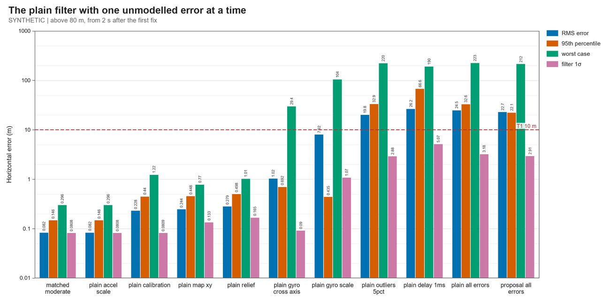
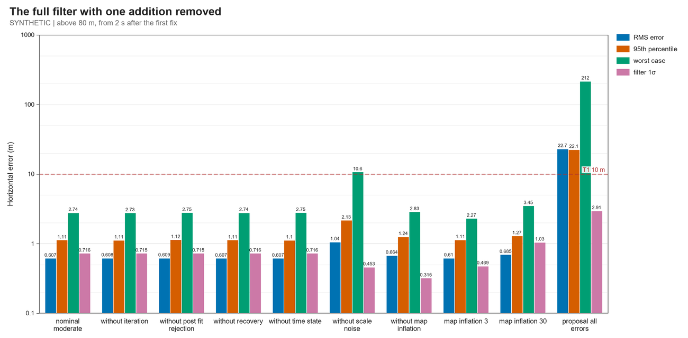
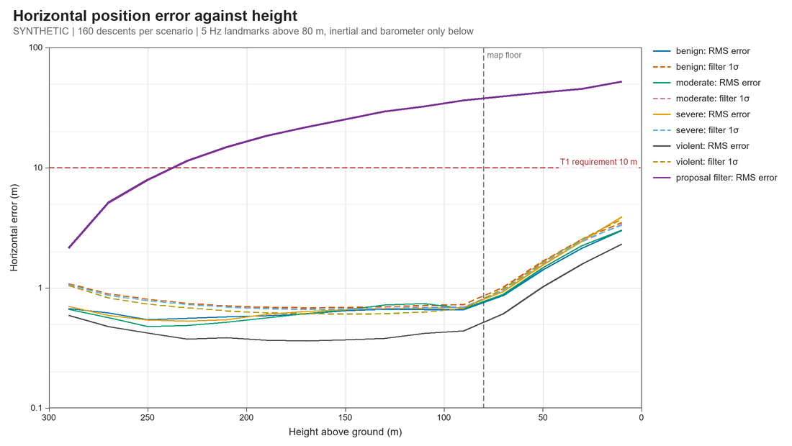
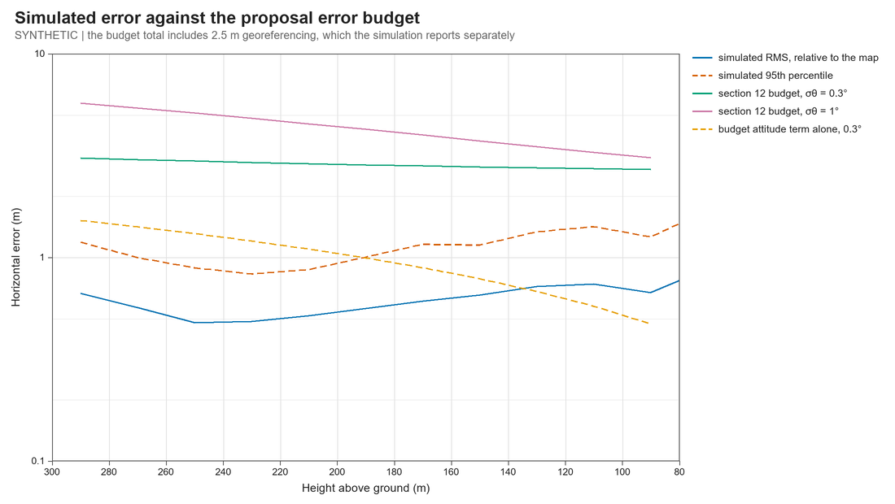

# Closed-loop navigation simulation (Phase 0)

9 October 2026 study; status cross-checked 13 October 2026. Everything here is **simulated**. No flight, drop, captive-carry or bench data exist, and no real imagery was matched. Numbers describe the models in `sim/nav/` and the filter in `code/cansat/eskf.py`, not the CanSat. The current hardware baseline is [design_baseline.md](design_baseline.md), with component detail in the authoritative [flight computer BOM](flight_computer_bom.md). This run used the then-current Pi Zero 2 W, BMI088, MS5611 and IMX296 camera selection; it simplified the selected Edmund #34-711 lens to a pinhole after ideal undistortion. That optical model is an assumption, not a calibration of the flight camera stack.

This is the October "filter in simulation" milestone of the [mission proposal](trn_secondary_mission_proposal.md) (section 21) and the piece the [1 October audit](mathematics_simulation_audit.md) listed as missing: a nonlinear navigation filter run in closed loop against a simulated parachute descent, with a Monte Carlo that scores it against T1 and T2.

**Scope of proposal comparisons:** whenever this 9 October report compares a filter, canopy, landmark count or error-budget shape with "the proposal", it means the 27 September source snapshot preserved at [history/trn_secondary_mission_proposal_2026-09-27.md](history/trn_secondary_mission_proposal_2026-09-27.md), not the revised live proposal. The live proposal now retains T1's 10 m/5 s target, specifies the hardened 17-error-state filter, removes the required attitude/map crossover shape from T2, and leaves canopy choice open. The comparisons below are historical study evidence and have not been recomputed or regraded against that revised mission interpretation.

## Summary

1. **The navigation filter as the proposal describes it does not survive realistic errors.** One EKF update per image with a χ² gate per landmark reached 23 m RMS with the baseline error set, and only 92.5 % of descents stayed within T1's 10 m. A 1 ms camera delay alone made it lose lock in a quarter of descents. The failure is always the same: the filter becomes overconfident, its gate then rejects good landmarks, and it drifts.
2. **With six additions the same error set gives 0.6 m RMS, 2.7 m worst case and every descent within 10 m** (none lost in 160 per class), across four canopy behaviours including 19° RMS swing, and the filter's stated uncertainty covers its errors. The additions are in `code/cansat/eskf.py`: an iterated update, post-fit rejection, prior recovery, a camera time-offset state, rate-dependent gyro noise, and an allowance for a landmark's map error repeating from frame to frame.
3. **That figure is error relative to the map.** A rigid map offset passes straight into position (2.5 m in, 2.6 m out) and the filter cannot see it, so the georeferencing survey in proposal section 9 decides the absolute result.
4. **The proposal's error budget has the wrong shape.** One image fixes tilt to 0.03° at 300 m when landmarks span the field of view, so attitude never dominates. Simulated error is flat at 0.5–0.7 m from 300 m to 80 m and is set by landmark map and height error. T2 predicts a crossover near 290 m; the simulation does not show one. T2's wording needs a decision.
5. **Landmark height matters most among the things we control.** Taking landmark heights from the 1 m LiDAR surface model (0.3 m error) gives 0.44 m RMS; 5 m of unmodelled hedge and tree height gives 1.8 m and a filter that is wrong about its own accuracy 56 % of the time.
6. **The simulated processing load can be cut about fourteenfold from this run's baseline, thirtyfold from the proposal's 50 landmarks at 5 Hz.** Eight landmarks at 1 Hz still gives 1.0 m RMS and 5 m worst case. Correlation matching took 0.19 s per image for 21 landmarks on a laptop using rendered synthetic imagery. Neither this matcher nor acquisition has been timed on the Pi Zero 2 W; the Pi feasibility conclusion therefore remains open.
7. **A first fix with unknown yaw works geometrically:** from 16 coarse matches with 30 % wrong, the new solver fixed on the first image in 96 % of descents and within 5 s in all, to 1.7 m RMS. It needs at least 8 good matches. What it does not solve is getting those matches: the correlation matcher tolerates only 5–10° of yaw error, so an unknown-yaw first fix needs about 36 yaw hypotheses or the optional magnetometer.
8. **Coherent false matches are the remaining unsolved failure.** Random mismatches are handled up to 20 %, and at 40 % cost 2 descents in 160. Five of 30 landmarks sharing one 8 m shift put half of descents beyond 10 m, and in the image-in-the-loop base run of the one draw that started 9.6 m out the matcher returned 17 false matches of 17 and the filter locked on 26 m away while reporting 0.9 m.
9. **Canopy glide, not swing, threatens the wind science.** A canopy that trims at 12° angle of attack glides at 1.9 m/s and produces 1.3 m/s of false wind per axis in 20 m layers, against the 0.5 m/s target; at 25° it is 3 m/s. It is identical in image-derived and GPS-derived winds, so S1's comparison cannot detect it. A stable canopy gives 0.03 m/s. The canopy choice needs a decision.

Sections 3–9 give the evidence, section 10 the decisions and recommendations, section 11 the limits.

## 1. What was built

| File | What it is | Checks |
| --- | --- | --- |
| `code/cansat/eskf.py` | The candidate flight filter: 17-state error-state Kalman filter (position, velocity, attitude, accelerometer and gyro bias, barometer bias, camera time offset), NumPy only | `code/tests/test_eskf.py`, 21 tests |
| `code/cansat/firstfix.py` | Pose from one image with unknown yaw (2-point consensus, then 6-DoF refinement) to start the filter | `code/tests/test_firstfix.py`, 20 tests |
| `sim/nav/truth.py` | Batch multibody descent: canopy with apparent mass and an angle-of-attack force law, inextensible line, rigid can; log-law wind with drop-Dryden turbulence; IMU output from rigid-body kinematics | `sim/nav/test_truth.py`, 11 tests |
| `sim/nav/run_nav_mc.py` | Monte Carlo: 109 scenarios, 160 descents each, four canopy classes | `sim/nav/test_nav_mc.py`, 16 tests |
| `sim/nav/fix_bounds.py` | Single-image Cramér–Rao bounds and the section 12 budget, evaluated | in `test_nav_mc.py` |
| `sim/nav/ncc_attitude_tolerance.py` | How much yaw, tilt, height and position error the correlation matcher tolerates | `test_ncc_attitude_tolerance.py`, 8 tests |
| `sim/nav/image_in_loop.py` | Descents with rendered images and real correlation matching feeding the filter | `test_image_in_loop.py`, 15 tests |
| `sim/nav/characterise_descent.py` | Swing, glide and false-wind statistics of the descent model, 30 configurations | results only |
| `sim/nav/test_independent_checks.py` | Independent re-derivations written by separate reviewers | 53 tests |
| `sim/nav/analyse_nav_mc.py`, `plotting.py` | Tables and figures (Pillow; matplotlib is not available here) | `test_plotting.py`, 36 tests |

Results are in `sim/nav/results/`; the full scenario tables are in [`results/nav_mc/tables.md`](../sim/nav/results/nav_mc/tables.md). Truth batches and raw per-descent records are regenerated under `sim/nav/generated/` (git-ignored, about 1 GB).

To reproduce, from the project root with the KiCad-bundled Python (NumPy and Pillow only):

```text
python sim/nav/run_nav_mc.py --descents 160 --workers 8
python sim/nav/fix_bounds.py
python sim/nav/analyse_nav_mc.py
```

The full run takes about an hour on the project laptop. A rerun agrees to the digits quoted here but not bit for bit: threaded linear algebra changes rounding in the last place, which occasionally flips a borderline gate decision (a partial rerun of 18 scenarios changed no figure by more than 0.3 % of its value).

## 2. Models and inputs

### Hardware represented in this dated run

The simulation represented the then-current [BOM](flight_computer_bom.md), not the proposal's earlier hardware: Pi Zero 2 W, Sony IMX296 at 1456 × 1088 with 3.45 µm pixels, Bosch BMI088 and TE MS5611. It treated the selected 2.5 mm Edmund #34-711 lens as an ideal pinhole after undistortion (focal length 724.6 px, 90° × 74°). Current optics also include the #53-675 C-to-M12 adapter; lens distortion, focus and camera-to-IMU alignment still require measurement and calibration. Orange Pi H618 and OV9281 figures below are historical proposal context only.

### Inputs and where they come from

| Input | Value used | Basis |
| --- | --- | --- |
| Gyro noise density | 0.014 °/s/√Hz | Sourced: [BMI088 datasheet](https://www.bosch-sensortec.com/media/boschsensortec/downloads/datasheets/bst-bmi088-ds001.pdf) rev 1.9, table 5, typical |
| Accelerometer noise density | 175 µg/√Hz | Sourced: Bosch product page, typical. The datasheet gives 160 (x, y) and 190 (z) µg/√Hz at ±3 g and nothing at ±24 g |
| Accelerometer offset | 20 mg, 1σ | Sourced: datasheet table 4, typical zero-g offset |
| Gyro offset | 0.1 °/s, 1σ | Assumed residual after averaging on the pad. Datasheet typical before calibration is ±1 °/s |
| Gyro scale and cross-axis error | 0.3 % and 0.2 %, 1σ | Assumed after a turntable calibration. Datasheet typical before calibration is ±1 % and ±1 % |
| Barometer noise | 0.15 m per 10 Hz sample | Assumed, above the sourced figure: [MS5611 datasheet](https://www.te.com/commerce/DocumentDelivery/DDEController?Action=showdoc&DocId=Data+Sheet%7FMS5611-01BA03%7FB3%7Fpdf%7FEnglish%7FENG_DS_MS5611-01BA03_B3.pdf%7FCAT-BLPS0036) gives 0.012 mbar RMS at OSR 4096, about 0.10 m |
| Barometer bias | 1 m, 1σ, slow walk | Assumed (pad drift, port position error) |
| Camera timing | 1 ms constant delay, unknown to the filter | Assumed. The camera documentation gives only a fixed +14.26 µs exposure offset; trigger latency is undocumented |
| Match precision | 0.3 px floor plus 0.15 m on the ground | Assumed; cross-checked against correlation matching on rendered synthetic images in section 9, not real imagery |
| Bad matches | 5 %, uniform within ±16 m | Assumed |
| Landmark map error | 0.3 m horizontally, 1 m in height, fixed per landmark | Assumed. For scale: OS MasterMap imagery quotes 1.1 m RMSE absolute, Environment Agency 1 m LiDAR ±0.15 m RMSE in height, and most English hedgerows are 1–6 m tall (UKCEH) |
| Lens calibration residual | 0.1 % focal length, 0.5 px principal point, 0.05° camera-to-IMU | Assumed |
| Landmarks | one per 40 m of ground, up to 30 per image spread over a 6 × 5 image grid, usable only if the matcher's 48 m search patch is inside the image | Assumed; the patch rule comes from section 9 |
| First fix | 3 m, 1°–2°, 2 m/s (1σ) | Assumed; section 7 replaces it with the solver |
| Canopy, line, masses | 0.31 kg can, 0.45 m line, 10.5 m/s, four stability classes | Historical model assumptions for this run; the current budget expects 335 g and recommends targeting about 11 m/s after drop calibration. No descent figures here were recomputed for that updated mass or target; see [mass, power and descent budget](mass_power_budget.md) and the later [wind-retrieval study](wind_retrieval_end_to_end.md) |
| Wind | 5 m/s at 10 m log law, 1 m/s turbulence, eddy scale 0.5 z | The proposal's Appendix I model with the earlier studies' values |

The full extraction with page references and evidence codes is in [navigation parameter sources](navigation_parameter_sources.md). The current BMI088 replaces the former ICM-42688-P choice; the ICM noise comparison in §6 is a sensitivity case, not a current BOM option.

### The descent model

A point canopy that only has drag cannot swing: with our masses the pendulum mode is overdamped (a hand calculation gives a damping ratio of about 2), because the canopy is far lighter than the can and is dragged sideways by it. Real round canopies swing because their normal force is destabilising at small angle of attack. The model therefore gives the canopy an axis (the line) and a normal-force law with a trim angle. The law is a generic shape chosen to produce a family of motions. It is not a model of our canopy and its parameters are unvalidated.

Four classes are used. Their names say how hard they were expected to be, not what they turned out to do (measured over 48 descents each, section 8):

| Class | Canopy | Swing RMS / 95 % / max | Body rate RMS | Glide |
| --- | --- | --- | --- | --- |
| benign | restoring | 4.3° / 7.8° / 19.5° | 34 °/s | none sustained |
| moderate | unstable below 12° | 6.0° / 13.1° / 23.0° | 28 °/s | 1.9 m/s |
| severe | unstable below 25° | 4.6° / 8.0° / 15.5° | 23 °/s | 4.4 m/s |
| violent | weakly restoring, shaken by a random side force | 19.2° / 32.8° / 53.2° | 99 °/s | 1.4 m/s |

Only the violent class swings as much as published drop tests of round canopies (22–27° average on a 3.6 m canopy, 10–25° with shorter lines; Tutt, AIAA 2013-1384). No measurement was found for canopies of our size.

The can is a rigid body hung from its top, so it has its own wobble on top of the pendulum mode, and spins under a random torque. The IMU sits off the centre of mass and its output is computed from the rigid-body motion, so the simulated accelerometer shows the proposal's F.4 effect (specific force along the line, blind to swing) without it being assumed.

### What the filter is and is not told

The filter is given the IMU, a barometric height at 10 Hz and, at 5 Hz above 80 m, pixel positions of map landmarks. It is never given GPS. It is not told the camera delay, the scale-factor and cross-axis errors, the lens calibration residuals, or each landmark's map error; those are the "unmodelled" errors in what follows. Below 80 m it has no landmarks and coasts on the IMU and barometer; the proposal's visual odometry is not implemented.

Landmark measurements in the Monte Carlo are generated from geometry and an error model. Section 9 checks that model against real correlation matching on rendered images.

## 3. Verification

**The descent model obeys the physics it should.** On an immovable pivot with no air it conserves energy, vertical angular momentum and line length to better than 1e-8 over 3 s of tumbling. It reproduces the simple-pendulum period to 2e-4, the stated descent speed to 0.2 %, and a one-dimensional release from rest. A separately derived Lagrangian double pendulum agrees with it to 1.5e-7 rad and 1.4e-6 rad over 2 s from a large-angle start, and an independent minimal-coordinate model of the free canopy agrees to 5e-9 m in still air.

**The simulated IMU is consistent with the simulated motion.** Its output matches the differentiated trajectory to 1.5e-7 m/s² and 1.2e-7 rad/s during vigorous swing and spin. Fed to the filter's own strapdown with no noise, it reproduces the trajectory to 1e-8 m/s and 1e-9 in attitude over 10 s.

**The filter's algebra is right.** Its error transition agrees with the proposal's Appendix H.1 equations to second order in the time step on every path. All landmark Jacobian columns match finite differences, including the time-offset column. The posterior covariance equals the information form to 3e-10. The iterated update lands within 0.02σ of an exact maximum-a-posteriori solve after corrections of up to 12°.

**The closed loop is statistically consistent when the filter's model matches the simulation.** This is the main check, because it exercises the nonlinear descent model, the sensor wiring and the filter together.

| Canopy | Horizontal RMS | Filter 1σ | Mean NEES (16 expected) |
| --- | ---: | ---: | ---: |
| benign | 0.085 m | 0.084 m | 16.29 ± 0.25 |
| moderate | 0.082 m | 0.081 m | 16.38 ± 0.25 |
| severe | 0.084 m | 0.082 m | 16.35 ± 0.24 |
| violent | 0.062 m | 0.061 m | 16.39 ± 0.27 |

Each is within 1.6 standard errors of 16. The four classes share sensor-noise draws, so the common +0.3 is one sample, not four. Position NEES is 2.04–2.10 against 2, and the 95 % protection level is exceeded in 3.6–4.0 % of epochs. A reviewer's separately built matched world gave 16.7–17.5 against 17 for the same filter.

**Two defects were found by the independent checks and fixed.** An iterated update reset its covariance twice, a 10–20 % covariance error after an 8° correction. Prior recovery fired on a single image of mostly bad matches and let them in (24 m error at 60 % mismatches against 1.9 m without recovery); it now waits for three starved images in a row and keeps the result only if most landmarks then agree. One crash was found by the Monte Carlo and fixed: the first-fix solver raised an exception when a trial pose put a landmark in the camera's own plane.

## 4. The proposal's filter is not robust

The proposal (sections 8 and 11, Appendix H) specifies an error-state EKF with one update per image and a χ² innovation gate on each landmark. Started 3 m and 1°–2° from the truth, as after a first fix:

**With no unmodelled error at all it is already overconfident.** In the descents inspected, one first-order update from that start left 1–2 m of error while claiming 0.2 m. Mean NEES is 24–29 against 16, and in 1 of 160 descents (benign and moderate classes) the gate then locked out good landmarks and the solution drifted to 42 m and 53 m. Started inside the linear regime it is consistent (NEES 16), so this is linearisation, not arithmetic.

**Each realistic error, added alone, breaks it.** Iterated update, no other additions, moderate canopy:

| Unmodelled error added | Horizontal RMS | Worst | Descents within 10 m | Epochs beyond the 95 % protection level |
| --- | ---: | ---: | ---: | ---: |
| none | 0.08 m | 0.3 m | 100 % | 4 % |
| accelerometer scale 0.3 % | 0.08 m | 0.3 m | 100 % | 4 % |
| lens calibration residual | 0.23 m | 1.2 m | 100 % | 56 % |
| landmark map error 0.3 m (variance told, repetition not) | 0.24 m | 0.8 m | 100 % | 36 % |
| landmark height error 1 m (variance told, repetition not) | 0.28 m | 1.0 m | 100 % | 33 % |
| gyro cross-axis 0.2 % | 1.02 m | 29 m | 98.8 % | 43 % |
| gyro scale 0.3 % | 7.9 m | 104 m | 95.6 % | 15 % |
| 5 % random mismatches | 19.8 m | 220 m | 91.2 % | 21 % |
| camera delay 1 ms | 26.2 m | 190 m | 75.0 % | 28 % |
| all of them | 24.5 m | 223 m | 91.9 % | 71 % |
| all of them, single update (the proposal) | 22.7 m | 212 m | 92.5 % | 71 % |



The mechanism is the same each time. With 20–30 landmarks at a few tenths of a pixel the filter believes its attitude to 0.02°. A 1 ms delay at 50 °/s is 0.05°, a 0.3 % scale error at 60 °/s is 0.04° per image interval, and a mismatch that slips through a wide first-fix gate is metres. Each is larger than the filter thinks possible, so the gate starts rejecting good landmarks, and with fewer landmarks the filter drifts further.

### What was added

| Addition | What it does | Evidence that it matters |
| --- | --- | --- |
| Iterated update | Relinearises the landmark update until it converges | Matched case: NEES 24–29 becomes 16 and the 1-in-160 loss of lock disappears. From a 15 m, 4°–6° first fix with every error on: 100 % of descents within 10 m from the first image with it, 88.8 % without (after 2 s both are 100 %, at 0.61 m and 0.64 m RMS). The proposal's filter, with none of the additions, gives 103 m RMS and 44 % |
| Rate-dependent gyro noise | Attitude noise proportional to body rate covers scale and cross-axis error | Without it: 1.04 m RMS, 10.6 m worst, protection level exceeded 34 % of the time |
| Map-error allowance | Landmark map variance ×10, because the same landmark's error repeats every frame | Without it: filter claims 0.32 m while the error is 0.66 m; protection level exceeded 42 % of the time |
| Camera time-offset state | Estimates a constant camera delay from the motion itself | 10 ms delay under violent swing: 0.40 m RMS with it; 1.95 m RMS, 13.5 m worst without |
| Post-fit rejection | Re-tests accepted landmarks against the solution and repeats without the failures | 40 % mismatches: 0.81 m RMS and 98.8 % within 10 m with it; 1.42 m and 88.7 % without |
| Prior recovery | After three images in which most landmarks fail the gate, widens position and attitude and keeps the result only if most landmarks then agree | Uncalibrated gyro the filter was not told about: 2.1 m RMS, 15 m worst with it; 4.6 m and 70 m without |

At the baseline error level only the gyro-noise and map-error allowances change the result; the others matter under the stresses named. Each is switchable in the code, so the proposal's filter remains testable.



## 5. Accuracy against T1 and T2

Full filter, every baseline error on, frames above 80 m from 2 s after the first fix, 160 descents per class:

| Canopy | RMS | 95 % | Worst | Filter 1σ | Within 10 m | Tilt | Yaw | Beyond 95 % protection level |
| --- | ---: | ---: | ---: | ---: | ---: | ---: | ---: | ---: |
| benign | 0.61 m | 1.10 m | 1.8 m | 0.74 m | 100 % | 0.21° | 0.08° | 1.8 % |
| moderate | 0.61 m | 1.11 m | 2.7 m | 0.72 m | 100 % | 0.22° | 0.09° | 3.2 % |
| severe | 0.62 m | 1.10 m | 2.3 m | 0.71 m | 100 % | 0.21° | 0.08° | 3.1 % |
| violent | 0.40 m | 0.72 m | 1.3 m | 0.67 m | 100 % | 0.14° | 0.07° | 0.0 % |
| violent, proposal's filter | 12.5 m | | 169 m | | 90.6 % | | | |

Height error is 0.24–0.28 m RMS. Position NEES is 1.4–1.6 against 2 (0.7 for the violent class), so the filter is slightly conservative. Larger swing did not hurt. A likely reason is that it gives the landmarks more parallax, but that was not isolated.



**T1 (10 m above 80 m) is met with a wide margin in simulation, relative to the map.** A rigid 2.5 m map offset produced 2.59 m RMS error and the protection level was exceeded 99.9 % of the time: the filter cannot observe the datum (the proposal's Appendix L.1 gauge freedom), so the surveyed georeferencing offset must be measured and reported separately, exactly as section 9 of the proposal plans.

**T2's predicted shape is not what the simulation shows.** Section 12 expects attitude to dominate at altitude (1.6–5.2 m at 300 m for 0.3–1° of residual tilt) and the map to dominate low down, with a crossover near 290 m. In the simulation:

- One image alone bounds tilt to 0.03° at 300 m and 0.09° at 80 m, and horizontal position to 0.20 m with attitude unknown against 0.05 m with attitude known (Cramér–Rao, 30 landmarks across the full field of view). Perspective separates tilt from translation far better than the budget assumes.
- In closed loop the tilt error is 0.13° at 290 m and grows to 0.33° at 90 m, because fewer landmarks fit in the shrinking footprint (28 per image at 290 m, 19 at 150 m, 6 at 90 m). Height times tilt error is therefore nearly constant, and horizontal error stays between 0.48 m and 0.74 m all the way down.
- That flat level is set by landmark map and height error, not by attitude or matching precision.



The budget's own crossover formula, h* = σ_map / σ_θ, gives 480–1100 m for a 1.1–2.5 m datum error and the simulated tilt, which is above the flight. The falsifiable prediction the simulation supports is: error relative to the map is flat with height at roughly 0.5–1 m and scales with landmark height error; total error against GPS is dominated by the datum offset at every height. Whether to restate T2 that way is a decision for the team (section 10).

**Consistency (the second half of T2) holds only with the map-error allowance.** With it, the protection level is exceeded 0–3 % of the time against 5 % allowed. The full 16-state NEES is in the hundreds in every baseline run, because scale-factor and calibration errors are absorbed into the bias states; the bias estimates are wrong about themselves while position, velocity and attitude are not. Report position and velocity NEES, not the full-state figure.

**Below 80 m** the filter coasts. Error grows from 0.67 m at 80–100 m to 3.0 m RMS in the last 20 m, and the filter's 1σ grows with it (3.4 m). That is the starting point for T3's landing prediction if visual odometry is not built.

## 6. What drives the error

All with the full filter and the moderate canopy unless stated; baseline is 0.61 m RMS, 2.7 m worst.

### Camera timing

| Case | RMS | Worst | Note |
| --- | ---: | ---: | --- |
| constant delay 0, 1, 2, 5 ms | 0.60–0.61 m | 2.7 m | delay estimated to 0.2–0.4 ms |
| constant delay 10 ms, filter expecting about 2 ms | 0.60 m | 2.6 m | estimated to 1.0 ms |
| constant delay 20 ms, filter expecting up to 20 ms | 0.60 m | 2.7 m | estimated to 1.6 ms |
| constant delay 10 ms, no time-offset state | 0.68 m | 2.8 m | yaw error 0.44° against 0.09° |
| jitter 0–10 ms | 0.61 m | 2.7 m | |
| violent canopy, delay 10 ms | 0.40 m | 1.4 m | same as the 1 ms baseline |
| violent canopy, delay 10 ms, no time-offset state | 1.95 m | 13.5 m | 98.1 % within 10 m; recovery fired in 99 % of descents |
| violent canopy, jitter 0–2 ms | 0.40 m | 1.4 m | |
| violent canopy, jitter 0–10 ms | 0.52 m | 2.5 m | tilt error 0.29° against 0.14° |

The proposal says hardware triggering is mandatory because 10 ms of timing error costs about 2 m at 300 m. In this simulation, with landmarks across a wide field of view, a timing error mostly lands in attitude, and a constant delay is estimated and removed. What remains true: the plain filter cannot tolerate even 1 ms unmodelled (section 4), a time-offset state is needed, and frame-to-frame jitter cannot be estimated, costing attitude accuracy under strong swing. The hardware trigger is still the right design; the requirement on it is a stable delay, not a small one.

Decimating the IMU to one raw sample per 10 ms leaves position unchanged but raises tilt error from 0.14° to 0.51° under violent swing; the time-offset state absorbs most of the half-interval latency (it settles 4.6–5.0 ms from the true camera delay). Averaging 1 kHz samples without coning or sculling compensation costs nothing measurable here.

### Landmark height

| True height error (1σ) | Filter told | RMS | Worst | Beyond protection level |
| ---: | ---: | ---: | ---: | ---: |
| 0.3 m | 0.3 m | 0.44 m | 2.1 m | 2.9 % |
| 1 m | 1 m | 0.61 m | 2.7 m | 3.2 % |
| 2 m | 1 m | 0.83 m | 2.8 m | 9.5 % |
| 2 m | 2 m | 0.80 m | 3.4 m | 2.9 % |
| 5 m | 1 m | 1.79 m | 6.7 m | 55.6 % |
| 5 m | 5 m | 1.20 m | 4.1 m | 2.7 % |

The proposal picks landmarks on field boundaries, hedgerows, copses and buildings, which are exactly the tall features. Giving each landmark a height from the Environment Agency 1 m first-return surface model (±0.15 m RMSE) is the cheapest accuracy gain available, and telling the filter the true height uncertainty is what keeps it honest.

### Field of view and landmark count

| Case | RMS | Worst | Within 10 m |
| --- | ---: | ---: | ---: |
| full image, up to 30 landmarks | 0.61 m | 2.7 m | 100 % |
| central half of the image (about 53°) | 1.42 m | 5.5 m | 100 % |
| central third (about 37°) | 2.48 m | 19.8 m | 96.3 % |
| 12 landmarks | 0.64 m | 3.0 m | 100 % |
| 8 landmarks | 0.68 m | 2.9 m | 100 % |
| 4 landmarks | 0.84 m | 3.3 m | 100 % |
| map with a landmark every 80 m | 0.94 m | 4.0 m | 100 % |
| map with a landmark every 120 m | 1.27 m | 11.8 m | 99.4 % |

This confirms the proposal's Appendix C in closed loop: spread matters far more than count. Eight landmarks reaching the image edges beat thirty in the centre.

### Gyro

| Case | RMS | Worst |
| --- | ---: | ---: |
| BMI088, calibrated (baseline) | 0.61 m | 2.7 m |
| ICM-42688-P noise (five times lower) | 0.61 m | 2.8 m |
| five times higher noise | 0.65 m | 2.4 m |
| uncalibrated (1 % scale, 1 % cross-axis, 1 °/s offset), filter told | 0.96 m | 6.7 m |
| uncalibrated, filter not told | 2.09 m | 14.6 m |

For this run's 5 Hz image cadence, the simulated gyro-noise difference had negligible effect: the BMI088 baseline and an ICM-42688-P sensitivity case gave similar errors. This comparison only addresses this model and does not change the selected BMI088 in the current BOM. Scale-factor and cross-axis error are what matter here; calibrate them on a turntable or provide the filter with measured values.

### Mismatches, image rate and gaps

| Case | RMS | Worst | Within 10 m |
| --- | ---: | ---: | ---: |
| 20 % random mismatches | 0.64 m | 2.9 m | 100 % |
| 40 % random mismatches | 0.81 m | 15.9 m | 98.8 % |
| 60 % random mismatches | 3.0 m | 38.6 m | 54.4 % |
| 5 of 30 landmarks sharing one 8 m shift | 3.2 m | 20.2 m | 50.0 % |
| 12 of 30 sharing one 8 m shift | 6.8 m | 22.7 m | 29.4 % |
| images at 2.5 Hz | 0.66 m | 3.2 m | 100 % |
| images at 1 Hz | 0.78 m | 4.2 m | 100 % |
| no imagery for 3 s | 0.67 m | 4.2 m | 100 % |
| no imagery for 6 s | 1.04 m | 9.3 m | 100 % |

Random mismatches are handled up to 20 %; at 40 %, 98.8 % of descents stay within 10 m. Mismatches that agree with each other are not: a block of landmarks displaced together looks like a small rotation and translation, the filter follows it, and the good landmarks then fail the gate. Nothing in the filter can tell a consistent set of aliases from the truth, so this has to be prevented before the filter, by keeping landmarks off repeating texture and by the matcher's ambiguity gate.

### Cheaper processing

| Landmarks per image | Image rate | RMS | Worst | Correlations per second |
| ---: | ---: | ---: | ---: | ---: |
| up to 30 | 5 Hz | 0.61 m | 2.7 m | 110 |
| 12 | 2.5 Hz | 0.73 m | 3.2 m | 30 |
| 8 | 2.5 Hz | 0.79 m | 3.3 m | 20 |
| 8 | 1 Hz | 1.04 m | 5.1 m | 8 |
| 4 | 1 Hz | 1.40 m | 8.7 m | 4 |
| 8, violent canopy | 1 Hz | 1.03 m | 6.1 m | 8 |

All are 100 % within 10 m from 2 s after the first fix (with 4 landmarks, 98.1 % if the first 2 s are counted). The proposal's 50 landmarks at 5 Hz is far more than T1 needs in simulation.

### Search window

How far a good landmark lands from where the filter predicted it sets the matcher's search window. At the baseline the largest miss in an image is under 3.4 m in 99 % of images (4.8 m for the violent canopy), so the proposal's ±16 m fine window has margin and could be roughly halved, which quarters the correlation area. Unmodelled landmark height is what consumes it: 6 m with 2 m of height error and 15 m with 5 m. Under violent swing a 10 ms camera delay pushes it to 21 m unless the matcher centres its search using the filter's delay estimate.

## 7. First fix and start-up

`code/cansat/firstfix.py` turns one image's landmark matches into a pose with yaw unknown over the full circle, tilt unknown to 20° and position unknown to ±300 m. It back-projects the pixels assuming a level camera, finds the rotation, scale and shift that most matches agree on from pairs of matches (the proposal's Appendix L.2 form), then refines all six degrees of freedom and re-selects inliers. It refuses to return a pose it cannot support and says why.

On synthetic geometry (no image matching):

| Test | Result |
| --- | --- |
| no noise, 200 scenes, all yaw quadrants | 3.9e-8 m, 1e-10 rad |
| 1 px noise, 12 matches, 10 % barometer error | 100 % solved, 0.66 m RMS horizontal, NEES 6.2 against 6 |
| 30 % of 16 matches wrong | 100 % solved within 3 m, no false fix in 300 |
| 40 % of 16 matches wrong | 98 % solved, no false fix in 300 |
| 5 of 16 sharing a 16 m shift | 289 of 300 correct, 9 refused, 2 fixed elsewhere, none followed the shift |
| 11 of 16 sharing a 16 m shift | follows the shift (198 of 200): a majority of aliases wins |
| 4, 6, 8, 12 matches, none wrong | 7 %, 89 %, 99 %, 100 % solved (0 %, 3 %, 72 %, 94 % with 30 % wrong) |
| solve time on this laptop | 1.5 ms median when idle, about 4 ms with other jobs running |

Run end to end in the Monte Carlo, starting the full filter from the solver with 16 coarse matches at 0.6 m ground precision:

| Case | Fix on the first image | Fix within 5 s | Fix error RMS / worst | Then within 10 m | Tracking RMS |
| --- | ---: | ---: | ---: | ---: | ---: |
| 30 % of matches wrong | 96.3 % | 100 % | 1.66 m / 4.1 m | 100 % | 0.60 m |
| violent canopy | 95.6 % | 100 % | 1.59 m / 3.7 m | 100 % | 0.41 m |
| 50 % of matches wrong | 65.0 % | 100 % | 1.94 m / 5.3 m | 100 % | 0.60 m |
| only 8 matches | 58.1 % | 100 % | 2.15 m / 5.8 m | 100 % | 0.61 m |
| proposal's filter from the same fixes | 96.3 % | 100 % | 1.66 m / 4.1 m | 89.4 % | 39.8 m |

The solver's own 1σ (1.7–2.1 m) matches its errors. A single image is usually enough when 16 matches are offered (96 %). With only 8 it refuses the first image 42 % of the time, and with half of the 16 wrong 35 % of the time, and succeeds on a later one, which is the proposal's three-image consensus in effect.

**What this does not cover is producing the matches.** The correlation matcher needs the image rectified to the map first, and it is not rotation invariant:

| Error in the pose used to rectify | Fine matcher still ≥ 90 % correct up to |
| --- | --- |
| yaw | 5° at 300 m, 10° at 150 m and 80 m |
| tilt | 2° at 300 m, 5° at 80 m (the landmark leaves the ±16 m window) |
| height | 5–10 % |
| position | 12 m |

With yaw unknown, a coarse matcher with 64-pixel templates tolerated 5° on a texture of matching scale, which means about 36 yaw hypotheses for a brute-force search, each a full coarse correlation. With yaw wrong by 180° the synthetic texture gave accepted false matches in 31 % of cases for the coarse matcher and 40–52 % for the fine one. The baseline design has no magnetometer (J5 is not populated), so either the yaw search has to fit in the first-fix time budget on the Pi or the compass is fitted. This is measured on a sum of sinusoids, so the angles will differ on real maps; the scaling (tolerance proportional to texture correlation length over template half-width) held within 10 %.

## 8. The descent: swing, glide and false wind

`sim/nav/characterise_descent.py` ran 30 canopy configurations, 48 descents each. No slack line, no NaN, peak acceleration 1.4 g and peak rate 970 °/s (during start-up) against sensor ranges of ±24 g and ±2000 °/s.

**Navigation is insensitive to the canopy class** (section 5). **The wind retrieval is not.** The mission recovers wind from the can's horizontal velocity u as w = u + τ du/dt with τ = v_d/g. Any motion of the can through the air that is not that first-order lag is a false wind. Per axis, lag-corrected:

| Canopy | Instantaneous false wind | In 20 m layers | Cause |
| --- | ---: | ---: | --- |
| benign | 0.18 m/s | 0.03 m/s | lag model fits (measured lag 1.05 s against v_d/g = 1.07 s) |
| trim 5° | 0.63 m/s | 0.36–0.44 m/s | glide 0.8–0.9 m/s, direction wanders |
| trim 10° | 1.23 m/s | 1.06–1.09 m/s | glide 1.5–1.6 m/s |
| moderate (trim 12°) | 1.47 m/s | 1.32 m/s | glide 1.9 m/s, steady in about 70 % of descents |
| severe (trim 25°) | 3.09 m/s | 3.05 m/s | glide 4.4 m/s, steady in all descents |
| violent (19° swing) | 2.26 m/s | 1.03 m/s | swing at 0.9 Hz, amplified about 6 times by the lag inversion |

The requirement is 0.5 m/s in 20 m layers.

- **Glide dominates, and it is a bias.** Glide speed is 0.85–0.95 v_d tan(trim angle), nearly independent of how strongly unstable the canopy is. For trim angles of 20° and above its direction stays fixed through every descent, and at 12° in about 70 % of descents, so layer averaging does not remove it.
- **Swing is attenuated in layers but not removed**, and for fast swing the lag inversion makes it worse than not correcting at all (1.03 against 0.84 m/s).
- **S1 cannot see any of this.** Image-derived and GPS-derived velocity share the can's true motion, so they agree whatever the canopy does. The audit's fixed-pivot estimate (2.06 m/s for 15° on a 1.5 m line) was the right size instantaneously; in free flight the larger problem is glide.
- **A cited dropsonde provides a stable-canopy comparison, not a validation of this design.** NCAR's RD41 dropsonde has similar mass and descent speed (323 g, 11 m/s) and uses a 30 × 30 cm square-cone parachute specifically because it "eliminates any pendulum motion"; it quotes ±0.5 m/s winds, and dropsonde wind processing smooths over about 55 m of fall (Franklin et al. 2003). The CanSat canopy has not been selected or tested.

**Navigation velocity error is not the limit for S1.** The filter's horizontal velocity error is 0.19 m/s per axis, and 0.18 m/s averaged in 20 m layers, because the error is correlated over 1.6 s (lag-1 autocorrelation 0.93 at 5 Hz). The earlier wind study (`sim/maths/run_verification.py`) assumed 0.6 m/s of white noise; its "correlated noise ignored" case is the realistic one, and its conclusion stands: the retrieval must model the correlation.

## 9. Real matching in the loop

`sim/nav/image_in_loop.py` renders a camera image at each frame, rectifies patches with the filter's predicted pose, locates 32-pixel map templates by normalised cross-correlation within ±16 m, and feeds the result to the filter. 21 runs over 6 first-fix draws, with the same descents run on geometry-generated measurements as a paired control. The terrain is a sum of six sinusoids, not farmland.

- **When locked, image matching on rendered synthetic scenes and the geometry model agree:** 0.381 m against 0.377 m RMS over five descents, and likewise in the relief, yaw-error, noise and full-resolution variants. No real terrain imagery is represented.
- **The assumed match noise is not contradicted but not validated.** Measured match error was 0.026 px against the assumed 0.65 px. The synthetic texture is far cleaner than a field in March, so the assumption stays.
- **Steady-state mismatches were absent:** 0 in 34,917 landmarks once locked. The Monte Carlo's 5 % random mismatches is pessimistic there.
- **The first image is where it fails.** At the default first-fix quality a third of matcher-accepted matches on the first image were false, and the filter removed 79 % of them. In the one draw that started 9.6 m and 3° out, the true matches lay outside the search window; the matcher returned 17 matches, all false and mutually consistent (a texture repeat 26 m away), the filter kept 7, and it stayed 26 m off for the whole descent while reporting 0.9 m. The control never lost lock. That draw lost lock in 3 of the 5 variants it was run in (3 of 21 runs); one draw in six is not a rate estimate.
- **The Monte Carlo was overstating landmark availability low down.** A landmark is only usable if the matcher's whole 48 m search patch is inside the image, which leaves 5 at 80–100 m where the Monte Carlo had offered 13. The Monte Carlo now applies that rule.
- **Compute:** rectify plus correlate took 8.9 ms per landmark, 0.19 s per image for 21.5 landmarks, on a laptop core that was also running other jobs. That is an upper bound for this laptop and says nothing directly about a Pi Zero 2 W, except that the margin is not there at 5 Hz with 20–30 landmarks.

The first-fix solver's 1.7 m is well inside the matcher's 12 m position tolerance, so a solver-quality first fix avoids the failure seen here. A first fix of the quality assumed before the solver existed does not always.

## 10. Decisions and recommendations

### Needs a decision from the team

1. **Canopy type.** The proposal specifies a plain round canopy on a swivel. If it trims at more than about 5° the wind science fails its own target and S1 will not show it. Options: (a) keep the round canopy and measure its glide and swing in drops before committing; (b) change to a canopy type reported as stable (cruciform, annular, or the dropsonde's square cone) and accept a different drag coefficient and a re-sized canopy; (c) keep it and add an independent air-motion reference to the test campaign. Recommended: (b), with glide measured in the Phase 2 drops either way, because glide is a bias no post-processing removes.
2. **T2's predicted shape.** Keep "attitude-dominated at altitude, map-dominated low down" and risk it being falsified for a reason unrelated to the system's quality, or restate it as in section 5. Recommended: restate it; the new form is still falsifiable and is what the design actually predicts.
3. **Yaw at first fix.** Fit the optional magnetometer (a few grams, a calibration task, placement away from the cells and inductors) or commit to a yaw search of about 36 coarse correlations within the first-fix time. Recommended: decide after timing one coarse correlation on the Pi; fit the footprint regardless.
4. **Processing budget.** Design for 8–12 landmarks at 1–2.5 Hz instead of 50 at 5 Hz. This changes the proposal's key-numbers table and section 16. Recommended: adopt it; it costs under 0.5 m of accuracy and removes the largest compute risk.

### Adopted in the code (reversible)

5. The six filter additions of section 4, with the map-error allowance at ×10 and a 0.5 % gyro scale allowance.
6. Position and velocity NEES and protection-level exceedance as the consistency measures for T2, not full-state NEES.
7. The first-fix solver as the way the filter starts, refusing rather than guessing.

### Recommended for the build and test campaign

8. Take landmark heights from the Environment Agency first-return surface model and carry each landmark's height uncertainty into the filter.
9. Use the whole field of view. The chosen lens is strongly barrel-distorted (125° stated on a 1/2.8″ sensor, −36 % TV distortion, so about 110–115° on the IMX296, not the 90° of a pinhole model); calibrate it with a fisheye model and keep landmarks to the edges.
10. Calibrate gyro scale factor and cross-axis sensitivity on a turntable; do not spend on a lower-noise gyro.
11. Keep the hardware trigger, and measure the trigger-to-exposure delay and its jitter on the bench. A stable delay is enough.
12. Pre-integrate the IMU at 1 kHz in the STM32 rather than passing single samples to the Pi.
13. Keep landmarks off repeating texture and keep the matcher's ambiguity gate; the filter cannot recover from aliases that agree with each other.
14. Survey the map datum and report it separately, as planned.

## 11. Limits

- Everything is synthetic. The canopy force law is a generic shape, the terrain is a sum of sinusoids, and the map errors are independent Gaussian draws.
- No real map, no seasonal change, no lighting change, no blur, no lens distortion, no rolling terrain beyond per-landmark height error.
- The Monte Carlo's landmark measurements are geometric. Real matching was closed in the loop for 21 runs only.
- The coarse matcher was characterised but not run in the loop; the first fix was driven by assumed coarse matches.
- Below 80 m there is no visual odometry.
- Wind retrieval was not run on the filter's output; the false-wind figures use true velocity, and the navigation contribution is quoted separately.
- Nothing was timed on a Pi Zero 2 W.
- Canopy swing amplitudes for a 0.3 m canopy were not found in the literature; Knacke's table of oscillation angles could not be opened and is not relied on.
- 160 descents per scenario resolves fractions to about 1 %; a "100 % within 10 m" means no failure in 160.
- The 2026–27 competition rules have still not been published in the project's reference folder.
