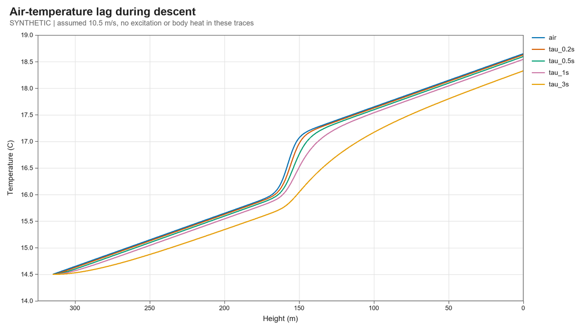

# Analogue air-probe characterisation — 9 October 2026

**Dated analysis record.** This report uses calculations and synthetic inputs only; it does not qualify the selected GA10K3MCD1 probe. The component baseline remains the [flight-computer BOM](flight_computer_bom.md); see [design baseline](design_baseline.md).

This separate workstream evaluates the selected TE GA10K3MCD1 / 150 kΩ / OPA333 / ADS1115 temperature path. It does not change the navigation, first-fix or descent workstreams. It adds reference calculations, an electrothermal model and an offline air-step fitting tool. **No physical measurements were available or fabricated.** No component, schematic, firmware or mission requirement was changed.

The mission asks for ≤0.1 K relative precision and ≤1 s response. The meaning of “response” remains unresolved: a first-order sensor has t63 = τ and t90 = 2.303τ. Precision, calibration accuracy, thermal bias and spatial smoothing need separate tests.

## Evidence and reproducibility

The authoritative run is [summary.json](../sim/temperature/results/2026-10-09-verified/summary.json); its [manifest](../sim/temperature/results/2026-10-09-verified/manifest.json) hashes 14 output files and the three numerical source files. Inputs and individual trials are retained in CSV/NPZ files alongside it. The earlier `2026-10-09/` directory is an exploratory run made during fitter development; preserve it but use the verified directory for conclusions. All code uses existing NumPy and Pillow; plotting reuses the existing helper read-only.

Run from the repository root with a working Python that has NumPy/Pillow:

```text
python -m unittest discover -s sim/temperature -v
python sim/temperature/run_study.py --out sim/temperature/results/NEW_RUN
python sim/temperature/check_results.py sim/temperature/results/NEW_RUN
python sim/temperature/step_fit.py INPUT.csv --step-time 3.137 --output NEW_REPORT.json
```

The standard Windows Python launcher is inaccessible on this machine. Verification used `C:/Users/b_yee23/.cache/codex-runtimes/codex-primary-runtime/dependencies/python/python.exe` (Python 3.12, NumPy 2.3.5). The study refuses a nonempty output directory. The fitter reads input without changing it; always choose a new JSON output path. Its retained [example input](../sim/temperature/results/2026-10-09-verified/SYNTHETIC_step_example.csv) is explicitly synthetic, with known step time 3.137 s.

## Conversion and readout

The [TE GA10K3MCD1 datasheet, February 2018](https://www.te.com/commerce/DocumentDelivery/DDEController?Action=srchrtrv&DocFormat=pdf&DocLang=English&DocNm=GA10K3MCD1&DocType=Data+Sheet&PartCntxt=GA10K3MCD1) supplies the nominal resistance table, 10 kΩ at 25°C, beta25/85 = 3976 K, ±0.2°C at 25°C, a 0.3 mW/K still-air dissipation constant and 200 ms response **in liquid**. None establishes installed air response. Use the PDF table rather than the product webpage's inconsistent beta0/50 field.

Using beta = 3976 K as a constant over the entire range produces calculated errors of **+1.595 K at −20°C and about +0.700 K at 0°C**, when compared with the nominal table. A three-point Steinhart–Hart fit, trained at −20, 25 and 50°C, differs from six separate table points by at most **0.00014 K**. That tiny residual describes agreement with a rounded nominal curve; it does **not** reduce the individual probe's tolerance or establish sub-millikelvin accuracy. The model intentionally rejects nominal resistance extrapolation outside −20…50°C. Calibrate the purchased probe at multiple temperatures.

The existing 3.0 V / 150 kΩ divider gives 0.1875 V and 3.516 µW probe heating at 25°C. Its power is bounded by V²/(4 Rref) = 15 µW for any positive resistance. Code must convert each ADC channel to volts using its own PGA range. Taking the raw-code ratio with ±2.048 V for AIN0 and ±4.096 V for AIN1 gives a **−16.53 K** error at 25°C in the ideal example.

The [ADS1115 Rev E datasheet](https://www.ti.com/lit/ds/symlink/ads1115.pdf), table 6-1, gives 62.5 µV RMS at ±2.048 V and 125 µV RMS at ±4.096 V for the tested 8/128/860 SPS settings; parentheses are peak-to-peak values. The table condition is **3.3 V supply**, whereas this board specifies a **3.0 V supply**; these values are a literature-based noise scenario, not a board noise specification. Treating those RMS values as independent Gaussian noise-equivalent inputs predicts **0.00817 K RMS at 25°C**; 20,000 draws give 0.00815 K. This scenario includes no second added quantisation variance. Actual noise correlation, offsets, gain mismatch and electrical interference remain unmeasured.

One-at-a-time calculations at 25°C give approximately 0.023 K for a 0.1% reference-value error, 0.024 K for a +3 LSB AIN0 offset, and 0.024 K for a 0.1% inter-range gain mismatch or sequential excitation change. These are separate sensitivity scenarios, **not independent Gaussian terms to add in quadrature**. The CSV's reference scenario changes the resistor value used in reconstruction; a physical resistor tolerance with fixed reconstruction reverses that sign. Ratiometric readout cancels a common, stable excitation voltage; it cannot cancel changes between sequential conversions. The [OPA333 datasheet](https://www.ti.com/lit/ds/symlink/opa333.pdf) provides the buffer offset/bias limits; its actual settling and the assembled board still need checks.

## Candidate acquisition schedule

Two sequential conversions are required per pair. Calculations include the ADS1115 −10% data-rate tolerance, approximately 25 µs single-shot startup per conversion, and **assumed** 1 ms settling plus 1 ms total bus overhead. Startup is approximate, so these are planning timings, not guaranteed worst-case latency. Poll conversion completion or use readiness hardware.

| ADC rate | Calculated pair ON time | 10 Hz excitation duty | Interpretation |
|---:|---:|---:|---|
| 8 SPS | 279.83 ms | 279.8% | Cannot produce 10 Hz pairs |
| 128 SPS | 19.41 ms | 19.41% | Characterisation candidate only; exceeds the selected ≤6% excitation duty ceiling |
| 860 SPS | 4.63 ms | 4.63% | Faster candidate; validate interference/settling |

At 128 SPS the slow-clock planning separation between conversion-window midpoints is about 8.71 ms before inter-conversion bus overhead; actual timing must be recorded. Timestamp the channels separately. The 128 SPS / 10 Hz pair is a calculation candidate only. Its 19.41% excitation ON time exceeds the selected circuit's ≤6% ceiling recorded in the BOM, so the schedule is not adopted and must not be implemented unchanged. Derive and verify a schedule meeting the ceiling before firmware work. At −40°C the nominal table resistance would put the divider above 2.048 V, so that PGA setting cannot be used unconditionally over the probe's entire catalogue range.

## Thermal model and sensitivity

The one-node model is

```text
C dTprobe/dt = Gair(Tair − Tprobe) + Glead(Tbody − Tprobe) + Pdivider(Tprobe, ON) + Qradiation
C = τ (Gair + Glead)
```

τ, lead coupling and net absorbed radiation are unknown. The datasheet's still-air conductance is a literature baseline, not the installed conductance. The nonlinear model uses RK4 with resolved forcing intervals; closed-form step solutions, timestep refinement and a resolved-pulse check independently verify it. It cannot represent multiple sensor/shield thermal nodes.

At 25°C, continuous excitation would give 0.0117 K self-heating using the still-air baseline. Worst-case continuous power gives 0.050 K. Exact fixed-power pulse calculations distinguish cycle mean from the higher ON-phase reading: across the stated τ = 0.1…3 s and G = 0.1…1 mW/K sensitivity range, the hypothetical 128 SPS / 10 Hz schedule's largest sampled peak rise is **0.040 K**. This schedule exceeds the selected duty ceiling and is not adopted; the result is a conditional model comparison only. Weaker thermal coupling can give larger bias.

For a body 20 K warmer than the air, equilibrium lead bias is 20 r/(1+r) K, where r = Glead/Gair. Thus **r = 1% gives 0.198 K**. Keeping this term alone below 0.1 K requires r < 0.00503. Net absorbed radiation must be below 30 µW to keep its term alone below 0.1 K at 0.3 mW/K. These are useful test budgets, not measured harness/shield properties.



The profile uses an assumed 10.5 m/s descent, 0.01 K/m background gradient and a smooth 1 K inversion. τ = 1 s gives a **10.5 m smoothing length**, 0.105 K steady ramp bias and 0.579 K peak lag near the inversion. Even τ = 0.2 s has 0.177 K peak lag in this assumed sharp transition. An electrical precision target alone therefore does not bound error against instantaneous air temperature.

## Offline air-step tool

`step_fit.py` accepts `t_s,reference_c,probe_c` columns, increasing finite timestamps and an independently known step time. It fits offset + gain × filtered reference + initial transient using exact zero-order-hold transitions over the recorded intervals, deterministic log-τ search (0.02…20 s), and profiled linear least squares. A known off-grid step splits its bracketing interval. A slow/noisy reference or unknown event time can bias τ; a smooth sampled ramp is approximated as held values.

The output reports τ, t63, t90, residual RMS/autocorrelation, gain/offset, conditioning, boundary hits and descriptive response/identifiability flags. Constant probe output and undersampled fast responses are flagged; a two-pole synthetic response leaves correlated residuals. These flags are diagnostics, not a certified hypothesis test or pass/fail qualification. The tool does not compute a real-data confidence interval.

With independent Gaussian 0.02 K noise and an exactly known 5 K step, 128 trials per setting give:

| Sample rate | True τ | Fitted median | Central 95% of synthetic estimates |
|---:|---:|---:|---:|
| 1 Hz | 0.3 s | 0.29875 s | 0.28541–0.31373 s |
| 10 Hz | 0.3 s | 0.29999 s | 0.29713–0.30265 s |
| 1 Hz | 1.0 s | 0.99979 s | 0.98215–1.01712 s |
| 10 Hz | 1.0 s | 0.99978 s | 0.99444–1.00610 s |

These are conditional Monte Carlo spreads, not uncertainty bounds for a mounted probe. The actual CSV CLI recovers τ = 0.99859 s from one retained noisy 1 s example, with 0.01874 K residual RMS. Measurement reference error, flow, switching time, sampling phase and model mismatch must be included in any eventual qualification.

## Highest-value next action: mounted air-step test

Keep the selected analogue circuit and record its actual channel PGA/rate, ADC completion times, excitation edges, airflow/orientation and electronics state. Obtain individual probe calibration across the expected range; do not apply the nominal fit as an individual calibration certificate.

Run an air-to-air step of approximately 5 K with the **actual shield, harness and mounting**, at representative airflow. Use a calibrated independent air reference whose response is substantially faster than the candidate probe, and record the event time independently. Log both temperatures at ≥10 Hz, with at least 5 s before and 30 s after the step; repeat at least ten times in both directions. Preserve raw timestamped records and provenance. Water response cannot substitute for this experiment.

Repeat with electronics cool/off and warm/running, and across intended airflow/orientations. A persistent steady offset that tracks body temperature supports lead/body coupling; a flow-dependent offset during ON pulses supports self-heating; solar-only offset supports radiation leakage. Hold the sensor, airflow and shield fixed while changing excitation duty to isolate self-heating. Reject a single-time-constant description if residual correlation or gain changes remain across repetitions; use a richer thermal model only after evidence motivates it.

Report measured t63 and t90 with repeatability and reference/timing uncertainty. If “≤1 s” means t90, τ must be ≤0.434 s; if it means t63, τ may be ≤1 s. Resolve that interpretation with the mission owner. Check the 0.1 K relative target separately with held-out calibration points and installed warm/cool comparisons. No qualification conclusion is justified until those records exist.
