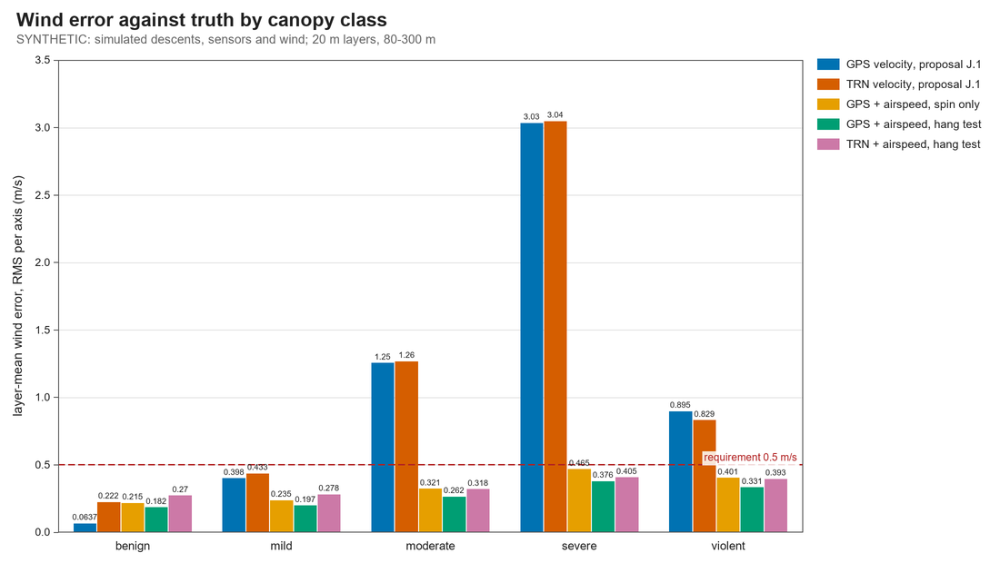
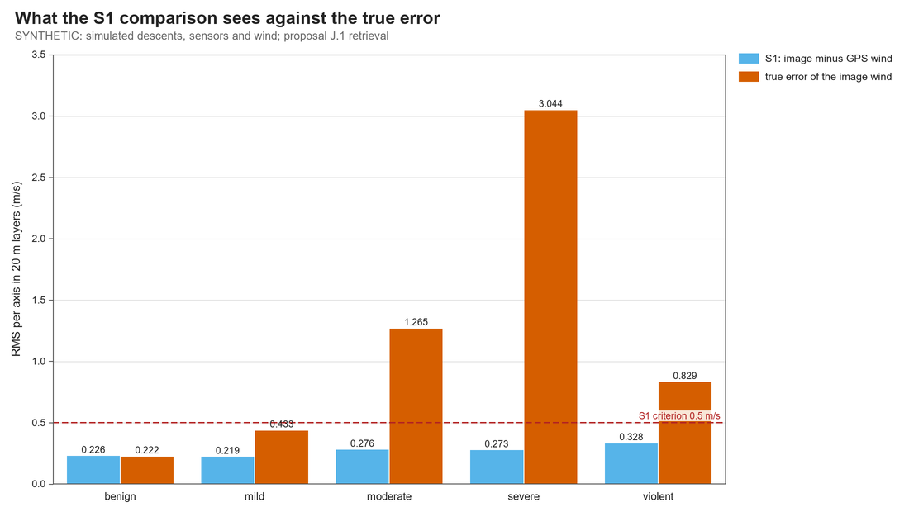
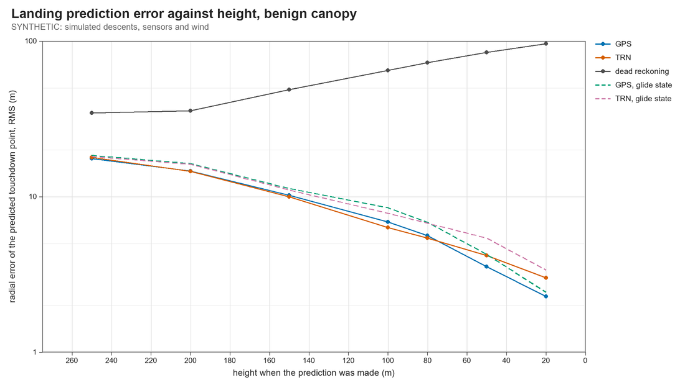

# Wind retrieval and landing prediction, end to end (Phase 0)

10 October 2026 study; status cross-checked 13 October 2026. Everything here is **simulated or calculated**. No flight, drop, bench or wind-tunnel data exist, nothing was run on the Raspberry Pi or the STM32, and the can's aerodynamic side force, on which the lateral-air estimate rests, is the simulator's own assumption. Numbers describe the models in `sim/nav/` and the code in `code/cansat/`, not the CanSat. The current hardware and budget baseline are [design_baseline.md](design_baseline.md), [flight computer BOM](flight_computer_bom.md) and [mass, power and descent budget](mass_power_budget.md). This study retains its historical 0.31 kg and 10.5 m/s model inputs; its result tables have not been rerun at the budget's 335 g expected mass or recommended ~11 m/s drop-calibration target.

The [closed-loop navigation study](navigation_closed_loop_simulation.md) ended with the navigation filter's output and listed "wind retrieval has not been run on the filter's output" as open. This study runs the rest of the chain: simulated descent → navigation filter → wind profile and landing prediction, scored against the simulated wind and touchdown. It tests S1, S2 and T3 of the [mission proposal](trn_secondary_mission_proposal.md) and adds one new measurement.

**Scope of proposal comparisons:** the phrase "proposal's wind target/retrieval" in this 10 October report refers to the 27 September proposal snapshot preserved at [history/trn_secondary_mission_proposal_2026-09-27.md](history/trn_secondary_mission_proposal_2026-09-27.md). The revised live proposal defines S1 as image/GNSS method agreement and explicitly says that passing it does not demonstrate absolute wind accuracy. The against-synthetic-truth 0.5 m/s comparisons here are diagnostic historical study scores, not the current S1 acceptance gate; the anemometer, stable-canopy and lateral-force conditions are candidate independent evidence for any future absolute-wind claim.

## Summary

1. **The proposal's wind retrieval meets its target only under a canopy that barely glides and does not swing.** Error against the true wind, per axis in 20 m layers from 80 m to 300 m (requirement 0.5 m/s): 0.06 m/s from GPS velocity and 0.22 m/s from the navigation filter's velocity on the stable canopy; 0.40 and 0.43 with a 5° trim, which still passes; 1.25 with a 12° trim; 3.03 with a 25° trim; 0.89 under 19° RMS swing.
2. **S1 passes in every one of those cases, including the three that fail.** Image-derived minus GPS-derived wind is 0.22–0.33 m/s in all five classes, because both share the can's true motion. S1 measures the navigation filter's velocity error. It says nothing about whether the wind is right.
3. **A candidate lateral-force measurement improves retrieval inside this simulator.** Under the model's single-point suspension and assumed side-force law, the time-averaged lateral specific force is converted to sideways airspeed. With the assumed 10 % force-gain error and 1 mg calibrated offset, it brings the simulated wind error to 0.18–0.38 m/s from GPS velocity and 0.27–0.41 m/s from image-derived velocity across all five classes. This is not evidence that a real can measures absolute wind to that accuracy; the force law, attachment geometry and sensor alignment require calibration.
4. **That result needs three things measured before it can be relied on:** how much side force the real can makes per metre per second of sideways airspeed (the literature search could not establish even that it is linear), the accelerometer's body-fixed lateral offset to about 1 mg (a static hang test), and the navigation filter's tilt (0.2° here). Section 6 gives the test and what result would reject the idea.
5. **A glide state without the airspeed measurement does not help.** It turns the bias into honest uncertainty: 0.79 m/s on the stable canopy, where the plain retrieval gets 0.06.
6. **S2 as written is not a test.** One descent's 80–300 m winds put the fitted roughness length within a factor of ten of the truth in 29 % of cases, and the proposal's least-squares fit states an uncertainty about nine times too small. In the simulation, adding a ground anemometer constraint at 6 m raises this to 98 %; that is conditional on an actual calibrated ground-anemometer reading and suitable overlap, neither of which exists yet.
7. **The landing predictor is calibrated on a stable canopy and overconfident under glide.** Stable canopy: 17.6 m RMS at 250 m falling to 2.3 m at 20 m from GPS, the same from TRN above 80 m, and 34 m growing to 96 m from dead reckoning; 93–98 % of touchdowns inside the GPS-fed predictor's 95 % ellipse. With a 12° trim only 62–84 % fall inside above 80 m unless the predictor carries a glide state.
8. **The landing predictor is written as flight software for the Pi Zero 2 W** (`code/cansat/landing.py`). An independent reviewer found five ways a bad input could stall, poison or crash it; all are fixed and now covered by tests. It has not been run or timed on the Pi.

## 1. What was built

| File | What it is | Checks |
| --- | --- | --- |
| `code/cansat/windprofile.py` | Wind model, the streaming `WindFilter` (flight), the smoother and layer means (`retrieve`, post-flight), and `lateral_airspeed` (post-flight) | `code/tests/test_windprofile.py`, 20 tests |
| `code/cansat/landing.py` | Flight landing predictor: drift table built on the pad, one filter step and a table lookup per update, fills the telemetry packet | `code/tests/test_landing.py`, 13 tests |
| `code/tests/bench_onboard.py` | Times the navigation filter, first fix, wind filter and landing predictor on whatever machine runs it | run on the laptop only |
| `sim/nav/run_wind_mc.py`, `analyse_wind_mc.py` | End-to-end Monte Carlo, 160 descents × 5 canopy classes, plus five sensitivity runs; tables and figures | `sim/nav/test_wind_mc.py`, 7 tests |
| `sim/nav/similarity_fit.py` | S2 feasibility: how well one descent determines roughness length | `sim/nav/test_similarity_fit.py`, 21 tests |
| `sim/nav/test_wind_independent.py` | A separate reviewer's re-derivations of the physics, the retrieval and the predictor | 20 tests |
| [`wind_science_parameter_sources.md`](wind_science_parameter_sources.md) | Literature for the new inputs, with what was and was not actually read | most rows are search excerpts |

One existing file changed: `sim/nav/run_nav_mc.py` now builds its simulated IMU samples in a function (`imu_stream`) so this study sees exactly the samples the filter was given. Four descents compared before and after are identical to the last bit.

Results are in `sim/nav/results/wind_mc/` ([tables](../sim/nav/results/wind_mc/tables.md)) and `sim/nav/results/similarity_fit/`. To reproduce, with the KiCad-bundled Python:

```text
python sim/nav/run_wind_mc.py --descents 160 --workers 8
python sim/nav/analyse_wind_mc.py
python sim/nav/similarity_fit.py
```

The first takes about 25 minutes on the project laptop, most of it simulating the descents. A sensitivity run reuses those descents and takes about two minutes per canopy class, for example `python sim/nav/run_wind_mc.py --canopies moderate,severe --tag gain_low30 --set side_force_bias=-0.3`; its results go to a folder named after the tag.

## 2. Model and inputs

The retrieval is the proposal's Appendix J.1 filter with the things it assumed known turned into unknowns. Each horizontal axis carries two turbulence states (the drop-Dryden model of Appendix I), the can's velocity lagging the wind by v_d/g, the mean wind as an unknown multiple of a log-law shape, an unknown release velocity, and a correlated error for the navigation filter's velocity. Optional additions are a canopy glide state and a body-fixed accelerometer offset, both needed only with the airspeed measurement of section 6.

| Input | Value used | Basis |
| --- | --- | --- |
| Descent, wind, navigation filter, sensors | as the navigation study | [navigation report, section 2](navigation_closed_loop_simulation.md) |
| Canopy classes | benign, moderate, severe, violent as before, plus "mild" (trim 5°) | Assumed shapes, not predictions for our canopy |
| GPS velocity | truth plus 0.1 m/s white noise per axis at 5 Hz | Proposal. The MAX-M10S figure is 0.05 m/s, seen only as a search excerpt |
| Navigation velocity error | the filter's own sigma, taken as correlated over 2 s | Assumed from the navigation study (lag-1 autocorrelation 0.93) |
| Turbulence prior | the truth's: 1 m/s, eddy scale 0.5 z | Matched; mismatch tested in section 4 |
| Can side-force rate | 0.5 ρ CdS v / m with CdS = 0.003 m², i.e. 6.3 mg per m/s of sideways airspeed | **The simulator's own drag law.** The analysis is told it with a 10 % error (1σ) |
| Extra body-fixed lateral offset | 7 mg per axis on top of the 20 mg accelerometer bias | Assumed. BMI088 cross-axis sensitivity of 0.5 % (typical) and an assumed 0.5° of mounting misalignment acting on 1 g give 5–9 mg |
| Hang-test calibration | leaves 1 mg per axis | Assumed |
| Airspeed sample | 2 s Hann window every 1 s, 0.4 m/s per sample told to the retrieval | Assumed from the simulation itself |
| Anemometer (landing prediction only) | true mean wind at 6 m ± 0.3 m/s | Proposal plans the mast; the accuracy is assumed |

The canopy classes behaved here as follows (160 descents each, descent to the ground):

| Class | Canopy | Descent-mean glide | Air-relative speed, per axis |
| --- | --- | ---: | ---: |
| benign | restoring | 0.19 m/s | 0.45 m/s |
| mild | unstable below 5° | 0.31 m/s | 0.60 m/s |
| moderate | unstable below 12° | 1.48 m/s | 1.32 m/s |
| severe | unstable below 25° | 4.22 m/s | 3.07 m/s |
| violent | shaken, 19° RMS swing | 0.44 m/s | 0.91 m/s |

"Descent-mean glide" is the magnitude of the mean air-relative velocity from 3 s after release to touchdown, so a glide whose direction wanders (the mild class) scores low.

## 3. Verification

**The discretisation matches the continuous model.** One filter step agrees with a Runge-Kutta integration of the moment equations with height-varying coefficients to 3e-3 at the default step and 2e-5 at a finer one, from 300 m down to 0.2 m. The prior wind covariance the steps generate equals the drop-Dryden kernel σ²(1 − r/2)e^(−r) to nine decimal places, including across the 1 m floor.

**The filter and smoother match a dense Gaussian solve.** On a 19-epoch problem with every feature switched on, smoothed means and covariances agree with one large conditioning to 2e-8, the log-likelihood to 1e-6, and layer-mean variances (which need the covariance between epochs) to 1e-8. Leaving those cross terms out understates the layer variance by more than a third in the case tested.

**It is statistically honest on worlds drawn from its own model**: wind errors normalised by the stated sigma have unit variance, 95 % layer intervals contain 95 ± 3 %, and the predicted landing covariance matches the scatter.

**A separate reviewer re-derived three things by other routes** (`sim/nav/test_wind_independent.py`):

- The retrieval against an exact Gaussian-process solve built from the kernel formula and the reviewer's own lag operator: the two converge at second order, to 1.8e-4 m/s in the mean.
- Honesty on profiles from the descent simulator's wind generator rather than the filter's own matrices: about 96 % coverage when told the right turbulence intensity, 98 % when told double, 90 % when told half.
- The drift table against 8,000 simulated drifts (4,000 wind profiles, two components) of the continuous model: mean drift 166.83 ± 0.15 m against 166.81 m from 300 m, standard deviation 13.66 m against 13.44 m.

The figures in these three items are from the reviewer's own runs; the tests in the file assert bands around them.

**The reviewer also found eleven defects.** Five were in the flight predictor and are described in section 9. The others:

| Defect | Effect | Action |
| --- | --- | --- |
| Docstrings said any lateral specific force is the can's side force | False sample by sample; see section 6 | Corrected |
| Airspeed window of 1 s too short for a swinging canopy | 1.7 m/s error on a 0.8 m/s signal | Default now 2 s; the Monte Carlo was rerun |
| Total airspeed taken from unaveraged samples | Scale 5–7 % low by the reviewer's estimate | Now from a 0.4 s average |
| Landing docstring called the descent-rate rescaling exact | It is about 1 % short from 300 m and about a tenth short from 40 m at 8 m/s against a 10.5 m/s table | Docstring corrected; build the table at the measured rate |
| Lookup above the table top clamped the drift but not the time | Drift understated above 450 m | Now assumes the present velocity until the top is reached |
| Top layer excluded a sample exactly on its edge; averaging window half a sample off centre | Negligible | Fixed |

All suites pass at close: `code/tests` 110 (77 existing, 20 wind, 13 landing) and `sim/nav` 187 (139 existing, 7 Monte Carlo, 21 roughness, 20 independent).

## 4. Wind error against truth

Per axis, RMS of 20 m layer means from 80 m to 300 m, 160 descents per class. The requirement is 0.5 m/s.

| Retrieval | benign | mild | moderate | severe | violent |
| --- | ---: | ---: | ---: | ---: | ---: |
| GPS velocity, proposal J.1 | 0.06 | 0.40 | 1.25 | 3.03 | 0.89 |
| Navigation (image) velocity, proposal J.1 | 0.22 | 0.43 | 1.26 | 3.04 | 0.83 |
| The same, velocity error taken as white | 0.23 | 0.45 | 1.27 | 3.05 | 0.88 |
| GPS, direct inversion u + τ du/dt | 0.08 | 0.41 | 1.26 | 3.03 | 0.94 |
| GPS, glide state but no airspeed | 0.79 | 0.88 | 1.46 | 2.83 | 1.57 |
| GPS + airspeed, offset found from spin alone | 0.22 | 0.24 | 0.32 | 0.47 | 0.40 |
| GPS + airspeed, offset from a hang test | 0.18 | 0.20 | 0.26 | 0.38 | 0.33 |
| Navigation velocity + airspeed, hang test | 0.27 | 0.28 | 0.32 | 0.41 | 0.39 |
| GPS + airspeed, no canopy model at all | 0.22 | 0.22 | 0.26 | 0.37 | 0.31 |



- **On a stable canopy the proposal's method is excellent from GPS (0.06 m/s) and adequate from imagery (0.22 m/s).** The image-derived figure is the navigation filter's velocity error (0.18 m/s per axis, correlated over seconds, so it does not average down in a layer).
- **Glide passes straight into the wind.** The error is the glide: what remains after averaging a whole descent is 0.20 m/s per axis for the mild class, 1.10 for the moderate one and 2.98 for the severe one. The mild class stays inside the requirement only because its glide is small and wanders. Layer averaging and smoothing do nothing for it.
- **The retrieval is also wrong about its own accuracy.** Its stated layer sigma is 0.06 m/s from GPS in every class, so the share of errors inside its 95 % interval is 92 % on the stable canopy and 26 %, 11 %, 2 % and 11 % on the others.
- **Modelling the navigation error as correlated matters for honesty, not accuracy.** Taking it as white leaves the error the same (0.23 against 0.22) but drops coverage on the stable canopy from 96 % to 71 %, as the earlier mathematics audit predicted.
- **With the airspeed measurement every class meets the requirement from either velocity source.** With a hang-test offset 87–100 % of errors fall inside the stated 95 % interval (slightly optimistic for the severe and violent classes, conservative for the rest); with spin alone the worst is 82 %.
- **Dropping the canopy model altogether costs little once airspeed is measured** (last row): 0.04 m/s on the stable canopy, 0.02 on the mild one and nothing on the other three. The wind is then ground velocity minus measured air-relative velocity, with no assumption about how the canopy responds. That removes the dependence on the lag ratio the earlier audit flagged.

Below 80 m only GPS-derived winds exist. The proposal's method gives 0.10 m/s there on the stable canopy and 1.19 on the moderate one; with airspeed 0.22 and 0.30.

Telling the retrieval the wrong turbulence intensity changes little; the sensitivity runs are in section 6.

## 5. S1 cannot see any of this

S1 says image-derived and GPS-derived winds agree to 0.5 m/s RMS in 20 m layers from 300 m to 80 m, and that the difference shrinks towards the ground.

| Canopy | S1: image minus GPS wind | True error of the image wind | True error of the GPS wind |
| --- | ---: | ---: | ---: |
| benign | 0.23 | 0.22 | 0.06 |
| mild | 0.22 | 0.43 | 0.40 |
| moderate | 0.28 | 1.26 | 1.25 |
| severe | 0.27 | 3.04 | 3.03 |
| violent | 0.33 | 0.83 | 0.89 |



S1 passes in all five. It is a real test of one thing, the navigation filter's velocity: on the stable canopy the S1 difference (0.23) is the image wind's true error (0.22). It carries no information about the canopy, because both retrievals start from the same motion of the same can.

The second clause holds only in appearance. By layer the difference is flat at 0.15–0.18 m/s from 80 m to about 220 m and then rises to 0.44 m/s in the top layer on the stable canopy, 0.65 on the moderate one. The image wind's own error has the same shape while the GPS wind's does not, so the rise belongs to the navigation velocity in the first seconds after the first fix, which starts 2 m/s out. That is a start-up effect, not error scaling with altitude. The cause was not isolated further.

## 6. Airspeed from the lateral specific force

### The idea

The proposal's Appendix F.4 notes that the accelerometer under a pendulum reads along the line and so cannot see tilt. In an ideal single-point suspension, a line can pull only along its length; under the additional assumption that the can axis follows that line and other lateral forces and rotational terms are negligible, lateral specific force could reflect aerodynamic side force. If the can moves sideways through the air at v and the assumed linear law holds, side force per unit mass is κv, with κ = 0.5 ρ CdS V / m. For the historical simulated can at 10.5 m/s, κ = 0.062 s⁻¹: one metre per second of sideways airspeed corresponds to 6.3 mg across the can. The real attachment and force law have not been tested, so this remains a calibration-dependent candidate measurement.

If the sensor-to-line alignment and aerodynamic force law are known, wind can be estimated from ground velocity minus air-relative velocity. A steady glide could then appear as a steady lateral reading. These are model conditions; image/GPS agreement alone does not establish absolute true-wind accuracy, and the selected-can force response has not been measured.

### What limits it

- **It is true only on average.** Sample by sample the line sits 0.8–2.2° off the can's axis while the can rocks on its attachment (3 Hz in the simulation), and that term is 1.5–3.8 m/s of equivalent airspeed against a signal of about 1 m/s. The reviewer reconstructed the line direction from the gyro alone and accounted for the residual to within 2 %. Averaging over 2 s leaves 0.07 m/s (stable), 0.26 m/s (gliding) and 0.33 m/s (swinging) with ideal sensors.
- **6.3 mg per m/s is small against the sensor's fixed errors.** The BMI088's typical offset is 20 mg, and cross-axis sensitivity and mounting misalignment acting on the 1 g axial load add 5–9 mg. Uncorrected, that is about 2.5 m/s of false airspeed per axis. Two things remove it: the offset is fixed in the can while the glide is fixed in the world, so spin separates them (the can turned a median 1.3 turns per descent here); and hanging the can at rest measures the whole offset directly. 1 mg is 0.057° of alignment.
- **Tilt.** A tilt error δ gives an airspeed error of about V δ: 0.02–0.06 m/s for the 0.13–0.33° the navigation study reported. An IMU-only attitude good to 2° would give 0.37 m/s, so the method leans on the image-derived attitude.
- **The side-force rate has to be known.** See below.

### Sensitivity

Wind error with GPS velocity, airspeed and a hang-test offset, m/s per axis, 80–300 m:

| Case | benign | moderate | severe |
| --- | ---: | ---: | ---: |
| Baseline: gain known to 10 %, hang test to 1 mg, turbulence prior matched | 0.18 | 0.26 | 0.38 |
| Side-force gain assumed 30 % too small | not run | 0.60 | 1.23 |
| Side-force gain assumed 30 % too large | not run | 0.38 | 0.74 |
| Hang test leaves 3 mg | 0.21 | 0.29 | not run |
| Retrieval told turbulence 0.5 m/s (truth 1 m/s) | 0.28 | 0.32 | not run |
| Retrieval told turbulence 2 m/s | 0.16 | 0.31 | not run |

- **The gain is what matters.** The error it leaves is roughly the fractional gain error times the glide, so a 30 % error fails the requirement at a 12° trim and badly at 25°, and the stated uncertainty no longer covers it (68 % and 30 % inside the 95 % interval when the gain is assumed too small). Assuming too small a gain is worse than too large, because the correction then overshoots.
- **The offset calibration is forgiving.** 3 mg instead of 1 mg costs 0.02–0.03 m/s, because the can's spin helps.
- **The turbulence prior matters little.** Wrong by a factor of two either way moves the airspeed retrieval by up to 0.10 m/s and the proposal's GPS retrieval on the stable canopy by less than 0.01 m/s. Told too little turbulence, the stated interval becomes optimistic (89 % and 82 %).

### What is not established: the real can's side force

The simulation gives the can a drag force opposite to its velocity through the air with the same drag area in every direction. Nothing measured supports that for a 66 mm × 115 mm flat-ended cylinder at 10° to the flow. The literature search could not open the primary sources. The bracket it derived for the equivalent side-force area is roughly 0 to 0.0068 m² around the assumed 0.003 m², and one unverified search excerpt reports short flat-faced cylinders with a normal force near zero or slightly negative at small angles. The reviewer added that if the side force acts a distance d below the centre of mass the reading is multiplied by (1 + d/l), with l = 55 mm the attachment height, and is zero if it acts at the attachment. So κ cannot be computed from a drag coefficient; it has to be calibrated as a whole.

**The experiment.** Hang the flight-configuration can by its real attachment in a steady airflow of 8–12 m/s (a car-top rig on a calm day or a blower with a honeycomb), with the flow along its axis and then at 3°, 6°, 10°, 15° and 20° to it, logging the BMI088 at the flight settings. Rotate the can about its axis between runs to separate body-fixed offsets. Record lateral specific force against sideways airspeed V sin(angle).

- **Supports the method:** the reading is monotonic and close to linear in sideways airspeed, at 3 mg per m/s or more, repeatable to 10 %.
- **Rejects it:** less than about 1 mg per m/s, a sign change, or a dead band at small angles. Then no realistic offset calibration recovers a 1 m/s glide, and the canopy decision of the navigation report stands alone.
- **In between** (nonlinear but monotonic): usable with a calibration curve in place of a constant.

A flight check comes free: with the offset from a hang test, the offset the retrieval estimates from the can's spin should agree with it.

## 7. S2: roughness length from one descent

S2 says the fitted roughness length agrees in order of magnitude with the land cover. `sim/nav/similarity_fit.py` drew 2,000 frozen profiles per case from the descent simulator's wind model (5 m/s at 10 m, z0 = 0.1 m, turbulence 1 m/s) and fitted them two ways: the proposal's least-squares fit of speed against ln z (Appendix K.4), and a fit that knows the turbulence covariance and profiles the likelihood over z0.

| Heights used | Method | z0 within ×10 | z0 within ×3 | Truth inside the fit's own 95 % interval (likelihood interval for the covariance-aware fit) |
| --- | --- | ---: | ---: | ---: |
| 80–300 m (image winds) | least squares | 24 % | 11 % | 36 % |
| 80–300 m | covariance-aware | 29 % | 13 % | 95 % |
| 10–300 m | covariance-aware | 76 % | 42 % | 96 % |
| 10–100 m | covariance-aware | 61 % | 29 % | 95 % |
| 2–100 m | covariance-aware | 88 % | 58 % | 96 % |

- **The cause is the number of independent samples.** With eddies that grow with height, 80–300 m spans 2.6 correlation lengths and even 2–100 m spans 7.8. The analytic bound on the scatter of log10(z0) is 3.1 decades for 80–300 m, and the Monte Carlo gives 3.95.
- **The least-squares fit is overconfident by a factor of 3 to 9** because it treats every 2 m sample as independent. The covariance-aware fit's simple ±1.96σ interval is also short for 80–300 m (82 %); its likelihood interval is the honest one. In 82 % of 80–300 m fits the honest 95 % interval is unbounded, which is the right answer.
- **The 6 m anemometer is what makes it a test.** One descent plus a mean wind at 6 m known to 0.2 m/s gives 98 % within ×10 and 85 % within ×3 from the 80–300 m winds (65 % within ×3 if it is known only to 0.5 m/s; the landing study in section 8 assumed 0.3 m/s). Three descents on the same day plus the anemometer give 94 % within ×3. Pooling descents without it never rescues the 80–300 m range (38 % within ×3 at ten descents).
- **Then the anemometer is doing most of the work.** S2 becomes a test of whether the profile aloft is consistent with the wind at 6 m.

The profiles are neutral and follow the log law at every height, which is generous above 100 m. Sensitivity runs (turbulence 0.5–2 m/s, wind 2–8 m/s, z0 0.03–0.3 m, wrong eddy scale, added noise) are in `sim/nav/results/similarity_fit/summary.json`; halving the turbulence gives 51 % within ×10 from 80–300 m and doubling it 14 %.

## 8. Landing prediction (T3)

`code/cansat/landing.py` was fed three ways, as section 13 of the proposal describes: GPS position and velocity; the navigation filter's position and velocity (velocity only above 80 m, where it has landmarks); and dead reckoning, meaning the navigation filter run without landmarks after its first fix and no velocity at all. All three were given the anemometer reading. Radial RMS error of the predicted touchdown point, and the share of touchdowns inside the predictor's own 95 % ellipse:

| Canopy | Predictor | at 250 m | at 100 m | at 20 m | Inside 95 % ellipse at 100 m |
| --- | --- | ---: | ---: | ---: | ---: |
| benign | GPS | 17.6 m | 6.9 m | 2.3 m | 95 % |
| benign | TRN | 17.9 m | 6.3 m | 3.0 m | 98 % |
| benign | dead reckoning | 34.5 m | 64.9 m | 96.0 m | 96 % |
| moderate | GPS | 30.1 m | 9.7 m | 2.5 m | 80 % |
| moderate | TRN | 30.6 m | 9.6 m | 3.8 m | 79 % |
| moderate | GPS, glide state | 29.1 m | 9.2 m | 2.6 m | 100 % |
| severe | GPS | 64.4 m | 20.2 m | 3.1 m | 9 % |
| severe | GPS, glide state | 52.5 m | 12.2 m | 2.5 m | 99 % |
| violent | GPS | 25.0 m | 9.4 m | 2.6 m | 78 % |
| violent | GPS, glide state | 33.6 m | 14.5 m | 3.0 m | 98 % |



- **T3's ranking holds.** TRN-driven prediction is as good as GPS-driven while the filter has landmarks and a little worse below 80 m, where it coasts (3.0 m against 2.3 m at 20 m). Dead reckoning gets worse as the can descends, because its position error grows faster than the remaining drift shrinks.
- **T3's calibration holds only without glide.** On the stable and mild canopies 92–98 % of touchdowns fall inside the GPS- and TRN-fed predictors' 95 % ellipses at every height. The predictor treats a glide as wind that will die away near the ground, so with a 12° trim it is overconfident (62–84 % above 80 m) and with 25° it is almost always wrong about itself (2–31 % down to 50 m).
- **A glide state restores honesty at a price.** With it the ellipse covers 96–100 % in the four non-swinging classes and the severe-class error at 100 m falls from 20.2 m to 12.2 m, but on the stable canopy the stated 1σ at 100 m grows from 7.0 m to 16.4 m and the error from 6.9 m to 8.5 m. The prior width of that state (2.5 m/s here) should be set from the glide measured in drop tests.
- **Swing is not glide.** Under violent swing the plain predictor is overconfident (72–91 % GPS-fed, 67–97 % TRN-fed) and the glide state makes its error larger (14.5 m against 9.4 m at 100 m) while covering 86–100 %: the state mistakes swing for a persistent drift. Neither predictor models swing.
- **Touchdown time** from the GPS-fed predictor is good to 1.0–1.5 s RMS at 250 m and 0.4–0.5 s at 100 m, depending on the canopy.

A test round-trips one prediction through the telemetry packet. The packet's ellipse field saturates at 127 m, which dead reckoning's stated uncertainty (about 100 m by 20 m of height) approaches; the Monte Carlo did not record whether any single prediction exceeded it.

## 9. Flight software and the hardware stack

Of what was written, only the landing predictor and the forward wind filter it drives are flight software. The smoother, layer means and airspeed reconstruction are post-flight analysis on a laptop.

**Where it runs.** The hardware documents ([connections](flight_computer_connections.md), [BOM](flight_computer_bom.md)) give the STM32F405 timing, sensors, GNSS and the radio, and the Pi Zero 2 W the camera and heavier estimation, joined by a buffered UART. The predictor is Python with NumPy, so it runs on the Pi beside the navigation filter and hands its result to the STM32 for the 40-byte packet. `Prediction.fill()` writes the existing `pred_*` fields of `cansat/telemetry.py`, and a test round-trips them through the packet.

**What remains to be implemented or qualified.**

- **GNSS velocity on the Pi.** The GPS-driven predictor needs UBX-NAV-PVT velocity, and the MAX-M10S is wired to the STM32. The protocol is now defined in [stm32_pi_link_protocol.md](stm32_pi_link_protocol.md), with the Pi reference implementation in [`code/cansat/link.py`](../code/cansat/link.py). No STM32 firmware implements it, and the protocol has not been bench-qualified. Its Pi `Nav` frame is 32 bytes; that is distinct from the 40-byte downlink telemetry packet assembled by the STM32.
- **A predictor that survives loss of the Pi.** The proposal's fallback is "keep live prediction on GPS". That would need a C port for the STM32. The arithmetic per update is a 14-state filter step and a table lookup, small enough for that, but no port exists.

**Cost.** The expensive part, propagating the wind state to the ground, is done once on the pad into a table of seven numbers per 2 m of height. In flight an update is one filter step and an interpolation. On the idle laptop an update takes 0.3–0.7 ms and the table 41 ms to build; with the navigation filter at 100 Hz, 12 landmarks at 5 Hz and three predictors at 5 Hz the total is 1.4 % of one laptop core above 30 m and about 2 % with the costlier updates near the ground, excluding image matching (`sim/nav/results/wind_mc/bench_laptop.json`). `code/tests/bench_onboard.py` prints the same table on the Pi. Until it is run there the Pi's figure is unknown.

**Robustness.** The reviewer fuzzed `LandingPredictor.update` and found five defects, all now fixed and tested:

| Defect | Consequence | Fix |
| --- | --- | --- |
| No bound on the time step | One timestamp 30 s ahead made every later sample "late": no predictions for the rest of the descent | A jump in time is believed only when a second sample confirms it, then the filter restarts |
| A NaN gain or an absurd velocity reached the filter | State NaN for the rest of the flight | Inputs are range-checked; the previous state is restored if anything non-finite appears |
| Malformed input raised out of `update` | A crash in the flight loop | Every input is parsed defensively; a last-resort guard counts the fault and returns nothing |
| No innovation gate | A single 1e6 m/s velocity was believed | Velocities beyond 60 m/s are refused; a velocity that is both improbable (χ² over 50) and more than 4 m/s out is gated, and five in a row restart the filter instead of locking it out |
| Negative position covariance accepted | The telemetry ellipse code raised | Checked; the output covariance is forced non-negative |

Counters (`ignored`, `gated`, `resets`, `faults`) record each event. The first version of the gate used χ² alone and the Monte Carlo showed it refusing about one GPS velocity in ten under violent swing, which is the lock-out the navigation study warned about; the 4 m/s condition was added for that reason. With it, nothing was refused in 800 simulated descents.

## 10. Decisions and recommendations

### Needs a decision from the team

1. **S1's wording.** As written it cannot fail for any reason connected with the wind. Options: (a) keep it and state plainly that it validates the navigation velocity, not the wind; (b) add a claim S1 cannot make by itself, that the retrieved wind is within 0.5 m/s of truth, supported by an independent reference (the 6 m anemometer where the profiles overlap, a stable canopy demonstrated in drops, or the airspeed measurement once calibrated). Recommended: (b), and drop "shrinks towards the ground", which is a start-up effect here.
2. **S2's wording.** Options: (a) keep "order of magnitude" but state that the 6 m anemometer is part of the fit; (b) restate it as consistency between the profile aloft and the anemometer; (c) pool descents from the drop campaign. Recommended: (a) with the covariance-aware fit and its likelihood interval, because the least-squares interval of Appendix K.4 would report a precision the data do not have.
3. **Whether to pursue the airspeed measurement.** It costs one afternoon's calibration test (section 6) and a logging requirement, and it either rescues the wind science from the canopy's behaviour or is ruled out. Recommended: run the test before the canopy is chosen, because its outcome changes how much the canopy choice matters.
4. **Glide state in the flight predictor.** On or off, and how wide. Recommended: on, with the width set from measured glide; off only if drops show a stable canopy.

### Adopted in the code (reversible)

5. The mean wind, release velocity and correlated navigation error are estimated in the retrieval; the proposal's J.1 is recovered by zero prior widths.
6. Layer uncertainties keep the covariance between epochs.
7. The flight predictor refuses rather than crashes, and uses a table built on the pad.

### For the build and test campaign

8. Log the BMI088 at 100 Hz or faster through the descent, both lateral axes, and consider switching the accelerometer to a lower range after canopy opening: at ±24 g one count is 0.73 mg, close to the 1 mg this needs.
9. Do the hang test on every flight unit, at flight temperature if possible (the offset's typical drift is below 0.2 mg/K).
10. Let the can spin. A swivel that turns freely gives the retrieval its own check on the offset.
11. Build the drift table at the descent rate measured in drops, not the design value.
12. Run `code/tests/bench_onboard.py` on the Pi Zero 2 W.
13. Implement and bench-qualify the [STM32-to-Pi protocol](stm32_pi_link_protocol.md), including forwarded GNSS velocity; the Python reference codec exists, but there is no STM32 firmware or hardware link result.

## 11. Limits

- Everything is synthetic, and the airspeed result is circular in one respect: the simulator's can obeys the side-force law the analysis assumes, to within a 10 % gain error. A different real law is the main risk.
- The simulator puts the can's drag at its centre of mass and hangs it from a single point. A bridle, an off-axis attachment or a side force acting elsewhere changes the gain or adds lateral force that is not aerodynamic.
- The canopy classes are a generic force law. Real glide may wander faster or slower than the 20 s the retrieval assumes.
- The wind is frozen, neutral and follows the retrieval's own turbulence model. The mismatch runs changed only the intensity.
- GPS velocity is truth plus white noise. Receiver filter lag under swing is not modelled.
- 160 descents per class resolve a coverage fraction to about ±2 %.
- Wind and landing errors below 80 m rest on GPS; there is still no visual odometry.
- Nothing was timed or run on the Pi, and no STM32 firmware exists.
- Most literature values in the sources file are search excerpts, not primary reads.
